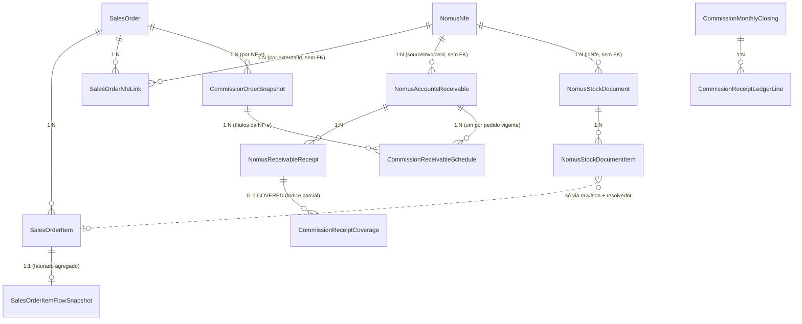

# Comissões — Auditoria de cardinalidade N:N (pedido × NF-e × título × comissão)

Etapa A (auditoria e proposta). Data: 22/10/2026. Base auditada: `origin/main` `dbe2bd7d`
(motor de comissões idêntico a `7c1e3058`; nenhuma branch de comissões com commits fora da main).
Nenhum arquivo do motor foi alterado. Evidência de execução: sonda que chama as funções oficiais
`buildCommissionReceiptPreview` e `buildInduscostCoverageRows` com fatos sintéticos do incidente
(fora do repositório). **Não foi verificado qual commit está implantado em homologação/produção.**

---

## A. Diagnóstico executivo

**Negócio.** A NF-e 7862 consolida dois pedidos da mesma vendedora. O sistema já calculou e guardou
corretamente a comissão de cada pedido para cada parcela (R$ 30,11 + R$ 106,78 na 1ª). Mas a prévia
do fechamento trata "uma NF-e com dois pedidos" como erro de vínculo, joga o título inteiro em
exceção "sem vendedor" e zera a comissão.

**Técnica (comprovada por execução):** são três camadas, e a terceira é a mais grave.

1. **Guarda de ambiguidade cedo demais.** `indexUniqueOrderBundlesByNfeId` coloca toda NF-e com 2+
   pedidos em `ambiguousNfeIds`; `buildCommissionReceiptPreview` testa isso
   (`commissionReceiptEngine.ts:2048`) **antes** do caminho de schedules (`:2066`) e emite uma linha
   `NO_SALES_LINK` sem pedido nem vendedor ("Sem vendedor no pedido Nomus"), comissão 0.
2. **Um schedule por título.** Mesmo sem a guarda, `pickMaterializedScheduleForReceivable`
   (`:916-929`) devolve **um** schedule por título; o loader ordena `createdAt desc`
   (`commissionReceiptEngine.server.ts:103`), então vence o pedido mais novo e os demais somem em
   silêncio. Na sonda: sem a guarda, a prévia mostra R$ 30,11 e perde R$ 106,78.
3. **Perda permanente ao fechar.** `NO_SALES_LINK` é status *final* de cobertura
   (`commissionReceiptCoverage.shared.ts:116-122`). Aplicado o fechamento de 10/2026 como está, o
   recebimento 12130 é gravado `COVERED` com comissão **R$ 0,00** (sonda com `buildInduscostCoverageRows`)
   e nunca volta como pendência nem carryover.

> **Recomendação operacional imediata:** não aplicar o fechamento de 10/2026 enquanto houver recebimentos
> de NF-e com mais de um pedido na prévia como `NO_SALES_LINK`/ambíguo — ou aplicar só depois da correção
> da Etapa B1. Listar os recebimentos afetados exige consulta somente leitura autorizada (seção J, D6).

O mesmo pressuposto 1:1 existe em outros consumidores (Previsão, auditorias, Visão 360°, auditoria R1,
orquestrador de materialização) — seção D. Separadamente, o defeito **R1** (cenários B/C: um pedido em
várias NF-e) continua: cada snapshot por NF-e carrega a comissão integral do pedido.

---

## B. Inventário do que já existe (e se é preservado)

| Componente | Arquivo / função | Responsabilidade | Situação | Decisão |
|---|---|---|---|---|
| Vínculo PV × NF-e | `SalesOrderNfeLink` (`@@unique([salesOrderId, nfeExternalId])`), `salesOrderNfeLink.ts` | N:N real, uma linha por par; cancelada mantida (status) | Existente e correta | Preservar |
| NF-e | `NomusNfe` (`externalId @unique`), `nfeStatus.ts` (7 = cancelada, 4 = autorizada) | Cabeçalho fiscal | Existente; **sem itens persistidos** | Preservar |
| Título × NF-e | `NomusAccountsReceivable.sourceInvoiceId = NomusNfe.externalId` | 1 NF-e → N títulos; título **sem pedido** | Existente e correta | Preservar |
| Evento de recebimento | `NomusReceivableReceipt.externalId @unique`, `receiptDate` | Fato financeiro único | Existente e correta | Preservar |
| Documento de saída | `NomusStockDocument` (`externalId @unique`, `idNfe`, `documentNumber`), itens com `rawJson` | Atendimento físico; refs de pedido/item só no JSON | Existente; não usado pelas comissões | Reutilizar na Etapa B5 |
| Vínculo DS → item do PV | `salesOrderOutputDocumentLinkResolver.ts` (`resolveOutputDocumentLineLinks`: item id → sequência → pedido → produto único) | Atribui linha de DS a item de pedido | Existente; produto único é heurística | Reutilizar só evidência forte |
| Faturado por item | `SalesOrderItemFlowSnapshot.invoicedQuantity` (agregado); `nfeAllocations` transitório no motor de fluxo | Atendimento/faturamento por item | Existente mas **sem quebra por NF-e** | Estender na B5 |
| Snapshot de comissão | `CommissionOrderSnapshot` por (pedido, NF-e) ACTIVE; `commissionOrderMaterializer*` | Comissão do pedido congelada | Chaves N:N ✔; **conteúdo = pedido inteiro (R1)** | Corrigir conteúdo na B5 |
| Schedule por título | `CommissionReceivableSchedule` (snapshot, título); `buildCommissionReceivableScheduleDrafts` rateia pelo nominal dos títulos da NF-e | Direito econômico por (pedido, título) | **Correto para N pedidos por título** | **Unidade canônica — preservar** |
| Vigência | `commissionScheduleVigency.ts`, `keepSchedulesFromActiveSnapshot` | Só versão vigente do pedido | Correta (sem noção de pedido) | Preservar e usar por pedido |
| Prévia | `buildCommissionReceiptPreview`, `buildLinesForReceivableWithMaterializedSchedule`, `previewLineFromMaterializedSchedule` | Linhas do fechamento | **Defeito 1:1** | Alterar (B1) |
| Ledger | `buildCommissionReceiptLedgerLineKey` (inclui `commissionReceivableScheduleId`) | Identidade da linha | Distingue schedules ✔; linha de exceção não distingue pedido | Estender (B1) |
| Cobertura | `buildInduscostCoverageRows`; índice parcial único em `receiptExternalId` WHERE COVERED | Um evento coberto uma vez | 1 linha por evento, comissão somada ✔; status misto entre pedidos ✗ | Guarda na B1; decisão D2 |
| Competência / cap | `commissionReceiptCompetence*.ts` (`receiptDate`, prior/period por título) | Liberação incremental | Correta (título-nível) | Preservar |
| Totais | `aggregateCommissionReceiptPreview` (recebido deduplicado por título); `receiptClosingReceivedAnchorKey` / `markReceivableReceivedAnchors` (API) | Totais da prévia/página | Parcial: base e por vendedor duplicam | Unificar âncora (B1) |
| Reconciliação Nomus | `detectDuplicateReceived` | Divergência crítica | Falso positivo com N pedidos | Ajustar (B1) |
| Previsão | `commissionPortfolioOutlook.ts` `resolveVoidReasons` | Um schedule por título | **Anula o 2º pedido** | Alterar (B2) |
| Orquestrador | `ensureSchedulesForReceivableRefList` | Garante schedules por título | Pula NF-e ambígua; "algum schedule" = coberto | Alterar (B3) |
| Fechamento oficial / pagamentos / legado | `commissionReceiptClosing.server.ts`, lotes, `NOMUS_LEGACY` | — | Preservados; nenhuma mudança de regra | Preservar |

---

## C. Mapa de dados (cardinalidades reais)



**Lacunas de dado:** não há item de NF-e persistido nem vínculo persistido item de NF-e/DS ↔ item do
PV com quantidade e valor; o título não tem pedido (só a NF-e). Tabelas que têm alocação por item
(`OrderToCashAuditFact`, `PortfolioReconciliationFact`) são derivadas, por execução, e alocam por
produto de forma gulosa — não servem de fonte oficial de comissão.

**Documento de saída 4894 (não comprovado):** o mapper grava `externalId = raw.id` e zera
`documentNumber` quando ele repete o id (`nomusStockDocumentsMapper.ts:211-228, 406`); os testes usam o
número visível como `externalId`. Uma consulta por `documentNumber` falha mesmo com o documento
existente. Conferência somente leitura proposta: `NomusStockDocument` por `externalId = 4894` ou
`idNfe = 8204`. As comissões não usam `NomusStockDocument` (usam `InventoryMovement`).

---

## D. Matriz de suporte N:N

| Capacidade | Existe? | Funciona? | Evidência | Lacuna | Risco de alterar | Classificação |
|---|---|---|---|---|---|---|
| NF-e → N pedidos (dado) | Sim | Sim | `SalesOrderNfeLink @@unique([salesOrderId, nfeExternalId])` | — | — | EXISTENTE E CORRETA |
| NF-e → N pedidos (comissão/prévia) | Sim | **Não** | `commissionReceiptEngine.ts:2048, 916-929`; sonda | guarda + 1 schedule/título | Médio (prévia/fechamento) | EXISTENTE COM DEFEITO |
| Pedido → N NF-e (dado) | Sim | Sim | mesma tabela; snapshot por (pedido, NF-e) | — | — | EXISTENTE E CORRETA |
| Pedido → N NF-e (comissão) | Sim | **Não** | R1: `commissionOrderCalculation.ts:193`, teste `commission360MultiNfeDuplication.test.ts` | comissão integral por NF-e | Alto (snapshots, reprocesso) | EXISTENTE COM DEFEITO |
| Atendimento parcial por item | Parcial | Agregado | `SalesOrderItemFlowSnapshot.invoicedQuantity`; `nfeAllocations` transitório | quantidade por (item, NF-e) não persistida | Alto | EXISTENTE MAS INCOMPLETA |
| Consolidação financeira (N títulos por NF-e) | Sim | Sim | scheduler rateia pelo nominal dos títulos | — | — | EXISTENTE E CORRETA |
| Comissão por pedido | Sim | Sim (pedido em 1 NF-e) | snapshot + Provisão por pedido | R1 em N NF-e | — | EXISTENTE E CORRETA (exceto R1) |
| Comissão por parcela | Sim | Sim (1 pedido) | schedule por título | seleção 1:1 na prévia | Médio | EXISTENTE COM DEFEITO |
| Múltiplos vendedores por NF-e | Dado sim | **Não** | vendedor tirado de `ordersByNfeId` (`:1211-1224`); agregação por vendedor duplica recebido | vendedor por schedule/pedido | Médio | EXISTENTE COM DEFEITO |
| Recebimento parcial | Sim | Sim | `computeCompetenceReleaseBreakdown` (prior/period) | — | — | EXISTENTE E CORRETA |
| Idempotência | Sim | Sim | `ledgerLineKey` com scheduleId; hash do fechamento; índice parcial de cobertura | linha de exceção sem pedido na chave | Baixo | EXISTENTE MAS INCOMPLETA |
| Cancelamento / reemissão | Sim | Parcial | links mantidos com status; resolver filtra 7/4 por igualdade estrita | não usa `normalizeNfeStatus` (3/5) | Baixo | EXISTENTE MAS INCOMPLETA |
| Cobertura de recebimento | Sim | Parcial | 1 linha COVERED por evento, comissão somada | pedido B pendente some quando A cobre o evento | Alto (schema) | EXISTENTE MAS INCOMPLETA |
| Conciliação do fechamento | Sim | Parcial | base por linha duplica; `detectDuplicateReceived` falso crítico; payable/validação somam recebido por linha | âncora financeira única | Médio | EXISTENTE COM DEFEITO |
| Previsão por parcela | Sim | **Não** | `commissionPortfolioOutlook.ts:337-364` anula o 2º pedido; `paidToSellerAmount` por título copiado | agrupar por (título, pedido) | Baixo (só leitura) | EXISTENTE COM DEFEITO |
| Materialização dirigida por título | Sim | **Não** | `ensureSchedulesForReceivableRefList:676-703` pula NF-e ambígua | materializar cada pedido | Médio | EXISTENTE COM DEFEITO |
| Histórico e legado | Sim | Sim | `NOMUS_LEGACY` por evento (cobre todos os pedidos) | — | — | EXISTENTE E CORRETA |
| Auditorias (consistência, rastreio, cobertura, AR×comissão) | Sim | Falsos positivos | `commissionScheduleConsistencyAudit.ts:127-152`, `commissionTraceAudit.server.ts:303-352`, `commissionCoverageAudit.server.ts:209-249`, `reconcileArVsCommission.ts:266,299` | regra por pedido | Baixo | EXISTENTE COM DEFEITO |
| Visão 360° / auditoria R1 (desta sessão) | Sim | Herdam o defeito | `commission360View.ts:973`, `commissionR1Audit.server.ts:137, 187, 252` | idem | Baixo | EXISTENTE COM DEFEITO |
| Documento de saída 4894 | — | — | — | identidade não verificada | — | NÃO COMPROVADA |

> A auditoria R1 (`npm run audit:commission:r1`) credita a cada pedido as liberações e pagamentos do
> título inteiro quando o título é compartilhado. **Não deve ser executada em homologação antes da B2.**

---

## E. Causa raiz do incidente (fluxo)

```
NomusAccountsReceivable 19809 (sourceInvoiceId 8204)
 └─ loader: schedules por receivableId, snapshot ACTIVE, createdAt desc   ✔ carrega os 2 (PD 02933, PD 02997)
 └─ loader: indexUniqueOrderBundlesByNfeId → 8204 ∈ ambiguousNfeIds        ✘ NF-e com 2 pedidos = "ambígua"
buildCommissionReceiptPreview
 └─ :2048 ambiguousNfeIds.has(8204) → buildExceptionLine(NO_SALES_LINK)    ✘ sem schedule/pedido/vendedor
      → resolveCommissionReceiptSeller sem fontes → "Sem vendedor no pedido Nomus", comissão 0
 └─ (sem a guarda) :2066 → pickMaterializedScheduleForReceivable           ✘ 1 schedule; o outro pedido some
aplicar fechamento
 └─ NO_SALES_LINK é status final → cobertura 12130 COVERED, comissão 0     ✘ perda permanente
```

Os schedules estão certos: R$ 91,24 × 4.435,50/13.440,90 = R$ 30,11 e R$ 323,57 × 4.435,50/13.440,90 =
R$ 106,78 (o scheduler rateia a comissão de cada pedido pelo nominal dos títulos da NF-e). A falha é de
**leitura** (prévia), não de materialização.

---

## F. Riscos sistêmicos

| Risco | Onde | Hoje | Depois da proposta |
|---|---|---|---|
| Recebimento contado N vezes | base por linha (`:711-726`, `:1897-1906`); por vendedor/cliente (`seller|receivable`); payable e validação somam por linha | Base duplica com N linhas; por vendedor soma o título inteiro para cada vendedor | Âncora financeira única (título + eventos); participação por pedido separada |
| Comissão duplicada | R1 (pedido em N NF-e) | Sim, integral por NF-e | Corrigido só na B5 |
| Comissão perdida | guarda + 1 schedule + cobertura final | Sim (incidente) | Linha por pedido; fechamento bloqueado com status misto |
| Vendedor errado | vendedor da linha vem do pedido da NF-e (`ordersByNfeId`) | Seria o do outro pedido | Vendedor do schedule/pedido da linha |
| Faturamento parcial | snapshot por NF-e = pedido inteiro | Antecipa 100% na 1ª NF-e | B5 |
| Fechamento | exceção por título; chave de exceção sem pedido; prontidão olha a 1ª linha | Colisão/omissão possível | Exceção e prontidão por pedido |
| Pagamentos | lotes ligam a `CommissionRecord` (legado), não a linhas | Inalterado | Inalterado (fora do escopo) |
| Histórico | ledgers fechados, cobertura `NOMUS_LEGACY` | — | Não reescritos; chaves de linhas 1:1 inalteradas |
| Relatórios | Previsão, 360°, auditorias | 2º pedido some / falsos positivos | B2 |

---

## G. Arquitetura proposta (menor evolução)

**Princípio:** o direito econômico canônico já existe — é o **schedule vigente por (pedido, título)**.
O título/evento é o **fato financeiro único**. A evolução separa as duas granularidades em todos os
consumidores; não cria nova origem de comissão nem novo cálculo.

### G1. Regra única de seleção: "um schedule vigente por pedido, por título"
Nova função pura, substituindo o "um por título" nos dois lugares que o aplicam:
`selectVigentSchedulesByOrder(schedules)` = `keepSchedulesFromActiveSnapshot` + agrupar por
`salesOrderId` + dentro do pedido, a mesma escolha atual (ACTIVE vence; mais recente). Usada pela prévia
(no lugar de `pickMaterializedScheduleForReceivable`) e pela Previsão (`resolveVoidReasons` agrupando por
título **e** pedido). Duplicidade passa a ser só "dois schedules vigentes do **mesmo** pedido no mesmo
título" — essa continua anulada/bloqueada.

### G2. Vínculo legítimo × ambiguidade impeditiva (por título)
`resolveReceivableOrderBasis({ receivable, nfeLinks, schedulesByOrder, snapshotsByOrder })` classifica:

| Situação | Resultado |
|---|---|
| Cada schedule vigente aponta pedido **vinculado à NF-e do título** (`SalesOrderNfeLink`), `schedule.nfeId = receivable.sourceInvoiceId`, um snapshot vigente por (pedido, NF-e) | **N:N legítimo** → uma linha por pedido |
| Pedido vinculado à NF-e, comissionável, sem schedule neste título (outros têm) | Linha **de exceção daquele pedido** (`NO_SCHEDULE`), não do título inteiro |
| Schedule de pedido **não** vinculado à NF-e; `nfeId` divergente; 2 snapshots vigentes do mesmo pedido na mesma NF-e | **Ambiguidade impeditiva** → exceção auditável (como hoje), com pedidos/schedules listados |
| NF-e com N pedidos e nenhum schedule | Exceção `NO_SCHEDULE` com os pedidos candidatos e vendedores (não "sem vendedor") |

`ambiguousNfeIds` deixa de decidir sozinho: vira entrada da classificação acima. A proteção continua
para os casos contraditórios.

### G3. Linha da prévia por pedido
`buildLinesForReceivableWithMaterializedSchedule` passa a emitir uma linha por schedule selecionado.
Pedido, vendedor e exclusões vêm **do pedido do schedule** (bundle carregado por `salesOrderId`, não por
`nfeId`); `commissionRecordsByNfeId` e `orderSnapshotDiagnosisByNfeId` passam a ser por pedido. A
liberação continua a oficial (`releaseCommissionFromMaterializedSchedule`: `scheduledCommissionAmount` ×
fração do principal recebido do título no período) — com N pedidos cada um libera a sua fração do seu
próprio valor programado, sem multiplicar o recebimento.

### G4. Âncora financeira única
Uma única regra de âncora (`receiptClosingReceivedAnchorKey`, já existente na API) aplicada também no
motor (`aggregateCommissionReceiptPreview`), nos breakdowns por vendedor/cliente, no payable mensal e na
validação: recebido e base contam **uma vez por âncora**. Cada linha passa a informar
`sharedFinancialAnchor` (N pedidos no mesmo título). Por vendedor, o título compartilhado aparece como
"compartilhado" (decisão D3) — nunca o valor integral somado para cada vendedor.
`detectDuplicateReceived` passa a acusar duplicidade só quando a mesma âncora aparece em linhas do
**mesmo pedido/schedule** ou em duas âncoras.

### G5. Ledger, cobertura e fechamento (sem migration na B1)
- Chave: linhas de schedule já são distintas; linha **de exceção por pedido** ganha o pedido na chave
  (sufixo só quando presente → chaves 1:1 existentes não mudam).
- Preencher colunas já existentes do ledger: `nomusOrderId`, `orderCode` (schedule id continua em
  `ruleSnapshotJson`). Sem migration.
- Cobertura continua uma linha por evento (índice parcial atual), com comissão somada dos pedidos.
- **Guarda de aplicação:** se um evento tiver linhas de pedidos com status mistos (um final, outro não),
  o fechamento **não aplica** e lista os pedidos pendentes — evita que o pedido pendente seja coberto
  junto. Cobertura por (evento, pedido) fica como alternativa (D2, exige migration).
- Prontidão e carryover avaliam **todas** as linhas do título, não a primeira.

### G6. Materialização dirigida por título
`ensureSchedulesForReceivableRefList`: NF-e com N pedidos materializa **cada** pedido vinculado (mesmo
caminho por pedido que já existe); "título coberto" = todo pedido comissionável vinculado tem schedule.

### G7. R1 — pedido em várias NF-e (B5, decisão D4)
A única evolução com nova estrutura: alocação canônica persistida por (item do PV, NF-e) — quantidade e
valor — produzida pelo resolvedor de documentos de saída **só com evidência forte** (`idItemPedido` ou
sequência; produto único não basta). O snapshot de (pedido, NF-e) passa a conter só os itens/quantidades
daquela NF-e; sem evidência, o snapshot daquela NF-e fica bloqueado (não "integral"). Exige migration,
reprocesso apenas de períodos abertos e política explícita para o snapshot pré-faturamento (`nfeId` nulo).

### Invariantes e onde serão garantidos
| Invariante | Garantia |
|---|---|
| Faturamento ≤ quantidade válida | B5: Σ alocação por item ≤ pedida − cortada − cancelada, senão bloqueio |
| Recebimento único | G4: âncora única em todos os agregadores; teste de propriedade |
| Comissão ≤ programado | Liberação oficial por schedule (cap atual) + G1 (um schedule por pedido) |
| Parcelas | `computeCompetenceReleaseBreakdown` inalterado |
| Rastreabilidade | Linha carrega pedido, schedule, vendedor, título, eventos |
| Idempotência | Chave com scheduleId/pedido; seleção determinística |
| Sem dupla liberação entre fechamentos | Cobertura por evento + guarda de status misto (G5) |
| Histórico | Ledgers fechados e cobertura existentes não são reescritos |

---

## H. Plano incremental (Etapa B, só após aprovação)

| Etapa | Escopo | Arquivos previstos | Migration | Rollback | Aceite |
|---|---|---|---|---|---|
| **B1** Prévia/fechamento N pedidos | G1–G5 | `commissionReceiptEngine.ts`, `commissionReceiptEngine.server.ts`, `commissionSalesOrderNfeLinkResolution.ts`, `commissionReceiptLedger.ts`, `commissionReceiptClosing(.server).ts`, `commissionReceiptCoverage.ts`, `commissionReceiptClosingApi*.ts`, `commissionNomusReceiptReconciliation.ts`, `commissionReceiptClosingValidation.ts` | Não | revert do commit; nenhum dado gravado | Incidente: 2 linhas, R$ 30,11 + R$ 106,78, recebido R$ 4.435,50 uma vez; casos impeditivos seguem exceção; testes de propriedade |
| **B2** Consumidores de leitura | Previsão, 360°, auditoria R1, auditorias de consistência/rastreio/cobertura, AR×comissão | `commissionPortfolioOutlook*.ts`, `commission360View*.ts`, `commissionR1Audit*.ts`, `commissionScheduleConsistencyAudit.ts`, `commissionTraceAudit.server.ts`, `commissionCoverageAudit.server.ts`, `reconcileArVsCommission.ts` | Não | revert | Previsão mostra os 2 pedidos; sem falsos positivos |
| **B3** Materialização por título | G6 | `commissionMaterializationOrchestrator.server.ts` | Não | revert | NF-e com N pedidos materializa todos; nada é recriado se existe |
| **B4** (D2) Cobertura por (evento, pedido) | só se fechamento parcial por pedido for exigido | schema + `commissionReceiptCoverage*` | **Sim** | migration reversível | evento parcialmente coberto mantém pendência do pedido restante |
| **B5** (D4) R1 — alocação por item × NF-e | G7 | schema, materializador, resolvedor de DS, scheduler | **Sim** | flag + migration reversível; snapshots antigos preservados | pedido em 3 NF-e soma a comissão do pedido uma vez |

Dependências: B1 → B2 → B3; B4 e B5 independentes, após B1. Cada etapa: testes antes da correção,
comparação com o mesmo commit-base (método de `induscost-regression-check`), validação em homologação.

---

## I. Plano de testes

**Base de comparação:** commit-base da etapa; suítes `test:commissions`, `test:unit`, `tsc` (conjunto
normalizado), build e checagens; falhas comparadas título a título.

**Unitários/puros (fixtures sintéticas):**
- Cardinalidade NF-e → 1, 2, 8, 10, 50, 100 pedidos (geradas); pedido → 1, 2, 3, 10 NF-e (B5); N:N
  cruzado (NF-e1: A,B,C; NF-e2: A,D,E; NF-e3: A,C; NF-e4: B..F).
- Vendedores: mesmo vendedor, distintos, sem vendedor, canônico não resolvido, divergência snapshot ×
  origem, troca na origem após materialização (vale o snapshot vigente).
- Financeiro: integral, parcial, 2 eventos no título, competências distintas, aberto, juros/multa,
  desconto, cancelamento, estorno, cobertura existente/ausente, evento já coberto em fechamento encerrado.
- Comissões: ACTIVE, STALE/SUPERSEDED, snapshot substituído, sem schedule, schedule duplicado do mesmo
  pedido, exclusão por cliente, item não comissionável, margens/regras distintas, comissão zero legítima,
  conflito de vendedor, regressão R1.
- Incidente: NF-e 8204, PD 02933 e PD 02997, títulos 19809/19810/19811, evento 12130 em 20/10/2026 →
  R$ 30,11 + R$ 106,78 = R$ 136,89; recebido R$ 4.435,50 uma vez; GISLENE LIMA; competência 10/2026.

**Propriedades (gerador com semente, sem nova dependência — `fast-check` não está instalado):**
permutação dos pedidos não muda totais; repetição idempotente; mais pedidos não multiplicam o recebido;
Σ liberado por título ≤ Σ programado do título × fração recebida; nenhuma linha sem schedule/pedido
vinculado; ambiguidade contraditória sempre bloqueada; conciliação centesimal (Σ arredondado = total).

**Integração (caminho real):** loader + prévia + aplicação do fechamento com Prisma em memória (mesmo
padrão de `commissionReceiptCoverage.test.ts`), verificando ledger, cobertura e totais da página.

**Homologação (validada pelo usuário, somente leitura antes de qualquer aplicação):** gerar prévia de
10/2026 e conferir os recebimentos de NF-e com N pedidos; comparar com a Provisão por pedido, a Previsão e
a Visão 360°; não aplicar fechamento sem autorização.

---

## J. Decisões que exigem aprovação

**Obrigatórias (técnicas):**
- **D1** Regra de "N:N legítimo × ambiguidade impeditiva" da seção G2.
- **D2** Status misto entre pedidos do mesmo evento: **bloquear aplicação** (B1, sem migration —
  recomendado) ou cobertura por (evento, pedido) (B4, migration).
- **D5** Preencher `nomusOrderId`/`orderCode` no ledger (colunas existentes).

**Regra de negócio:**
- **D3** Por vendedor, título compartilhado: mostrar "compartilhado" (recebido contado uma vez no total)
  agora; "participação atribuível" por pedido depende da B5.
- **D4** R1: alocação por item × NF-e com evidência forte, bloqueio sem evidência, reprocesso só de
  períodos abertos.

**Operacional:**
- **D6** Segurar a aplicação do fechamento de 10/2026 até a B1; autorizar consulta somente leitura (homologação
  e/ou produção) para listar recebimentos de NF-e com mais de um pedido e o documento de saída 4894.

---

## K. Critério de conclusão

Comprovado quando, no mesmo commit-base e em homologação:

| Capacidade | Prova |
|---|---|
| NF-e com N pedidos | Teste gerado 1…100 pedidos: uma linha por pedido, recebido uma vez, Σ comissão = Σ schedules × fração; incidente R$ 136,89 |
| Pedido com N NF-e | (B5) pedido em 3 NF-e: Σ comissão = comissão do pedido |
| Faturamento parcial | (B5) item faturado 40%: comissão da NF-e = 40% |
| Consolidação | N:N cruzado conciliado por pedido e por NF-e |
| Múltiplas parcelas | 3 títulos: Σ schedules por pedido = comissão do pedido |
| Múltiplos vendedores | por vendedor: comissão individual; recebido do título contado uma vez no total |
| Recebimentos parciais | 2 eventos em competências distintas liberam frações sem exceder o programado |
| Fechamento/pagamento sem duplicidade | aplicar + reprocessar: cobertura única por evento; nada é liberado de novo |

Mais: suítes sem falha nova em relação à base, testes de propriedade verdes e conferência em homologação.


---

# Etapa B — arquitetura-alvo consolidada e implementação B1–B3

Aprovação condicionada recebida em 22/10/2026 (D1–D6). Branch `feat/commission-nn-cardinality`
a partir de `origin/main` `341196b4`, worktree isolado `C:/Dev/induscost-commissions-360`. Sem commit,
push, merge, deploy, migration, reprocesso ou banco.

## L. Origem econômica do schedule (requisito 2)

| # | Pergunta | Como funciona hoje (código) | Atende? |
|---|---|---|---|
| 1 | Como nasce do pedido e do faturamento | `materializeCommissionForSalesOrder(pedido, nfeId)` calcula a comissão de **todos os itens ativos do pedido** (`soldAmount = SalesOrderItem.totalNetValue`; cancelado/cortado/stale fora) na data da NF e grava `CommissionOrderSnapshot(pedido, NF)` ACTIVE com `sourceHash`. `rebuildCommissionReceivableSchedule` rateia `totalFinalCommissionAmount` entre **todos os títulos da NF** (`sourceInvoiceId`) pelo nominal (`allocateProportional`, resto exato) — um schedule por (snapshot, título). | Sim |
| 2 | Faturamento parcial | Não representado: o snapshot usa o pedido inteiro, qualquer que seja o conteúdo da NF. | **Não** (B5) |
| 3 | Evitar comissão integral em N NF-e | Não evita: cada snapshot (pedido, NF) carrega a comissão integral (R1, `commissionOrderCalculation.ts`). | **Não** (B5; guarda na B1) |
| 4 | Cancelamento e reemissão | Itens cancelados saem do cálculo. A NF preferida só precisa estar vinculada (qualquer status); reemissão cria snapshot (pedido, NF nova) e o da NF cancelada continua ACTIVE. Títulos de NF cancelada costumam vir com `status=false` e saem da prévia. | Parcial (B5) |
| 5 | Vigência dos snapshots | Por (pedido, NF): nova materialização com hash diferente marca o anterior SUPERSEDED na mesma transação; schedules de snapshot substituído nunca chegam ao motor (`commissionActiveSnapshotWhere` + `keepSchedulesFromActiveSnapshot`); rebuild marca linhas antigas STALE/SUPERSEDED; `sourceHash` único. | Sim |
| 6 | Frações por evento de recebimento | `releaseCommissionFromMaterializedSchedule` → `computeCompetenceReleaseBreakdown`: libera `scheduled × (principal recebido na competência / nominal)`, com acumulado anterior e teto. Pendência via cobertura (carryover). | Sim |
| 7 | Direitos já liberados, fechados ou pagos | Ledger CLOSED imutável (reprocesso cria outro fechamento); cobertura com índice único parcial por evento impede liberar de novo; materialização não toca fechamentos CLOSED; lotes ligam a `CommissionRecord`. | Sim (com a guarda da B1 para N pedidos) |

**Conclusão.** O schedule vigente por **(pedido, título)** já é a unidade certa do direito econômico:
nasce do snapshot (pedido, NF), respeita vigência e é liberado por fração de recebimento. A lacuna
está no **conteúdo** do snapshot (itens 2–4), não no schedule. A menor evolução é a B5: o snapshot
(pedido, NF) passa a conter só o que aquela NF faturou, a partir de uma alocação persistida por
(item do pedido, NF). Schedule, liberação, ledger e cobertura continuam os mesmos. Por isso B1–B3
são construídas sobre o schedule por (pedido, título) e não precisarão ser refeitas.

## M. Arquitetura-alvo (B1–B5)

```
Evento financeiro (único)    NomusReceivableReceipt e ─┐
Título                       NomusAccountsReceivable t ─┼─ âncora financeira (t + competência)
NF-e                         NomusNfe n ───────────────┘
Vínculo fiscal               SalesOrderNfeLink (o, n)          N:N
Alocação por item (B5)       SalesOrderItemInvoiceAllocation (item, n, DS/item, qtd, valor, evidência)
Direito econômico            R(o, t) = schedule vigente de S(o, n), n = NF de t
Liberação                    L(o, t, k) = R(o, t) × fração do principal de t recebida em k
Cobertura                    B1: por evento e, só quando TODOS os direitos de e são finais
                             B4: por (e, o)
```

**Contratos (pure, `commissionReceivableOrderRights.ts`)**

| Função | Contrato |
|---|---|
| `selectVigentRightsByOrder(schedules)` | Só versão vigente; por pedido: ACTIVE vence, depois desfecho vigente (ex.: CUSTOMER_EXCLUDED), depois o mais recente. Dois schedules "vivos" do mesmo pedido no mesmo título ⇒ `DUPLICATE`. Ordem determinística (código do pedido, id). |
| `resolveReceivableOrderRights({ receivable, linkedOrderIds, schedules, overAllocatedOrderIds })` | Um direito por pedido. Classes: `SCHEDULED`; `MISSING_SCHEDULE` (pedido vinculado sem schedule); `CONTRADICTORY_LINK` (pedido do schedule não vinculado à NF do título, ou `schedule.nfeId` ≠ NF do título); `DUPLICATE_SCHEDULE`; `OVER_ALLOCATED_ACROSS_NFE` (R1). |
| `detectOrdersOverAllocatedAcrossNfes(snapshots, bundles)` | Pedido cujos snapshots vigentes, em NF-e vinculadas e não canceladas, somam base vendida acima do valor do item/pedido ⇒ a mesma venda está em mais de uma NF. Critério compatível com B5: snapshots parciais por NF passam. |
| `attributeFinancialAnchor(lines, weights)` | Recebido e base do título repartidos entre os pedidos pelo valor vendido oficial (snapshot vigente; sem snapshot, o mesmo valor do pedido que o materializador usaria). Resto exato no último. Sem lastro (R1, peso ausente ou zero) ⇒ `UNATTRIBUTED`. |
| `findReceiptRightConflicts(lines)` | Evento com linhas finais e não finais ao mesmo tempo, ou `NO_SALES_LINK` ao lado de direito vigente ⇒ a aplicação é recusada. |

**Invariantes**

| Invariante | Onde |
|---|---|
| Recebimento contado uma vez | totais por âncora; por vendedor/cliente só a parcela atribuída |
| Liberado ≤ programado | liberação oficial por schedule; um schedule por (pedido, título) |
| Σ programado do pedido ≤ direito do pedido | guarda R1 (B1), alocação por NF (B5) |
| Evento com direito pendente nunca coberto | guarda de conflito na aplicação e no gerador de cobertura (B1); cobertura por direito (B4) |
| Rastreabilidade | linha leva pedido (id local e Nomus), snapshot, schedule, NF, título, eventos, vendedor |
| Idempotência | mesma evidência ⇒ mesmas linhas, chaves e valores; ordem determinística |
| Histórico | ledgers CLOSED e coberturas existentes não são reescritos; chaves de títulos de um pedido não mudam |

**O que entra sem migration (B1–B3) e o que depende de esquema (B4–B5)**

| Mudança | Migration |
|---|---|
| Seleção por pedido, validação de vínculo, guarda R1, linhas por pedido, atribuição da âncora, guarda de conflito, ledger com `nomusOrderId` e ids em `ruleSnapshotJson`, agregações, Previsão, auditorias, orquestrador | Não |
| Cobertura por (evento, pedido) — B4 | Sim: colunas `salesOrderId`/`commissionReceivableScheduleId` em `CommissionReceiptCoverage` e novo índice parcial |
| Alocação por item × NF e snapshot parcial — B5 | Sim: tabela de alocação + `allocationBasis` no snapshot; rematerialização só de períodos abertos |

## N. Defeitos corrigidos em B1–B3 e causa raiz de cada um

| # | Defeito | Causa raiz | Correção (sem migration) |
|---|---|---|---|
| 1 | NF-e com N pedidos vira "sem vendedor" e comissão 0 | guarda `ambiguousNfeIds` antes do caminho de schedules | Com schedules, N pedidos é cardinalidade: `resolveReceivableOrderRights` resolve um direito por pedido. A guarda segue só no caminho legado sem schedules. |
| 2 | Só um pedido por título chega à prévia | `pickMaterializedScheduleForReceivable` devolve um schedule por título | `selectVigentScheduleForOrder` (mesma regra de vigência, por pedido) e uma linha por pedido, com vendedor, exclusões e chave do próprio pedido. |
| 3 | Fechamento cobriria o recebimento com R$ 0 | `NO_SALES_LINK` é status final de cobertura | Com direitos de pedido nunca nasce `NO_SALES_LINK`; sem schedule nem vínculo carregado vira `NO_SCHEDULE` (pendente). Guarda `findReceiptRightConflicts` na prontidão, na validação de aplicação e no gerador de cobertura. |
| 4 | Pedido pendente some atrás de outro no mesmo título | prontidão e pendências olhavam a primeira linha do título | Prontidão avalia todas as linhas; recebimento com direito final + pendente é recusado (`RECEIPT_RIGHTS_UNRESOLVED`); pendência de mês anterior só é incluível com todos os direitos resolvidos. |
| 5 | Recebido do título replicado por vendedor e base duplicada | agregações somavam o recebido por linha/vendedor | Âncora financeira: total uma vez por título; por vendedor, só a parcela atribuída (pelo valor vendido oficial de cada pedido, resto exato); sem lastro, "não atribuído". Ledger grava `allocatedReceivedAmount` = parcela. |
| 6 | Vínculo contraditório comissionava | schedule era aceito sem conferir o vínculo | Schedule de pedido não vinculado à NF-e do título, com NF-e diferente, ou duplicado do mesmo pedido → `STALE_SCHEDULE` (bloqueia até rematerializar). |
| 7 | R1 liberaria a comissão integral em cada NF-e (e B1 exporia mais casos) | snapshot por (pedido, NF-e) = pedido inteiro | Guarda `detectOrdersOverAllocatedAcrossNfes`: Σ base vendida dos snapshots vigentes em NF-e de saída autorizadas > valor do item ⇒ linha retida (`ERROR`, não final, não bloqueia o mês; o recebimento fica pendente). |
| 8 | Previsão anulava o segundo pedido e copiava o pago do título | `resolveVoidReasons` agrupava por título; pago por título | Agrupa por (título, pedido); pago por (título, pedido Nomus) em título compartilhado. |
| 9 | Materialização pulava NF-e com N pedidos | `resolveUniqueSalesOrderFromNfeLinkCandidates` no caminho por título | Materializa cada pedido vinculado sem schedule vigente; "título coberto" = todo pedido vinculado com schedule. |
| 10 | Falsos alertas e créditos duplicados em auditorias | regras por título | Consistência (por pedido), rastreio (schedules do pedido auditado), cobertura (vendedores e comissão somados, só versão vigente), conciliação Nomus (N pedidos legítimos), Visão 360° (soma dos N direitos; título de vendedores diferentes não vai a um vendedor), auditoria R1 (liberação/pagamento só com prova do pedido). |

## O. Componentes reaproveitados (sem mecanismo paralelo)

Schedule vigente, `keepSchedulesFromActiveSnapshot`, `releaseCommissionFromMaterializedSchedule` /
`computeCompetenceReleaseBreakdown` (liberação), `previewLineFromMaterializedSchedule` e
`buildLinesForReceivableWithMaterializedSchedule` (linha e diagnóstico), `buildExceptionLine`,
`allocateProportional` (resto exato), `buildCommissionReceiptLedgerLineKey` (sufixo só quando há pedido),
`isCoverageFinalLineStatus`, índice parcial único da cobertura, `materializeCommissionForSalesOrder` /
`rebuildCommissionReceivableSchedule`, colunas `nomusOrderId`/`allocatedReceivedAmount` e `ruleSnapshotJson`
do ledger. Nenhuma regra de comissão, taxa, liberação, pagamento, competência ou corte foi alterada.

## P. Arquivos alterados (B1–B3, sem commit)

| Área | Arquivos |
|---|---|
| Novo módulo de direitos (puro) | `commissionReceivableOrderRights.ts`, `commissionReceiptFinancialAnchor.shared.ts` |
| Prévia/motor | `commissionReceiptEngine.ts`, `commissionReceiptEngine.server.ts`, `commissionSalesOrderNfeLinkResolution.ts` |
| Ledger/fechamento/cobertura | `commissionReceiptLedger.ts`, `commissionReceiptClosing.ts`, `commissionReceiptCoverage.ts`, `commissionReceiptClosingApi.ts`, `commissionReceiptClosingApi.shared.ts`, `commissionReceiptClosingValidation.ts`, `commissionNomusReceiptReconciliation.ts` |
| B2 (leitura) | `commissionPortfolioOutlook.ts`, `commissionPortfolioOutlook.server.ts`, `commission360View.ts`, `commissionR1Audit.server.ts`, `commissionScheduleConsistencyAudit.ts`, `commissionTraceAudit.server.ts`, `commissionCoverageAudit.server.ts` |
| B3 | `commissionMaterializationOrchestrator.server.ts` |
| Script read-only | `scripts/auditCommissionNnPreview.ts` (`npm run audit:commission:nn`) |
| Testes | novos `commissionNnCardinality.test.ts` (41) e `commissionReceivableOrderRights.test.ts` (22); ajustados `commissionReceiptEngine.test.ts` e `commissionMaterializationOrchestrator.test.ts` (um teste em cada exigia o comportamento do defeito); `package.json` (suíte `test:commissions` e script) |

## Q. Testes que falhavam antes e passaram depois

`commissionNnCardinality.test.ts` executado **antes** da correção (código de `341196b4`): 40 testes, 8 passam,
**29 falham**, 3 pendentes (B4/B5). Depois: 41 testes (um novo, Visão 360°), **0 falhas**, 3 pendentes.

| Grupo | Antes | Depois |
|---|---|---|
| Incidente NF-e 7862 (prévia, recebido único, ledger, cobertura, valor a pagar, parcial em duas competências) | 5 falham | passam |
| N pedidos na mesma NF-e: 2, 8, 10, 50, 100 (propriedades com semente; 1 pedido passava) | 5 falham | passam |
| Vendedores distintos, exclusão de cliente, comissão zero legítima | 3 falham | passam |
| Recusas: pedido sem schedule, N pedidos sem schedule, pedido não vinculado, NF-e divergente, schedule duplicado, status misto, pendência anterior | 7 falham | passam |
| R1: pedido em 3 e 10 NF-e, N:N cruzado (pedido em 1 NF-e passava) | 3 falham | passam |
| Previsão com 2 pedidos; materialização dos 2 pedidos; materialização só do pendente | 3 falham | passam |
| Aplicação real do fechamento: incidente, direito pendente recusado, R1 retido | 3 falham | passam |
| Regressões que já passavam (snapshot substituído, duplicidade real, mesmo pedido duplicado na Previsão, idempotência) | passam | passam |

`commissionReceivableOrderRights.test.ts`: 22 testes, 0 falhas (escrito com o módulo novo).

## R. Regressão completa (mesma base `341196b4`, banco offline)

| Gate | Base | Depois |
|---|---|---|
| `test:commissions` | 852 testes · 5 falhas | 915 testes (63 novos, 3 pendentes B4/B5) · **as mesmas 5** |
| `test:unit` | 5763 · 4 falhas | 5763 · **as mesmas 4** |
| Testes alcançados pelos módulos alterados (grafo de importação, cada arquivo isolado) | 130 arquivos · 1831 testes · 7 falhas | 1894 testes · **as mesmas 7** · 0 regressões |
| `tsc --noEmit` | 1371 erros | 1371 erros (conjunto normalizado idêntico) |
| build / check:browser-bundle / check:frontend-server-imports / check:server-imports / `git diff --check` | — | todos ok |

As 5 falhas de comissões (Previsão/fluxo) só aparecem com a suíte inteira e já existiam; as 7 dos arquivos
alcançados são de sidebar, cards e fronteira de supply-chain, também pré-existentes.

## Integridade financeira e cobertura (comprovada por teste, banco em memória)

- **Incidente:** duas linhas da GISLENE LIMA — PD 02933 R$ 30,11 e PD 02997 R$ 106,78 —, total liberado
  R$ 136,89; recebido R$ 4.435,50 contado uma vez (total, vendedor, valor a pagar e ledger); base atribuída
  R$ 1.005,15 + R$ 3.430,35 pelo valor vendido de cada pedido. A aplicação real grava 2 linhas de ledger
  (chaves distintas, `nomusOrderId`, schedule, snapshot e pedido no JSON) e **1 cobertura** do recebimento
  12130 com R$ 136,89; segundo fechamento do mês é recusado e o ledger não muda.
- **Propriedades (1 a 100 pedidos, gerador com semente):** uma linha por pedido; Σ liberado = Σ schedules;
  recebido uma vez; Σ atribuído = recebido; Σ base = principal; Σ por vendedor = recebido; cobertura única com
  a soma; permutação e reexecução produzem a mesma prévia.
- **Recusas:** direito pendente, vínculo contraditório, NF-e divergente, schedule duplicado e status misto
  bloqueiam a aplicação; o gerador de cobertura também recusa; nada é gravado.
- **R1:** pedido em 3 ou 10 NF-e não libera nada (retido, recebimento pendente, sem cobertura); em 1 NF-e
  libera normalmente; no N:N cruzado só os pedidos de uma NF-e liberam.

## S. Impactos por área

| Área | Impacto |
|---|---|
| Prévia/Fechamento | Uma linha por pedido em título compartilhado; incidente fecha com R$ 136,89; aplicação recusa recebimento com direito pendente; título de um pedido produz as mesmas linhas e chaves de antes. |
| Ledger | Chaves de títulos de um pedido inalteradas. Exceção por pedido em título compartilhado ganha o pedido na chave. Novos dados só em colunas/JSON existentes: `nomusOrderId`, `allocatedReceivedAmount` (parcela), `ruleSnapshotJson.orderSnapshotId/salesOrderId/financialAnchor/rightResolution`. |
| Cobertura | Continua um registro por evento; agora só quando todos os direitos do evento são finais (comissão = soma dos pedidos). |
| Pedido em várias NF-e (R1) | **Muda o comportamento**: deixa de liberar comissão integral em cada NF-e; fica retido e pendente até a B5. Ver decisão D7. |
| Previsão (aba) | Título com N pedidos mostra os N; pago ao vendedor por pedido. |
| Previsão por títulos em aberto (motor da prévia) | Mesma regra da prévia, inclusive retenção R1. |
| Provisão por pedido | Não alterada (lê snapshots por pedido). |
| Visão 360° / auditoria R1 | Somam os N direitos; liberação e pagamento de título compartilhado só são creditados ao pedido com prova. A auditoria R1 pode ser executada depois desta correção. |
| Valor a pagar / validação | Recebido contado uma vez por título; por vendedor, a parcela atribuída. |

## T. Lacunas que permanecem para B4–B5

- **B5 (pedido em várias NF-e / faturamento parcial):** sem alocação persistida por (item, NF-e) o snapshot
  continua integral; a guarda só **retém** (não libera em dobro, não perde). Pedido com uma única NF-e mas
  faturado parcialmente continua antecipando 100% da comissão na primeira NF-e — não é detectável sem a
  alocação por item.
- **B4 (cobertura por direito):** com um pedido resolvido e outro pendente no mesmo recebimento, o fechamento
  do mês fica bloqueado até resolver o pendente (não há cobertura parcial por pedido).
- **Pagamentos:** lotes continuam ligados a `CommissionRecord` (legado); a conciliação de pagamento por direito
  (pedido × título) de ponta a ponta não está demonstrada.
- Conciliação AR × comissão legada (`reconcileArVsCommission`) segue por título (diagnóstico sobre
  `CommissionRecord`, fora do fechamento oficial).
- Visão 360°: título de NF-e com N pedidos **sem nenhum** schedule continua classificado como vínculo
  ambíguo (não simula potencial por pedido).
- Documento de saída 4894: identidade não comprovada (sem consulta autorizada).

## U. Plano de migration, compatibilidade e rollback (B4–B5, para aprovação separada)

**B4 — cobertura por (evento, direito).** Migration aditiva: `CommissionReceiptCoverage.salesOrderId uuid NULL`,
`commissionReceivableScheduleId uuid NULL`; troca do índice parcial `(receiptExternalId) WHERE COVERED` por
`(receiptExternalId, COALESCE(salesOrderId, '0000…'))`. Compatibilidade: linhas existentes (Nomus legado e
fechamentos) ficam com pedido nulo = cobertura do evento inteiro, que continua bloqueando qualquer direito do
evento. Código: gerador grava um registro por (evento, pedido); a guarda de conflito vira "cobre os finais,
mantém pendentes". Rollback: `DROP` das colunas e recriação do índice antigo (seguro enquanto nenhum evento
tiver mais de um registro COVERED; checagem SQL antes do rollback).

**B5 — alocação por item × NF-e.** Migration aditiva: tabela `SalesOrderItemInvoiceAllocation(salesOrderItemId,
nfeExternalId, outputDocumentId?, outputDocumentItemId?, quantity, netAmount, evidenceSource, evidenceRef,
status, unique(salesOrderItemId, nfeExternalId, outputDocumentItemId))` e `CommissionOrderSnapshot.allocationBasis`
(`FULL_ORDER_LEGACY` default | `INVOICED_ALLOCATION`). Alimentação só com evidência forte do resolvedor de
documentos de saída (`idItemPedido`/sequência; produto único não basta); sem evidência, o snapshot da NF-e
fica bloqueado. Rematerialização só de períodos abertos, com prévia/diff obrigatório, atrás de flag.
Fechamentos CLOSED e coberturas não são reescritos; diferença em período fechado vira `MANUAL_ADJUSTMENT`
auditado (decisão). Rollback: desligar a flag (snapshots `FULL_ORDER_LEGACY` continuam vigentes) e
`DROP` da tabela/coluna.

## Homologação (não executada — sem acesso a banco nesta máquina)

Nenhum teste de integração com banco foi executado. Para conferir em homologação, depois de confirmar
ambiente, configuração e segurança, com o código desta branch entregue num diretório isolado (sem deploy):

```
npm run audit:commission:nn -- --target-db=teste_bi_homolog --target-port=5433 --year=2026 --month=10 --check-only
npm run audit:commission:nn -- --target-db=teste_bi_homolog --target-port=5433 --year=2026 --month=10 --require-readonly-role
npm run audit:commission:r1 -- --target-db=teste_bi_homolog --target-port=5433 --check-only
```

O primeiro só confere a sessão; o segundo lista títulos compartilhados, direitos não resolvidos, linhas retidas
pela guarda R1 e recebimentos que a aplicação recusaria — sem materializar nada. A auditoria R1 agora credita
liberação e pagamento de título compartilhado só ao pedido com prova.

## V. Riscos impeditivos e decisões adicionais

- **D7 — retenção R1 (muda comportamento atual).** Pedido faturado em mais de uma NF-e deixa de liberar a
  comissão integral em cada NF-e e fica retido (pendente) até a B5. É a única forma, sem migration, de
  garantir "liberado ≤ direito". Se for comum, segura parte relevante das comissões de outubro: medir com
  `audit:commission:nn`/`audit:commission:r1` em homologação e decidir entre manter a retenção ou antecipar a B5.
- **D8 — evidência negativa de vínculo.** NF-e do título sem nenhum `SalesOrderNfeLink` mas com schedule
  vigente passa a bloquear (STALE_SCHEDULE: rematerializar). Esperado raro; medir em homologação.
- **D9 — status misto bloqueia o mês inteiro** até a B4 (cobertura por direito). Aprovar ou priorizar a B4.
- **D10 — dados novos em colunas/JSON existentes** do ledger (`nomusOrderId`, `allocatedReceivedAmount` como
  parcela do pedido, `ruleSnapshotJson.orderSnapshotId/salesOrderId/financialAnchor/rightResolution`).
- **Materialização automática após implantar:** a prévia do fechamento roda a materialização dirigida por
  título com gravação (comportamento já existente). Com a B3, ela passará a criar snapshots/schedules dos
  demais pedidos de NF-e compartilhadas na primeira abertura da prévia em cada ambiente.
- **D6 continua valendo:** não aplicar o fechamento de 10/2026 antes da conferência em homologação.
- Commit, push, merge, deploy, migrations e reprocessos seguem dependendo de nova autorização.

## Critério de aceite (situação em B1–B3, superada pela seção AE)

A relação N **não** está totalmente implementada: pedido faturado em múltiplas NF-e (B5), cobertura granular
(B4) e conciliação de pagamentos por direito ainda não estão demonstrados de ponta a ponta. B1–B3 garantem
que NF-e com N pedidos produz direitos corretos, rastreáveis e sem duplicidade, e que nenhuma combinação sem
lastro libera, cobre ou perde comissão em silêncio.

---

# Etapa B — B4 e B5 implementadas (missão autônoma, 22/10/2026)

Base `341196b4`, branch `feat/commission-nn-cardinality`, **sem commit, push, merge ou deploy**. Migrations
aplicadas **somente** no PostgreSQL efêmero de teste. Nenhum banco real acessado.

## W. B4 — cobertura granular por (evento, direito)

| Peça | O que faz |
|---|---|
| Migration `20261030120000_commission_coverage_per_right` | `salesOrderId`/`commissionReceivableScheduleId` (UUID, nulos) em `CommissionReceiptCoverage` e `CommissionReceiptLedgerLine`; o índice único por evento vira dois índices parciais — **evento** `(receiptExternalId) WHERE salesOrderId IS NULL` e **direito** `(receiptExternalId, salesOrderId) WHERE salesOrderId IS NOT NULL`; trigger `CommissionReceiptCoverage_scope_guard` (com `pg_advisory_xact_lock` por recebimento) recusa misturar evento inteiro e direito no mesmo recebimento (`unique_violation`, constraint `CommissionReceiptCoverage_receipt_scope_key`). |
| Semântica histórica | Toda cobertura existente (Nomus legado, ajustes, fechamentos anteriores) e toda linha sem pedido continuam **cobertura do evento inteiro** (`salesOrderId` nulo) — exatamente o que eram. Sem backfill. |
| Gerador (`buildInduscostCoverageRows`) | Um registro por (evento, pedido) final; o recebido do direito é repartido entre os eventos com resto exato; direito com todos os eventos pendentes não gera cobertura. Só recusa os conflitos que continuam impossíveis: linha do evento inteiro ao lado de direitos (`EVENT_LINE_WITH_RIGHTS`) e linhas de evento mistas (`MIXED_EVENT_LINES`). |
| Motor da prévia | Recebe os direitos já cobertos (`coveredRightsByReceiptId`); o direito coberto sai, os demais pedidos do mesmo evento seguem; eventos cobertos contam como "anteriores" no teto incremental. |
| Pendências (carryover) | Por direito: o pedido resolvido depois volta como pendência só com o seu direito; o já pago não volta. |
| Guarda transacional (`assertReceiptsNotCovered`) | Na transação da aplicação: conflita com cobertura do evento inteiro ou com o mesmo (evento, pedido); ledger CLOSED só consome com status final (status ausente = consumido, conservador). `validateReceiptClosingPreviewForApply` roda dentro da transação. |
| Consumidores | Previsão (cobertura de outro pedido não zera o direito), auditoria de cobertura (título coberto = evento inteiro ou todos os pedidos vigentes; `partialRights` no motivo). |

**Status misto deixa de bloquear o mês (D9 resolvida):** com PD C comissionável e PD D sem vendedor no mesmo
recebimento, o fechamento cobre C (R$ 90 sobre R$ 3.000) e mantém D pendente; com o vendedor cadastrado, D
entra como pendência (R$ 30 sobre R$ 1.000) e o evento fica consumido uma vez (R$ 4.000 no total).

## X. B5 — pedido faturado em N NF-e (faturamento parcial por item)

| Peça | O que faz |
|---|---|
| Migration `20261031120000_commission_snapshot_invoice_allocation` | Enum `CommissionOrderSnapshotAllocationBasis` (`FULL_ORDER_LEGACY` default · `INVOICED_ALLOCATION` · `ALLOCATION_PENDING`) em `CommissionOrderSnapshot.allocationBasis`; nos itens: `orderedQuantity`, `invoicedQuantity`, `cumulativeInvoicedQuantity`, `itemFullSoldAmount`, `itemFullCommissionAmount`, `allocationEvidenceJson`. **Sem tabela nova**: a alocação vive no snapshot versionado que scheduler, fechamento e Provisão já leem (substitui a `SalesOrderItemInvoiceAllocation` do plano U). |
| Evidência (`commissionInvoiceAllocation.server.ts`) | Linhas dos documentos de saída do Nomus de **todas** as NF-e do pedido, resolvidas pelo resolvedor canônico `resolveOutputDocumentLineLinks` para o pedido e para os demais pedidos das mesmas NF-e. Forte = `DIRECT_ORDER_ITEM_REFERENCE` (idItemPedido/sequência), `RESOLVED`, documento válido, não reivindicada por outro pedido. Linha cujo idItemPedido oficial é de outro pedido da NF-e pertence a esse pedido (não vira evidência fraca deste). Produto único **não** basta. |
| Base (`resolveOrderInvoiceAllocation`, puro) | NF-e única sem evidência forte → `FULL_ORDER_LEGACY` (histórico). NF-e única cuja evidência fatura **todo** o pedido → `FULL_ORDER_LEGACY` (mesmo valor e mesmo hash). Caso contrário, por NF-e em ordem (data, id): evidência completa → `INVOICED_ALLOCATION` com faturado, acumulado antes/depois e evidência; sem evidência, evidência fraca/reivindicada, acumulado acima do pedido (I3) → `ALLOCATION_PENDING` (itens `ERROR`, comissão 0, schedule `ERROR`, recebimento pendente — **nunca o integral**); NF-e posterior a uma inconsistência também fica retida. |
| Cancelamento, reemissão, devolução | NF-e cancelada/não autorizada/não de saída e documento cancelado ou de devolução não faturam; a reemitida mede o pedido. Reversão econômica **não** é inventada: devolução após faturamento não gera estorno automático (decisão pendente, D11). |
| Valores (`allocateItemAmountByQuantity`) | Parcela da NF-e = valor(acumulado depois) − valor(acumulado antes), arredondando o acumulado: Σ parcelas = valor do item em qualquer partição (I11). |
| Materializador | Carrega a alocação antes do rascunho (flag `COMMISSION_INVOICE_ALLOCATION_ENABLED`, padrão ligada; `false` volta ao pedido inteiro, que a guarda R1 retém). Hash do snapshot histórico **inalterado**; o alocado inclui base, quantidades e evidência. |
| Reativação do snapshot idêntico | `sourceHash` é único global: origem que volta a um estado anterior (flag desligada e religada, regra revertida) quebrava com P2002. Agora o snapshot idêntico já gravado é reativado (mesmo padrão `toReactivate` dos schedules). Defeito pré-existente, exposto pelo teste de flag. |
| Guarda R1 | Continua: Σ base vendida dos snapshots vigentes de NF-e válidas > valor do item ⇒ retido. Com a alocação, snapshots parciais passam; sem ela, retém. |

## Y. Totais por pedido e por NF-e (B3)

`summarizeLinesByOrderAndNfe(lines)` (`commissionReceiptFinancialAnchor.shared.ts`, puro): por pedido, recebido =
parcela atribuída do título compartilhado; por NF-e, cada âncora (título + eventos) uma vez; liberado só de
`COMMISSIONABLE`. Não altera o payload da prévia nem o hash do fechamento.

## Z. Banco efêmero e gerador sintético

- **Motor:** PGlite 0.5.11 (PostgreSQL 18.6 compilado para WASM, em memória, no processo) exposto pelo protocolo
  do Postgres via `@electric-sql/pglite-socket` 0.2.14 em `127.0.0.1` porta aleatória; Prisma Client do projeto
  com `connection_limit=1`. Não há Docker nem PostgreSQL instalado nesta máquina. Pacotes baixados do npm para
  o scratchpad da sessão (não são dependência do projeto).
- **Validação antes de conectar** (`scripts/testing/commissionPostgresHarness.ts`): host loopback, motor PGlite,
  URL ≠ `DATABASE_URL` do ambiente, marcador UUID gravado e lido pelo próprio Prisma. O singleton `prisma`
  global é trocado antes de importar os módulos oficiais.
- **Schema:** `prisma migrate diff --from-empty` do `schema.prisma` + objetos que só existem nas migrations
  (índices parciais, `DROP INDEX`, funções e triggers `$tag$`), na ordem das migrations. As migrations do repo
  não montam um banco do zero (dependem de estado anterior ao histórico), por isso o estado final.
- **Gerador** (`scripts/testing/commissionNnScenarioSeed.ts`, PRNG mulberry32 com seed): vendedores com alias,
  regras por produto, pedidos/itens, NF-e (autorizada/cancelada), vínculos N:N, documentos de saída com
  `idPedido`/`idItemPedido`, títulos, recebimentos. Snapshots, schedules, ledger, cobertura e fechamentos são
  produzidos pelas funções oficiais.
- **Executar:** `COMMISSION_PG_HARNESS_MODULES=<dir com @electric-sql/pglite e pglite-socket> npm run test:commissions:pg`
  (sem a variável o suite é pulado e diz por quê).

## AA. Resultados

**Integração PostgreSQL (`commissionNnPostgres.integration.test.ts`, fluxo oficial):** **21 testes, 21 aprovados**.

| Cenário | Comprovado |
|---|---|
| Isolamento + migrations | só 127.0.0.1/PGlite/marcador; índices evento/direito e trigger presentes |
| NF-e 7862 (PD 02933 + 02997) | materialização 6 schedules (30,11/106,78 · 30,11/106,78 · 31,02/110,01); prévia R$ 136,89 / R$ 4.435,50 uma vez; aplicação: ledger com pedido e schedule, 2 coberturas por direito; reaplicação recusada; CLOSED intocado após nova sincronização, rematerialização e mudança de origem; mês seguinte: só o recebimento novo, uma vez |
| B4 status misto | cobre C, mantém D; D depois como pendência; banco recusa evento sobre direito (trigger) e direito repetido (índice) |
| B5 três NF-e (8/12/10 mil) | snapshots 320 + 480 + 400 = R$ 1.200 (acumulado 8/20/30); título da 2ª NF-e pago em duas parcelas: 240 + 240, teto da NF-e respeitado; totais por NF-e; Previsão e Provisão = R$ 1.200 (I10) |
| B5 flag desligada | snapshots integrais (3 × R$ 1.200) e motor oficial retém tudo como `ERROR`; pendências não incluíveis; religar reativa os alocados |
| B5 NF-e parcial cancelada e reemitida | cancelada sem comissão; 200 + 200 = R$ 400; prévia libera 200 + 200 |
| N:N simultâneo A{1,2,3} B{1,4,5} C{2,3,5} D{1,2,4,6} | 13 direitos, liberado = parcela faturada, ≤ direito, evento consumido no máximo uma vez, fechamento aplicado com 13 linhas |
| Desempenho | ver tabela abaixo |

| Dataset (PGlite em memória, 1 conexão) | Materialização | Prévia |
|---|---|---|
| NF-e com 10 pedidos | 434 ms · 412 consultas | 39 ms · 23 consultas |
| NF-e com 50 pedidos | 2.142 ms · 2.052 consultas | 80 ms · 23 consultas |
| NF-e com 100 pedidos | 4.210 ms · 4.102 consultas | 97 ms · 23 consultas |
| 1.000 vínculos (100 pedidos × 10 NF-e, alocação em todas) | 57.170 ms · 44.005 consultas | 367 ms · 23 consultas |

A prévia tem número **constante** de consultas (sem N+1). A materialização é **linear** (~41–44 consultas por
snapshot: fonte do pedido, contexto de regras, alocação, gravação de snapshot e schedules) — sem crescimento
quadrático, mas é o gargalo: 1.000 snapshots ≈ 1 min num PGlite de conexão única. Ela roda uma vez por origem
(idempotente depois).

**Regressão (mesma base `341196b4`, banco offline):**

| Gate | Base | Depois |
|---|---|---|
| `test:commissions` | 852 testes · 5 falhas | 938 testes · **as mesmas 5** |
| `test:unit` | 5.763 · 4 falhas | 5.763 · **as mesmas 4** |
| Testes alcançados pelos módulos alterados (grafo de importação, 133 arquivos, cada um isolado) | 1.831 testes · 7 falhas | 1.917 testes · **as mesmas 7** · 0 regressões |
| `tsc --noEmit` | 1.371 erros | 1.370 (nenhum erro novo; mensagens dos arquivos tocados idênticas) |
| build · check:browser-bundle · check:frontend-server-imports · check:server-imports · `git diff --check` | — | todos ok |
| Migrations (schema da base + as 2 migrations no PGlite) | — | 11 colunas, 2 índices, trigger; drift 0 contra o `schema.prisma` |

A base dos testes por arquivo roda num worktree destacado de `341196b4` com o `node_modules` desta branch
(Prisma Client já regenerado com as colunas novas). Os 3 casos de teste que exigiam o comportamento de B1–B3
(status misto bloqueia, cobertura única por evento) foram reescritos para a semântica aprovada da B4, com
comentário.

## AB. Matriz de invariantes × testes

| Invariante | Testes |
|---|---|
| I1 recebimento único | propriedades 1–100 pedidos; NF-e 7862; N:N simultâneo; 1.000 vínculos (Σ atribuído = recebido por título); totais por NF-e |
| I2 comissão ≤ direito | B5 três NF-e e reemissão; N:N simultâneo; 1.000 vínculos; teto incremental com duas parcelas |
| I3 faturado ≤ pedido | alocador (acumulado acima do pedido → retido, NF-e seguintes também); integração (acumulado 8/20/30, 10/20) |
| I4 sem duplicidade R1 | guarda R1 (pedido em 3 e 10 NF-e); flag desligada no PostgreSQL; alocação por NF-e |
| I5 vendedor oficial | incidente (GISLENE), vendedores distintos, vendedor ausente → pendente, cadastrado depois → mesmo direito |
| I6 idempotência | rematerialização sem mudança (contagens iguais), permutação/reexecução da prévia, ordem das linhas/NF-e no alocador, reativação do snapshot idêntico |
| I7 cobertura | só direitos finais cobertos; pendente nunca coberto; trigger + índices; guarda na transação |
| I8 imutabilidade | CLOSED intocado após sincronização/materialização/mudança de origem; reaplicação recusada; reprocessamento oficial |
| I9 temporal | pendências de out/nov só entram por seleção em competência aberta; pré-cutover inalterado (suítes existentes) |
| I10 conciliação | Previsão (fatos por pedido) e Provisão (snapshots) = schedules = R$ 1.200; ledger = prévia |
| I11 arredondamento | `allocateProportional` (resto exato), alocação por acumulado (qualquer partição), cobertura por evento com resto |

## AC. Homologação — ordem de implantação (não executada)

1. Backup. 2. `prisma migrate deploy` com as duas migrations **antes** do código. 3. Conferir: índices
`..._receipt_event_covered_key`/`..._receipt_right_covered_key`, trigger, `SELECT count(*) FROM
"CommissionOrderSnapshot" WHERE "allocationBasis" <> 'FULL_ORDER_LEGACY'` = 0. 4. Código com
`COMMISSION_INVOICE_ALLOCATION_ENABLED` **desligada** e `npm run audit:commission:nn` / `audit:commission:r1`
(somente leitura). 5. Ligar a flag em homologação e repetir a auditoria: pedidos em mais de uma NF-e passam de
"retido R1" para alocados ou `ALLOCATION_PENDING` (medir quantos ficam pendentes por falta de `idItemPedido`).
6. Só então a prévia de 10/2026 (D6 continua: não aplicar antes da conferência). Rollback:
`docs/commissions/rollback/*.rollback.sql` (manuais, com pré-checagem).

**Efeito na implantação:** a prévia já materializa os títulos do mês (comportamento existente). Com a flag,
pedidos em mais de uma NF-e e pedidos de NF-e única **parcialmente** faturada (com evidência) ganham nova
versão de snapshot/schedules; fechamentos CLOSED apontam para os ids antigos e não mudam. Pedidos de NF-e
única integral (com ou sem evidência) mantêm o snapshot e o hash.

## AD. Pendências e riscos (honestos)

- **PGlite ≠ servidor PostgreSQL:** mesma semântica de SQL (enums, arrays, índices parciais, triggers,
  advisory locks, transações), mas conexão única — concorrência real entre duas aplicações simultâneas **não**
  foi exercida (o trigger serializa por lock; não medido sob carga).
- **Títulos em aberto fora do fechamento:** o motor oficial só lê título com `status` true/null (baixado);
  `status` false = em aberto no Nomus. Título parcialmente pago não entra na prévia até a baixa (risco
  pré-existente já registrado; não alterado nesta missão).
- **Evidência do Nomus em dados reais não medida:** se os documentos de saída reais não trouxerem
  `idItemPedido`/sequência, pedido em mais de uma NF-e fica `ALLOCATION_PENDING` (retido, como na guarda R1 —
  não piora, mas não libera). NF-e única parcial **sem** evidência continua medindo o pedido inteiro.
- **Materialização linear** (~44 consultas por snapshot); a alocação é recalculada por (pedido, NF-e) — cache
  por pedido dentro da mesma execução é otimização possível.
- **Pagamentos por direito:** lotes seguem em `CommissionRecord` (legado); conciliação de pagamento por
  (pedido, título) não demonstrada de ponta a ponta.
- **D11 — reversão econômica (devolução/estorno após fechamento):** sem regra no sistema; proteção
  conservadora (documento de devolução não fatura; nada é estornado automaticamente). Decisão pendente.
- Cenários da lista da missão não cobertos de ponta a ponta no PostgreSQL (cobertos só por testes puros ou não
  cobertos): desconto/juros/multa, estorno de pagamento, três pagamentos parciais, vendedor com identidade
  conflitante, schedules ORPHAN/SUPERSEDED/STALE no banco, dez pedidos num mesmo documento com evidência fraca.

## AE. Critério de aceite (situação após B4–B5)

B1–B5 implementadas e validadas **localmente**: unitários, propriedades e integração de ponta a ponta no
PostgreSQL efêmero com as funções oficiais. **Não** validadas em homologação nem em PostgreSQL servidor com
concorrência real; a evidência por item do Nomus em dados reais não foi medida; pagamentos por direito e
reversão econômica (D11) ficam fora do que foi implementado.

---

# Gate final de homologação (23/10/2026)

Mesma branch e worktree, sem commit/push/merge/deploy. Nada executado em banco real nem na AWS. Bancos usados:
**PostgreSQL 17.10** servidor real e descartável (binários do pacote npm `@embedded-postgres/windows-x64@17.10.0-beta.17`,
~101 MB, instalados fora do projeto; `initdb` num diretório temporário, só `127.0.0.1`, porta aleatória, usuário de
teste, removido ao final) e o PGlite da etapa anterior (compatibilidade).

## AF. Riscos corrigidos

| # | Risco | Correção | Prova |
|---|---|---|---|
| 1 | NF-e única que fatura parte do pedido, sem evidência por item, media o pedido inteiro (antecipava comissão) | `resolveSingleNfeBillingProof`: o pedido inteiro só vale com faturamento integral **comprovado** — cobertura por item do motor operacional (`resolveItemizedBillingCoverage`, a mesma regra do status de Faturamento) ou, se inconclusiva, valor de **produtos** da NF-e × valor líquido de todos os pedidos dela (tolerância do faturamento: R$ 1 / 1%). Parcial comprovado ou sem prova → `ALLOCATION_PENDING` com o motivo gravado no snapshot e exibido na linha. Integral comprovado mantém o snapshot e o **mesmo hash** (sem rematerialização). | unitários (proof, carga, snapshot/hash); PostgreSQL: maio retém (ERRO, R$ 0, recebimento pendente), junho a evidência chega (4 de 10) e libera só R$ 160 |
| 2 | Recebimento parcial de título em aberto não entrava no fechamento: o motor lia `status` do Nomus como cancelamento e só via título baixado | `status` é a **baixa** (true = baixado, false = em aberto): rótulo do Financeiro, amostra da sincronização e auditoria real de 30/09/2026 (125 títulos `false` com saldo integral e sem recebimento). Em competência oficial a baixa não seleciona nem exclui: o recebimento libera a parcela. **Antes do cutover a regra fica idêntica** (comparação com o Nomus). A previsão por títulos em aberto também deixou de exigir "baixado" com saldo > 0. Alavanca de rollback: `COMMISSION_OPEN_RECEIVABLE_RELEASE_ENABLED=false`. | PostgreSQL: título de R$ 12.000 em três baixas (fev/mar/abr 2027) — 160 + 160 + 160 = R$ 480, título em aberto até a última, cada evento coberto uma vez; previsão mostra o saldo de R$ 8.000; setembro/2026 inalterado |
| 3 | Lote de pagamento pagava `CommissionRecord` sem lastro no fechamento (R1, duplicata, vendedor errado, mês aberto) | Guarda `assertCommissionPaymentWithinOfficialClosing` na criação e no pagamento (transação): por (vendedor, pedido) nunca além do liberado no ledger CLOSED; competências do lote fechadas; registro sem pedido recusado. Flag `COMMISSION_PAYMENT_CLOSING_GUARD_ENABLED`. Plano estrutural separado: `commission-payment-per-right-plan.md`. | 6 unitários; PostgreSQL: rastreio pedido → NF-e → título → recebimento → direito → ledger → valor a pagar → lote pago; duplicata, R$ 400 × R$ 160, vendedor errado e mês aberto recusados; lote recusado não é gravado |
| 4 | Materialização simultânea (dois processos) terminava em P2002 no perdedor | Snapshot: o perdedor relê e aceita o snapshot idêntico ACTIVE do vencedor (`unchanged`); schedules: replaneja uma vez sobre o que está no banco. | PostgreSQL 17, dois processos: ambos ok, um snapshot ACTIVE por (pedido, NF-e), 6 schedules únicos, rematerialização seguinte sem mudança |
| 5 | Linha retida mostrava motivo genérico | Motivo do snapshot (`ALOCACAO_PENDENTE: …`) chega à linha da prévia/ledger | PostgreSQL (maio/2027) |
| 6 | Materialização de 1.000 vínculos: 44 consultas por snapshot (origem, regras e alocação recarregadas por par pedido × NF-e) | Memória por execução do orquestrador (`createCommissionMaterializationRunCache`): origem e alocação por pedido, regras/exclusões/identidade de vendedor uma vez. Só leituras que as gravações da própria execução não alteram; falha não fica em cache. | perfil no PostgreSQL 17: 44.006 → 28.207 consultas, 27,3 s → 13,8 s |

## AG. Concorrência (PostgreSQL 17, multiprocesso)

| Teste | Resultado |
|---|---|
| Dois processos Node (pools próprios) fecham 10/2026 no mesmo instante | um conclui; o outro recebe `RECEIPT_CLOSING_DUPLICATE`; 1 fechamento CLOSED, 3 linhas de ledger, 3 coberturas somando o evento uma vez; INSERT direto de um 2º CLOSED do mesmo mês cai no índice parcial único (P2002) |
| Trigger de cobertura com trava | transação A cobre o direito e segura 1,5 s; B tenta cobrir o evento inteiro: **espera a trava** (≥ 0,9 s medidos) e é recusada (unique_violation do trigger → P2002) |
| Índice parcial sob corrida | mesmo (evento, pedido) em duas transações: a segunda é recusada após a primeira confirmar |
| Rollback transacional | falha injetada (trigger temporário) na cobertura do 3º pedido: fechamento, ledger e cobertura de novembro **inteiros desfeitos**; sem a falha a mesma aplicação conclui |
| Materialização simultânea | ver AF-4 |

## AH. Migrations, flags e rollback

- Nomes `20261030120000_…` e `20261031120000_…`: contador sintético do repositório (a última migration de qualquer
  branch local/origin é `20261029120000_corporate_radar`); datas "futuras" são a convenção, não dependência temporal.
  `origin/main` está 4 commits à frente da base, sem tocar comissões nem o schema; nenhuma migration de outra branch
  toca as quatro tabelas alteradas.
- **Ensaio do deploy** (`npm run verify:commission:migrations`, PostgreSQL 17 descartável) — 10/10:
  schema da base (341196b4) sem drift; 257 migrations anteriores registradas; `prisma migrate deploy` aplica só as 2
  novas; `migrate status` em dia; sem drift contra o `schema.prisma`; cobertura legada preservada como cobertura do
  evento e protegida (índice + trigger); rollback (ordem inversa) devolve exatamente o schema da base e preserva os
  dados; remover o registro em `_prisma_migrations` e reimplantar funciona.
- **Flags**: `COMMISSION_INVOICE_ALLOCATION_ENABLED` desligada → ligada → desligada (PostgreSQL): desligada retém por
  R1 e fecha julho com as linhas retidas; ligada aloca 160 + 240 e fecha agosto com as pendências; desligada de novo
  reativa os snapshots idênticos sem erro; julho e agosto CLOSED e a cobertura ficam byte a byte iguais; religar
  reativa os alocados. `COMMISSION_PAYMENT_CLOSING_GUARD_ENABLED` (pagamento) independente.

## AI. Evidência real do Nomus

Auditoria somente leitura pronta: `npm run audit:commission:invoice-evidence -- --target-db=<banco>
--target-port=<porta> [--from=2026-09-01] [--to=…]` (mesma trava das auditorias 360°/R1/N:N: banco e porta
conferidos, transação `REPEATABLE READ READ ONLY`, cliente que só permite leituras). Mede linhas de documento com
`idItemPedido` / só sequência / só pedido / nada, e classifica cada pedido como **inequívoco, ambíguo ou sem
evidência**, com o efeito B5 (histórico comprovado, alocado, RETIDO) e a comissão hoje programada. Executada contra
o PostgreSQL 17 sintético (0 escritas, classificação conferida). **Não executada em dados reais**: não há fonte real
autorizada nesta máquina. A cobertura real é o principal dado que falta para o go/no-go.

## AJ. Riscos residuais

- Cobertura real de `idItemPedido` desconhecida (AI). Sem ela, pedidos em várias NF-e ficam retidos; NF-e única
  parcial sem evidência também (não antecipa, mas segura comissão).
- Pagamento por direito ainda por (vendedor, pedido), não por linha do ledger — plano P1–P5.
- Cancelamento/estorno de título após recebimento e reversão econômica (D11): sem regra no sistema.
- Corte/cancelamento de item sem snapshot do motor operacional pode fazer o valor da NF-e parecer parcial → retenção
  conservadora (aparece na auditoria).
- Materialização segue linear (~28 consultas por snapshot); primeira prévia de um mês com milhares de vínculos novos
  leva dezenas de segundos (depois é idempotente).

## AK. Critérios de go/no-go (homologação)

**GO** somente se todos:
1. `verify:commission:migrations` 10/10 e `migrate deploy` em homologação sem erro; drift zero.
2. `audit:commission:invoice-evidence` executada na base de homologação e a fatia **RETIDO** (pedidos e comissão
   programada) aceita pelo negócio.
3. `audit:commission:nn` (10/2026) sem recebimento bloqueado inesperado; NF-e 7862 com R$ 30,11 + R$ 106,78.
4. Prévia de 10/2026 conferida com o Financeiro antes de aplicar (D6).
5. Lote de pagamento de teste em homologação: valor = liberado no fechamento por vendedor/pedido.

**NO-GO** se: drift após deploy; RETIDO material sem plano; divergência da prévia de 10/2026; qualquer lote pagando
acima do ledger.

## AL. Procedimento de homologação (não executado)

1. **Pré-requisitos:** banco `teste_bi_homolog` confirmado (não produção), backup completo, janela sem sincronização
   extraordinária. Branch entregue num diretório isolado do servidor de homologação.
2. **Ensaio local:** `COMMISSION_PG17_BIN=<bin> npm run verify:commission:migrations` (10/10) e
   `npm run test:commissions:pg` com PostgreSQL 17 (36/36).
3. **Migrations antes do código:** `npx prisma migrate deploy` (aplica `20261030120000_…` e `20261031120000_…`);
   `npx prisma migrate status` em dia.
4. **Código com a alocação desligada:** `COMMISSION_INVOICE_ALLOCATION_ENABLED=false` (pagamento:
   `COMMISSION_PAYMENT_CLOSING_GUARD_ENABLED` e recebimento parcial `COMMISSION_OPEN_RECEIVABLE_RELEASE_ENABLED` ficam **ligados**).
5. **Auditorias somente leitura:** `audit:commission:invoice-evidence` (janela 2026-09-01 →), `audit:commission:nn`
   (10/2026), `audit:commission:r1`. Levar os resumos ao negócio.
6. **Ligar a alocação** (`COMMISSION_INVOICE_ALLOCATION_ENABLED` sem valor ou `true`), repetir as auditorias e comparar
   a fatia RETIDO antes/depois.
7. **Testes de aceite:** prévia de 10/2026 (NF-e 7862 = R$ 136,89, recebido uma vez); um título com recebimento
   parcial em aberto aparece com a parcela; um pedido de NF-e única parcial aparece retido com o motivo; lote de
   pagamento de teste limitado ao liberado.
8. **Integridade:** `SELECT "receiptExternalId", count(*) FROM "CommissionReceiptCoverage" WHERE "coverageStatus" =
   'COVERED' AND "salesOrderId" IS NULL GROUP BY 1 HAVING count(*) > 1` vazio; fechamentos CLOSED com o mesmo
   `calculationHash` de antes.
9. Só então decidir a aplicação do fechamento de 10/2026 (D6).

## AM. Procedimento de rollback

| Situação | Ação |
|---|---|
| Alocação B5 gerando retenção indevida | desligar `COMMISSION_INVOICE_ALLOCATION_ENABLED` (snapshots históricos idênticos são reativados na próxima materialização; fechamentos CLOSED intocados) |
| Guarda de pagamento bloqueando lote legítimo | analisar a violação (mensagem por pedido); em último caso `COMMISSION_PAYMENT_CLOSING_GUARD_ENABLED=false` |
| Regra de recebimento parcial (status = baixa) | `COMMISSION_OPEN_RECEIVABLE_RELEASE_ENABLED=false` volta à regra antiga (título em aberto fora da prévia) em todas as competências |
| Schema | pré-checagens dos arquivos de `docs/commissions/rollback/` (sem cobertura por direito COVERED; nenhum snapshot ACTIVE ≠ `FULL_ORDER_LEGACY`), executar em ordem inversa (`20261031…` depois `20261030…`), remover as duas linhas de `_prisma_migrations`. Ensaiado no PostgreSQL 17 (AH). |

## AN. Testes executados neste gate (números)

| Comando | Resultado |
|---|---|
| `npm run test:commissions:pg` com `COMMISSION_PG17_BIN` (PostgreSQL 17.10) | 36 testes (32 integração + 4 concorrência), 36 aprovados |
| `npm run test:commissions:pg` com PGlite (compatibilidade) | 32 aprovados; concorrência pulada (exige servidor multi-conexão) |
| `npm run verify:commission:migrations` (PostgreSQL 17.10) | 10/10 conferências |
| `npm run test:commissions` | 953 testes · 5 falhas = as mesmas 5 da base `341196b4` (852 testes) |
| `npm run test:unit` | 5.763 · 4 falhas = as mesmas 4 da base |
| Testes alcançados pelo grafo de importação (cada arquivo isolado, base × head) | 136 arquivos · base 1.831 testes / 7 falhas · head 1.932 / **as mesmas 7** · **0 regressões** (8 arquivos novos, 104 testes, 0 falhas) |
| `tsc --noEmit` comparado por identidade (arquivo + código + mensagem, sem linha; raiz, ordem de uniões e "N more" normalizados) | base 1.370 · head 1.368 · **0 erros novos**; 2 resolvidos (`commissionReceiptEngine.server.ts` TS2367 true × false); o TS2322 de `commissionOrderMaterializer.ts` é o mesmo erro pré-existente (`productNameSnapshot: unknown`), só imprime os campos novos |
| build · check:browser-bundle · check:frontend-server-imports · check:server-imports · `git diff --check` | todos ok |

Desempenho (PostgreSQL 17, pool de 8 conexões): prévia com **23 consultas** constantes (10/50/100 pedidos: 30/30/65 ms;
1.000 vínculos: 231 ms). Materialização: 10/50/100 pedidos 457 ms/1,5 s/2,7 s; 1.000 vínculos **17,5 s / 28.212
consultas** (antes da memória por execução: 31–33 s / 44.010).
