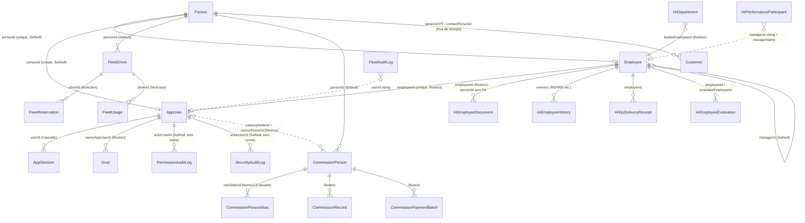
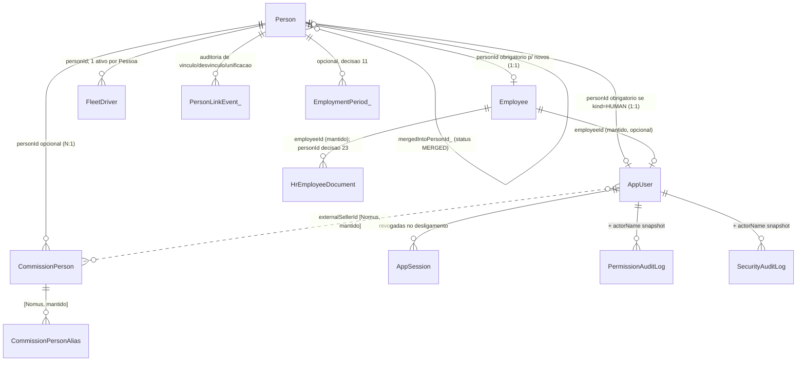
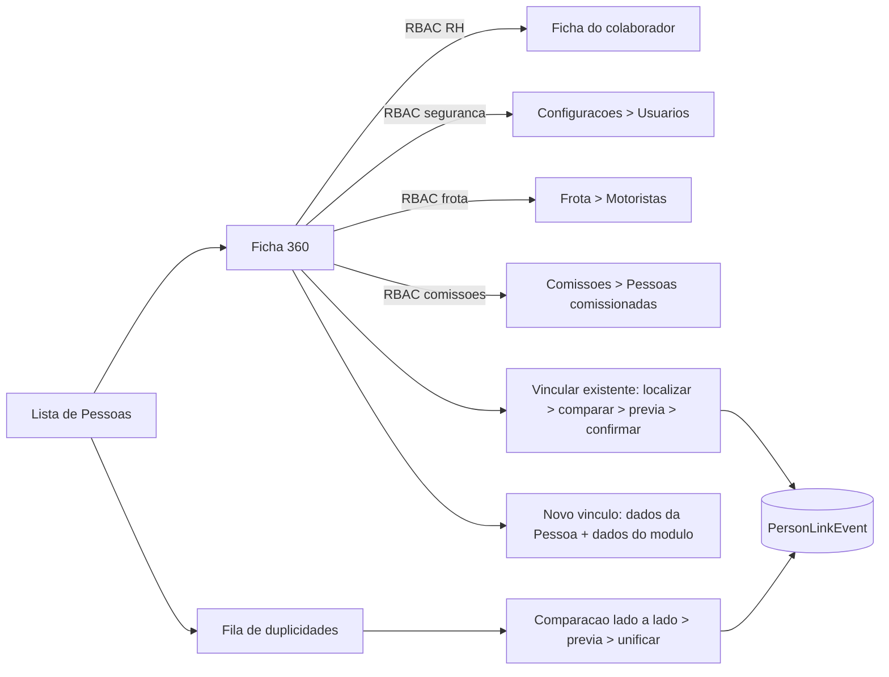

# Auditoria definitiva e projeto conceitual — Cadastro Único de Pessoas do IndusCost

| | |
|---|---|
| Data | 2026-10-20 |
| Escopo | Pessoas físicas e vínculos internos: `Person`, `Employee`, `AppUser`, `FleetDriver`, `CommissionPerson`, `HrEmployeeDocument` e demais entidades que representem pessoas |
| Fora do escopo de implementação | `Customer`, `FinancialSupplier`, pessoas jurídicas, contatos e Nomus de clientes/fornecedores (citados só como dependência) |
| Método | Leitura do schema Prisma, migrations, rotas, serviços, componentes, testes e documentação; nenhuma consulta a banco real |
| Execução | **Somente análise.** Nenhum código, schema, dado, migration, deploy, commit ou push. Nenhuma exploração de falha foi executada |
| Documentos consolidados | `canonical-person-current-state.md`, `canonical-person-target-model.md`, `canonical-person-migration-plan.md` (parcialmente desatualizado — ver §5), `auditoria-identidade-pessoas.md` |

Convenções: toda afirmação de fato traz `arquivo:linha`; o que não pôde ser verificado leva **[NÃO CONFIRMADO]** e diz qual verificação falta. Os blocos **FATOS COMPROVADOS**, **HIPÓTESES**, **RECOMENDAÇÕES** e **DECISÕES PENDENTES** estão marcados ao longo do texto e consolidados em §28. "Comprovado no código" significa lido no código; nada foi demonstrado contra um ambiente.

---

## 1. Resumo executivo

**Veredito.** O IndusCost já tem a entidade certa para ser o cadastro mestre — `Person` (`prisma/schema.prisma:43-84`), com `personId` em `Employee`, `AppUser`, `FleetDriver`, `CommissionPerson` e `Customer` — mas ela **não governa**: só o cadastro de colaborador a cria e sincroniza de fato; a criação de usuário ignora o campo; motoristas e comissionáveis nunca a consultam; não existe tela de Pessoa; não há unicidade no banco; não há unificação. O resultado é o que o próprio super administrador viveu: duas Pessoas para a mesma pessoa, o CPF numa e o login na outra, e nenhum caminho na interface para corrigir.

**Seis achados que pesam mais (todos comprovados no código):**

| # | Achado | Onde |
|---|---|---|
| 1 | Desligar um colaborador **não** inativa o usuário nem revoga sessões; `revokeAllUserSessions` existe e não tem chamador | `server.ts:3952`, `server.ts:1944-1949`, `src/lib/employeeUserLink.server.ts:3` |
| 2 | Quem tem `admin.settings.security:manage` pode atribuir `SUPER_ADMIN` a qualquer usuário, inclusive a si mesmo; as guardas só impedem rebaixar-se e rebaixar o último SUPER_ADMIN | `server.ts:2840-3053`, `:2936-3006` |
| 3 | Exclusão física de usuário (`DELETE /api/admin/users/:id`) sem linha de auditoria; os logs de segurança/permissão ficam com `actorUserId` nulo e sem snapshot de nome | `server.ts:3059-3124`, `prisma/schema.prisma:4295-4335` |
| 4 | Criar usuário exige colaborador ativo, mas **não copia** `employee.personId`; o único caminho que liga usuário a Pessoa é o vínculo manual na ficha, e só se o usuário ainda não tem Pessoa | `server.ts:2782-2797`, `src/lib/employeeUserLink.server.ts:222-228` |
| 5 | `Person` não tem UNIQUE de CPF nem de e-mail no banco (índices criados e removidos de propósito); `ensurePersonFromSource` cria Pessoa sem checar duplicidade e fora de transação | `prisma/migrations/20260715200000_canonical_person_core_harden/migration.sql:7-8`, `src/lib/canonicalPersonService.server.ts:69-197` |
| 6 | Comissionáveis são deduplicados **por nome normalizado** (script), contrariando a regra documentada "nome nunca é evidência" | `src/lib/commissions/commissionPersonIdentity.ts:137-197`, `docs/people/canonical-person-target-model.md` |

**Arquitetura recomendada (§28).** Manter `Person` como identidade mestre e os cadastros operacionais como vínculos (Alternativa A), com três adições aditivas e justificadas: auditoria formal de vínculos (`PersonLinkEvent`), estado `MERGED`/`mergedIntoPersonId` para unificação reversível, e `AppUser.kind` (humano × serviço) para que a regra "usuário humano = uma Pessoa" não quebre integrações. Nenhuma tabela central nova. Nenhuma restrição de unicidade antes da auditoria dos dados reais.

**Primeira entrega utilizável (§24, Fase 2).** Ficha 360° da Pessoa somente leitura + correção segura do vínculo Colaborador ↔ Usuário ↔ Pessoa com prévia e auditoria, reaproveitando `/api/people/resolve`, `/api/employees/:id/system-links` e `linkEmployeeToAppUser`. Antes dela, duas fases curtas: auditoria dos dados reais (consultas em §23) e as quatro correções emergenciais de segurança (§22.1), que não dependem do hub.

---

## 2. Respostas diretas às dúvidas da missão

Legenda: **F** = fato comprovado no código · **H** = hipótese · **R** = recomendação.

### 2.1 O que é uma pessoa no IndusCost (missão §4)

| # | Pergunta | Resposta |
|---|---|---|
| 1 | Definição atual de `Person` | **F** "Identidade canônica da pessoa física (hub fino)" — `prisma/schema.prisma:43-46`. Papéis ficam nas tabelas próprias. |
| 2 | Campos de identidade em `Person` | **F** `displayName`, `socialName`, `corporateEmail`, `personalEmail`, `cpfNormalized`, `phoneNormalized`, `status`, `origin`, `createdByUserId` (sem FK), `inactivatedAt` (`:47-63`). **Não há** data de nascimento, RG, endereço nem foto. |
| 3 | Dados duplicados em outros cadastros | **F** `Employee` guarda nome, nome social, CPF, RG, nascimento, telefone, e-mails, endereço, estado civil, contatos de emergência e foto (`:86-144`); `AppUser` guarda `name` e `email` (`:4108-4109`); `FleetDriver` guarda nome, CPF, telefone, e-mail (`:6441-6476`); `CommissionPerson` guarda nome, e-mail, documento (`:9690-9719`). |
| 4 | Fonte oficial do nome | **F** Não há uma. `Employee.name` alimenta `Person.displayName` na criação/edição pela ficha (`src/lib/canonicalPersonRoutes.ts:435-436`), mas `ensurePersonFromSource` grava `socialName \|\| name` (`src/lib/canonicalPersonService.server.ts:95`); `AppUser.name` nunca é re-sincronizado (`server.ts:2749-2752`). |
| 5 | Fonte oficial do CPF | **F** Não há. `Employee.cpf` sem unicidade; `Person.cpfNormalized` sem unicidade no banco; `FleetDriver.cpf` com unicidade parcial só entre motoristas não inativos (`prisma/migrations/20260603120000.../migration.sql:120`). |
| 6 | Alterações de nome | **F** Pela ficha do colaborador, com `personId` no corpo: campo divergente vira conflito 409 até o RH escolher o valor (`src/lib/canonicalPersonService.server.ts:219-240`, `src/lib/canonicalPerson.ts:169-206`). Sem `personId` no corpo, o formulário sobrescreve a Pessoa, inclusive com nulos (`server.ts:4173-4179`; `updatePersonCore` trata `null` como "definir", `src/lib/canonicalPersonCore.server.ts:216-283`). |
| 7 | Nome social × nome civil | **F** Ambos existem em `Employee` e `Person`. A exibição usa `socialName \|\| name` em vários pontos (`src/lib/adminUserEmployeeLink.ts:38`, `src/lib/auth/appAuth.server.ts:77`, `src/lib/employeeSystemLinks.server.ts:165`), mas `Person.displayName` ora recebe o civil, ora o social (pergunta 4). |
| 8 | E-mail pessoal × corporativo | **F** `Employee.corporateEmail` é único (lower) e é a chave do vínculo com o login (`src/lib/employeeUserLink.server.ts:72-76`); `personalEmail` não é chave. `Person` tem os dois, sem unicidade. `AppUser.email` é o login, único, e **não precisa** coincidir com o corporativo (`src/lib/adminUserEmployeeLink.ts:116-127`). |
| 9 | Regra atual de identidade única | **F** Só na aplicação: `createPersonCore`/`updatePersonCore` recusam CPF ou e-mail já usados por outra Pessoa (`src/lib/canonicalPersonCore.server.ts:179-214`, `:239-253`). |
| 10 | O banco impede duplicidade? | **F** Não. Os índices únicos parciais de `Person` foram criados em `20260715190000_canonical_person` e removidos em `20260715200000_canonical_person_core_harden:7-8` "até diagnóstico de duplicidades históricas". |
| 11 | Pessoa sem CPF | **F** Permitido: `cpfNormalized` é nulo por padrão; criação só exige nome (`src/lib/canonicalPersonCore.server.ts:167-176`). |
| 12 | Estrangeiros / sem documento | **F** Não há campo de documento alternativo (passaporte, RNE) nem país. **R** ver §10. |
| 13 | Duas `Person` para a mesma pessoa | **F** Possível: por `ensurePersonFromSource` (sem checagem, `src/lib/canonicalPersonService.server.ts:80-196`), por Pessoa sem CPF criada a partir do usuário e outra com CPF a partir do colaborador (caso real), e por concorrência (sem UNIQUE). |
| 14 | Identificar conflitos sem fundir indevidamente | **F** Hoje só o relatório de leitura `npm run audit:people-identity` (`scripts/auditPeopleIdentity.ts`) e a prévia de vínculo do colaborador. **R** ver §11–§12. |
| 15 | Estado de pessoa sem vínculos ativos | **F** Nenhum tratamento: `Person.status` nunca é alterado por desligamento, inativação de usuário ou motorista. **R** ver §14. |

**Decisão arquitetural (identidade × vínculo × conta × histórico).** Hoje os quatro conceitos estão misturados em `Employee` (identidade + vínculo), parcialmente separados em `AppUser` (conta, com `employeeId` e `personId` opcionais) e ausentes em `FleetDriver`/`CommissionPerson` (identidade repetida dentro do vínculo). O histórico está espalhado em tabelas de evento com `userId` em texto. A proposta (§6–§9) mantém `Person` = identidade, `Employee`/`FleetDriver`/`CommissionPerson` = vínculos, `AppUser` = conta, e eventos = histórico, sem mover dados operacionais.

### 2.2 Funcionário — `Employee` (missão §6)

| # | Pergunta | Resposta |
|---|---|---|
| 1 | Criar funcionário cria `Person`? | **F** Sim, por padrão (`createNewPerson` assume `true` quando não há `personId`), em `src/lib/canonicalPersonRoutes.ts:416-447` → `resolveEmployeePersonIdForPersist` (`src/lib/canonicalPersonService.server.ts:293-374`). |
| 2 | Procura pessoa existente antes de criar? | **F** Só se o RH usar "Vincular pessoa existente" (`src/components/employee/EmployeePersonLinkField.tsx:63,287` → `GET /api/people/resolve`). Sem ação do RH, cria nova. Não há sugestão automática por CPF na criação. |
| 3 | Vínculo por CPF | **F** A busca aceita CPF para quem vê PII (`src/lib/canonicalPersonSearch.server.ts:202,232`). Ao salvar, `syncPersonIdentityFromAppliedForm` grava o CPF do formulário na Pessoa e recusa se outra Pessoa já o tem (`DUPLICATE_CPF`, `src/lib/canonicalPersonCore.server.ts:239-244`). |
| 4 | Vínculo sem CPF | **F** Possível: a Pessoa pode não ter CPF; a prévia compara só os campos presentes (`previewLinkEmployeeToPerson`, `:242-291`). |
| 5 | CPF já existe em outra `Person` | **F** 409 `DUPLICATE_CPF` com nome e prefixo do ID da outra Pessoa (mensagem melhorada em `0754520`/`08f5789`); nenhuma ação de unificação é oferecida. |
| 6 | Permite vincular pessoa existente? | **F** Sim, na ficha (pergunta 2), com prévia de conflitos campo a campo e resolução "manter formulário / manter Pessoa" (`EmployeeModule.tsx:996-1005,1031-1056`). |
| 7 | Edição sincroniza com `Person`? | **F** Sim (`server.ts:4172-4179`). A escrita na Pessoa acontece **antes** das validações e fora da transação do colaborador (`server.ts:4039` vs `$transaction` ~`:4214`): um erro posterior deixa a Pessoa já alterada; no POST, pode deixar Pessoa órfã (`server.ts:3772`). |
| 8 | Campos duplicados | **F** nome, nome social, CPF, telefone, e-mail corporativo, e-mail pessoal (`Employee:88,101,106-111` × `Person:48-56`). |
| 9 | Risco de sobrescrever dado mais recente | **F** Sim, no `PUT` sem `personId` no corpo (2.1 pergunta 6). **[NÃO CONFIRMADO]** se a UI sempre envia `personId` para colaborador já vinculado (`EmployeeModule.tsx:996` sugere que sim). |
| 10 | Desvincular funcionário da pessoa | **F** `DELETE /api/employees/:id/person-link` (`src/components/employee/EmployeeSystemLinksPanel.tsx:287`). |
| 11 | Desligamento | **F** `PUT /api/employees/:id` com `status=INACTIVE` + `terminationDate/reason/noticeType/details` (`server.ts:3952`, `:4099-4245`). Não toca `AppUser`, `AppSession` nem `Person`. |
| 12 | Recontratação | **F** `PATCH /api/employees/:id/status` só aceita `ACTIVE`, zera `terminationDate` e todos os `termination*` (`server.ts:12431-12473`) e grava `REHIRE` em `HrEmployeeHistory` (`src/lib/peopleProfileHistory.ts:407-409`). `admissionDate` não muda. |
| 13 | Múltiplos períodos contratuais | **F** Não como entidade: sobrevivem só como eventos de histórico. Um segundo `Employee` para a mesma Pessoa é bloqueado pelo unique `personId` e por `PERSON_ALREADY_HAS_EMPLOYEE` (`src/lib/canonicalPersonService.server.ts:337-350`). |
| 14 | Cargos, departamentos, gestores, remunerações históricas | **F** `HrEmployeeHistory` (eventos imutáveis com antes/depois, `schema.prisma:272`), `HrCompensationAdjustment` (`:313`); o valor corrente fica na linha do `Employee`. |
| 15 | Inativo aparece em Pessoas? | **F** Não existe tela de Pessoas. Na busca `/api/people/resolve`, colaboradores inativos só entram com `includeInactive=1` (`src/lib/canonicalPersonSearch.server.ts:294`). |
| 16 | Exclusão física | **F** Sim: `DELETE /api/employees/:id` (`server.ts:4354-4386`), só SUPER_ADMIN, bloqueado se há usuário vinculado; os FKs `Restrict` dos satélites bloqueiam na prática quando há histórico. |
| 17 | Documentos, avaliações, EPIs e históricos após desligamento | **F** Permanecem ligados ao `employeeId` (FKs `Restrict`: `HrEmployeeDocument:556`, `HrEpiDelivery*:416-524`, `HrEmployeeEvaluation:711`). Nada é apagado no desligamento. |

**Questão fundamental — Employee subordinado a Person?** **R** Sim, e é o que já está modelado: `Employee` deve continuar como **cadastro funcional** (vínculo + dados do vínculo) 1:1 com a identidade. A separação `Employee`/`Employment` por período só se justifica se a diretoria quiser que recontratações preservem períodos como entidade consultável (decisão 11 em §26); a alternativa incremental — manter a linha e o evento `REHIRE` — já existe e não perde dados, só os deixa menos estruturados. Nenhuma tabela nova é necessária para o hub funcionar.

### 2.3 Usuário — `AppUser` (missão §7)

| # | Pergunta | Resposta |
|---|---|---|
| 1 | Como usuários são criados | **F** `POST /api/admin/users` (`server.ts:2684-2838`), guarda `admin.settings.security:manage` (`:2259-2263`); senha definida pelo administrador; `mustChangePassword` padrão `true` (`:2777-2780`); acesso inicial VIEWER sem permissões (`src/lib/adminUserCreationPolicy.ts:7-16`). Sem convite, sem importação em lote, sem autocadastro. |
| 2 | Por que depende de `Employee` | **F** `assertEmployeeEligibleForUserLink` exige colaborador existente, ATIVO e ainda não vinculado (`src/lib/adminUserEmployeeLink.ts:82-114`). A intenção documentada é "usuário nasce de colaborador". Não há alternativa para externos. |
| 3 | Já tem `personId`? | **F** Sim, `AppUser.personId String? @unique` (`schema.prisma:4119`). |
| 4 | Por que nem sempre preenchido | **F** A criação não o grava (`server.ts:2782-2797`); só o vínculo manual na ficha copia `employee.personId`, e só se o usuário não tem Pessoa (`src/lib/employeeUserLink.server.ts:222-228`); mudar `Employee.personId` não propaga; usuários anteriores ao hub (2026-07) nasceram sem o campo. |
| 5 | Duas Pessoas para o mesmo usuário | **F** O vínculo falha com `PERSON_MISMATCH` (`src/lib/employeeUserLink.server.ts:210-216`); trocar a Pessoa do colaborador falha com `DUPLICATE_CPF` se a outra Pessoa já tem o CPF. Não há correção pela interface. |
| 6 | Como escolhe a pessoa correta | **F** Não escolhe: copia a do colaborador se o usuário não tem; caso contrário, erro. |
| 7 | Vincular manualmente usuário a pessoa | **F** Não diretamente. Só via colaborador (cartão "Acesso ao sistema", `src/components/employee/EmployeeSystemAccessCard.tsx:215`). |
| 8 | Desvincular usuário | **F** `POST /api/employees/:id/unlink-user` limpa `employeeId`; mantém `personId` e `isActive` (`src/lib/employeeUserLink.server.ts:246-292`). |
| 9 | Permissões para vincular | **F** `admin.employees.user_link:manage`, registrado com `requireResourceOrHrEditor` (`server.ts:15430-15434`): editor de RH sem negação explícita também passa (`server.ts:2210-2244`). |
| 10 | Mesmo usuário em duas pessoas | **F** Impossível: `personId` é único por usuário e um usuário tem um `personId`. |
| 11 | Uma pessoa com duas contas | **F** Impossível pelo banco: `AppUser.personId @unique` e `AppUser.employeeId @unique` (`:4117,4119`). Mas uma pessoa com **duas Pessoas** pode ter duas contas. |
| 12 | Contas duplicadas | **F** Sem tratamento. Só a auditoria de leitura aponta. |
| 13 | E-mail: identidade ou login? | **F** Login (único) e também chave de casamento do vínculo Colaborador↔Usuário (`employeeUserLink.server.ts:72-76`). Não é identidade da pessoa. |
| 14 | Funcionário muda de e-mail | **F** `Employee.corporateEmail` e `AppUser.email` são independentes; o cartão só avisa `emailMismatch` (`:84-88`). O login não muda sozinho. |
| 15 | Bloquear acesso sem excluir | **F** `PATCH` com `isActive=false` (`server.ts:2840-3053`); `readAppSession` recusa inativos (`server.ts:1896`). Não gera auditoria nem revoga sessões ativas (a sessão morre porque toda requisição checa `isActive`). |
| 16 | Desligamento revoga sessões/credenciais? | **F** Não (achado 1). |
| 17 | Quem reativa | **F** Quem tem `admin.settings.security:manage` via `PATCH isActive=true`; sem fluxo específico. |
| 18 | Auditar vinculações incorretas | **F** `employee.link_user`/`unlink_user` só em `console.info` (`src/lib/employeeUserLink.server.ts:231-240`); `logEmployeeHrAudit` só stdout (`src/lib/employeeHrAudit.ts:133-143`). Sem tabela. |
| 19 | Administradores históricos | **F** O bootstrap foi removido (`server.ts:2041-2051`), mas `requireBootstrapOrAnyPermission` ainda aceita o cookie se `BOOTSTRAP_ADMIN_ENABLED` estiver ligado (`server.ts:2179-2188`); o runbook `docs/runbooks/recuperacao-super-admin.md` referenciado não existe. **[NÃO CONFIRMADO]** valor da variável nos ambientes. |
| 20 | Contas de serviço, integrações, dispositivos | **F** Não há modelo. Collector de inventário usa identidade Tailscale (`server.ts:17684-17687`); pesquisa de satisfação, portal de desempenho e reserva de frota usam tokens públicos (`src/lib/fleetPublicReservationRoutes.ts:103-119`). **[NÃO CONFIRMADO]** expiração desses tokens. |

### 2.4 Motoristas — `FleetDriver` (missão §8)

| # | Pergunta | Resposta |
|---|---|---|
| 1 | Precisa ser funcionário? | **F** Não: não há `employeeId` (`schema.prisma:6441-6476`). |
| 2 | Pode ser terceirizado? | **F** Sim, inclusive por autocadastro público via QR (`src/lib/fleetPublicReservationDriverOps.ts:216-230`, nasce `PENDING`). |
| 3 | Como é cadastrado | **F** Rota administrativa (`src/lib/fleetDriverRoutes.ts:112-182`), importação CSV (`src/lib/fleetCsvImport.ts`) e QR público. |
| 4 | CPF obrigatório? | **F** Sim (NOT NULL). Validação: admin e CSV só exigem não vazio / 11 dígitos, **sem checksum** (`src/lib/fleetDriverOps.ts:72-73`, `fleetCsvImport.ts:361`); o QR público valida checksum (`fleetPublicReservationDriverOps.ts:58-63`). |
| 5 | Consulta prévia a `Person`? | **F** Nenhum fluxo de frota consulta Pessoa ou colaborador por CPF. |
| 6 | Uso de `FleetDriver.personId` | **F** Só escrito por `ensurePersonFromSource` (`src/lib/canonicalPersonService.server.ts:148-166`) e pelo backfill (`src/lib/canonicalPersonBackfill.server.ts:330-338`). Nada na frota lê. |
| 7 | Dois motoristas com o mesmo CPF | **F** Bloqueado entre não inativos por índice parcial (`FleetDriver_cpf_active_key`) e por `assertUniqueActiveDriverCpf` (`src/lib/fleetService.ts:73-85`, verificação sem transação). Permitido se um estiver INACTIVE. |
| 8 | Motorista sem vínculo canônico | **F** É o padrão. |
| 9 | CNH e documentos | **F** Campos na própria linha (`cnh*`); sem documento anexado. |
| 10 | Histórico de viagens | **F** `FleetReservation`, `FleetUsage`, `FleetFueling`, `FleetFine`, `FleetIncident` com `driverId` `NoAction` (`:6499-6828`): não se apaga motorista com histórico. |
| 11 | Quando deixa a empresa | **F** Não há `DELETE`; só `INACTIVE` via `PUT` ou `BLOCKED` com motivo (`fleetDriverRoutes.ts:184-208`). Teste garante que limpeza não apaga motoristas (`src/lib/fleetReservationsCleanup.test.ts:86`). |
| 12 | Fonte oficial do nome | **F** O próprio `FleetDriver.name`. **R** Pessoa (quando vinculada). |
| 13 | Vincular motorista existente a pessoa | **F** Só pelo backfill por CPF/e-mail exato. Sem UI. |
| 14 | Preservar histórico ao corrigir vínculo | **F** Trocar `personId` não afeta as FKs de viagens (apontam para `driverId`). |

**Modelo ideal (R).** Ao criar motorista, resolver a Pessoa pelo CPF validado: se existe (por ser colaborador ou outro papel), apenas criar a habilitação de motorista apontando para ela; se não existe, criar Pessoa e motorista na mesma transação. Nunca uma segunda Pessoa. Detalhe em §18-C.

### 2.5 Pessoas comissionáveis — `CommissionPerson` (missão §9)

| # | Pergunta | Resposta |
|---|---|---|
| 1 | Identidade humana ou operacional? | **F** Operacional/comercial: representa "quem recebe comissão" segundo o Nomus, com `type` SELLER/REPRESENTATIVE/MANAGER/OTHER e `source` NOMUS/MANUAL (`schema.prisma:9690-9719`). Pode ser pessoa física ou representante PJ. |
| 2 | Sem CPF conhecido? | **F** Sim: `document` é opcional e o import nunca o preenche (`src/lib/commissions/commissionPersons.server.ts:334-432`). |
| 3 | Aliases históricos do Nomus? | **F** Sim: `CommissionPersonAlias` por `rawSellerId`/`rawSellerName` com unicidade parcial `(source, rawSellerId)` ativa (`prisma/migrations/20260706140000_commission_person_alias/migration.sql:42-44`). |
| 4 | Como são criadas | **F** Import dos pedidos (`import-from-orders`, `commissionsRoutes.ts:1573-1637`), formulário manual (`CommissionsPersonFormModal.tsx:101-192`) e sincronização a partir do usuário vendedor (`src/lib/commissions/commissionPersonAppUserSync.server.ts:33-58`). |
| 5 | Como são identificadas | **F** `(type, nomusPersonId)` → alias por id → alias por nome → **nome normalizado** (`src/lib/commissions/commissionPersonResolution.server.ts:38-65`; `commissionSellerIdentity.ts:149-274`). |
| 6 | Usa nome para deduplicação? | **F** Sim, no script `dedupe-commission-persons` (`src/lib/commissions/commissionPersonIdentity.ts:137-197`). |
| 7 | Risco de homônimos | **F** Real: duas pessoas com o mesmo nome normalizado seriam fundidas pelo script; o import também reativa/atualiza por nome (`resolution.server.ts:106-135`). Probabilidade não mensurável sem dados. |
| 8 | Cardinalidade `Person`↔`CommissionPerson` | **F** 1:N (sem unique em `personId`). |
| 9 | Múltiplas identidades comerciais históricas | **F** Sim, por tipo e por alias; também por duplicatas acidentais. |
| 10 | Associação ao vendedor Nomus | **F** `nomusPersonId` + aliases; `AppUser.externalSellerId(s)` mapeia o usuário ao mesmo id (`src/lib/commissions/commissionAccessScope.ts:166,187`). |
| 11 | Vendedores desligados | **F** `active=false`; a resolução reativa se o Nomus voltar a citá-lo. |
| 12 | Comissões históricas | **F** `CommissionRecord` e `CommissionPaymentBatch` com FK `Restrict` (`:9868,9932`): não se apaga pessoa com comissão. |
| 13 | Rateios, supervisoras, responsáveis | **F** "Rateio" = divisão por recebíveis, não entre pessoas (`commissionReceivableScheduler.server.ts:197`); "Supervisor comercial" é perfil de acesso que reatribui carteira (`customerCommercialOwnerAssignAccess.ts:12`); carteira (`CrmCustomerCommercialOwner`) é por chave de nome/id, sem FK a pessoa (`schema.prisma:3299-3330`). |
| 14 | Vincular comissionável a Pessoa existente | **F** Só backfill por e-mail/CPF exato. O formulário não tem o campo. |
| 15 | Identidade comissionável × usuário × funcionário | **F** Três tabelas sem ligação direta além de `personId` (raramente preenchido) e `externalSellerId` (usuário ↔ comissionável). |

**Pergunta essencial — absorver ou manter?** **R** Manter `CommissionPerson` como entidade própria, vinculada N:1 a `Person`. Motivos: (a) ela carrega identidade **do Nomus** (ids e aliases) que não é da pessoa; (b) representantes podem ser PJ; (c) as regras de comissão (`Restrict` em registros e lotes, `canonicalSellerId` em ledger/snapshot/schedule) dependem do seu id; (d) absorvê-la obrigaria a reescrever FKs históricas — vetado pela missão. O que muda: o formulário ganha "Pessoa" (vínculo), o import passa a sugerir Pessoa por CPF/e-mail quando houver, e a deduplicação por nome deixa de existir (vira fila de revisão humana).

### 2.6 Documentos e registros pessoais (missão §10)

| # | Pergunta | Resposta |
|---|---|---|
| 1 | Documentos da pessoa | **F** Nenhum modelo é "da pessoa": `HrEmployeeDocument` é por `employeeId` (`schema.prisma:556-582`), com `personId` informativo, sem FK nem índice (`prisma/migrations/20260912120000_hr_employee_functional_record/migration.sql:131`). Conceitualmente: RG, CPF, comprovantes de identidade. |
| 2 | Documentos do vínculo | **F/R** Contrato, EPI (`HrEpiDeliveryForm/Receipt`, `:491-524`, revisionados por `documentNumber`), avaliação de experiência (`EXPERIENCE_EVALUATION`, `src/lib/hrEvaluation.server.ts:1032`), certificados de treinamento (`HrTrainingCertificate:1046`, `HrEmployeeExternalCertificate:1075`). |
| 3 | Exclusivos do RH | **R** Todos os acima, mais laudos e dados sensíveis; a ficha de Pessoa só mostra que existem (contagem/tipo), não o arquivo. |
| 4 | Consultáveis por outros módulos | **F** Hoje: quem vê a ficha vê documentos (`canViewDocuments` inclui `employees.view`/escopo próprio e equipe, `src/lib/peopleProfileCapabilities.ts:177`); anexos de avaliação também com `evaluations-view` (`src/lib/peopleProfileRoutes.ts:403-415`). |
| 5 | Proteger confidenciais | **F** Download exige `admin.employees.documents:view` (`src/lib/employeesAccess.ts:148-153`). Não há classificação de sigilo por documento. |
| 6 | Evitar duplicidade | **F** Nenhum controle (tipo é texto livre, `PeopleProfileManageForms.tsx:1364-1370`). |
| 7 | Validade e versões | **F** `issuedAt`/`expiresAt`; sem versão/revisão (só EPI tem `SUPERSEDED`). |
| 8 | Acesso a arquivos | **F** Namespace `hremployeedocs`, chave por `employeeId` (`src/lib/peopleProfileMutations.server.ts:2423-2428`). |
| 9 | Retenção | **F** Nenhuma política; exclusão é física (`:2533-2575`), bloqueada se recibo de EPI referencia. |
| 10 | Após desligamento | **F** Permanecem ligados ao colaborador; nada muda. |

**Sobre `HrEmployeeDocument.personId`** (ajuste 3 da aprovação): é gravado a partir de `Employee.personId` no upload manual, nos certificados e nos anexos de avaliação (`src/lib/peopleProfileRoutes.ts:1334-1341,1430-1436`, `src/lib/hrEvaluation.server.ts:1032`), **não** é gravado nos recibos de EPI (`src/lib/epi/epiForms.server.ts:437-448`) e **nunca é lido**. Não se recomenda removê-lo nem transformá-lo em FK antes de: (a) medir quantos documentos têm o campo preenchido e se coincidem com `Employee.personId` (consulta §23 Q18); (b) decidir se a ficha 360° navegará por ele ou por `employeeId` (recomendação: por `employeeId`, pois é o vínculo); (c) avaliar impacto sobre recibos de EPI, que o deixam nulo. Decisão pendente 23 em §26.

---

## 3. Inventário das entidades pessoais

Tipos: **A** identidade pessoal · **B** cadastro operacional (vínculo/habilitação) · **C** informação subordinada · **D** histórico/evento/auditoria · **E** organização/PJ (fora de escopo).

| Entidade | Tipo | Representa pessoa? | Vínculo atual com `Person` | Cardinalidade | Pode existir sem `Person`? | Situação desejada |
|---|---|---|---|---|---|---|
| `Person` (`schema.prisma:43-84`) | A | Sim (hub) | — | — | — | Identidade mestre; ganha nascimento e foto autorizada; status MERGED |
| `Employee` (`:86-193`) | A+B (misturados) | Sim | `personId` unique, SetNull (`:127,189`) | 1:1 | Sim (legado) | B puro: cadastro funcional 1:1 obrigatório para novos |
| `AppUser` (`:4106-4208`) | Conta de acesso | Sim (humano) | `personId` unique, SetNull (`:4119`) | 1:1 | Sim (hoje sempre, na criação) | `personId` obrigatório para `kind=HUMAN`; `SERVICE` sem Pessoa |
| `AppSession` (`:4210-4224`) | C (da conta) | Não | — | N:1 AppUser | — | Inalterado; revogada no desligamento |
| `FleetDriver` (`:6441-6476`) | A+B | Sim | `personId` SetNull, sem unique (`:6458`) | N:1 | Sim | B: habilitação 1:1 por Pessoa ativa; identidade resolvida por CPF |
| `CommissionPerson` (`:9690-9719`) | B (identidade comercial Nomus) | Sim ou PJ | `personId` SetNull (`:9700`) | N:1 | Sim | Mantida; vínculo opcional a Pessoa; sem dedupe por nome |
| `CommissionPersonAlias` (`:9721-9742`) | C (do comissionável) | Não | — | N:1 | — | Inalterado |
| `HrEmployeeDocument` (`:556-582`) | C (do vínculo) | Não | `personId` sem FK (`:559`) | N:1 Employee | — | Decisão pendente (FK real × informativo × remover) após §23 Q18 |
| `HrEmployeeExternalCertificate` (`:1075`), `HrTrainingCertificate` (`:1046`) | C | Não | — | N:1 Employee | — | Inalterado; aparecem na ficha como contagem |
| `HrEpiDeliveryEvent/Delivery/Form/Receipt` (`:416-524`) | C/D | Não | — | N:1 Employee | — | Inalterado |
| `HrEmployeeHistory` (`:272`), `HrCompensationAdjustment` (`:313`) | D | Não | — | N:1 Employee | — | Inalterado; base para períodos |
| `HrAbsence` (`:585`), `HrEmployeeNote` (`:614`), `HrEmergencyContact` (`:371`), `HrEmployeeBenefit` | C | Não | — | N:1 Employee | — | Inalterado (RH) |
| `HrEmployeeEvaluation` (`:667-713`) | D | Não (avaliador = Employee FK) | — | N:1 Employee | — | Inalterado |
| `HrCompetency*`, `HrTraining*` (`:888-1139`) | C/D | Não | — | N:1 Employee | — | Inalterado |
| `HrPerformanceParticipant/Assignment/...` (`:1209-1500`) | D (retrato do ciclo) | Não; `managerId` string + `managerName` snapshot (`:1251`) | — | N:1 Employee | — | Inalterado (snapshot é intencional) |
| `HrDirectorate`, `HrDepartment` (`:202,227`) | Estrutura | `leaderEmployeeId` FK Restrict | — | N:1 Employee | — | Inalterado |
| `Goal`, `GoalKeyResult`, `GoalInitiative` (`:12447-12643`) | D/B (dono) | `ownerAppUserId`/`assigneeAppUserId` FK | — | N:1 AppUser | — | Inalterado (dono é a conta) |
| `FleetVehicle.responsibleUserId` (`:6348`) | Relacionamento | id string sem FK | — | — | — | Inalterado; opcionalmente FK a AppUser |
| `PurchaseRequest.requesterEmployeeId` (`:3068`), `buyerUserId` (`:3084`), `PurchaseApproval.*ByUserId` (`:9002-9003`) | D/Relacionamento | FK (requester) / string | — | — | — | Inalterado |
| Auditorias com FK + nome: `TreasuryAuditLog` (`:11096`), `FinancialCostCenterAuditLog` (`:7808`), `InventoryAuditLog`, `FiscalSettlementAuditLog`, `PurchaseOrderHistoryEvent` (`:9256`) | D | Não | — | — | — | Modelo a seguir |
| Auditorias só com id string: `CommercialAuditLog` (`:3362`), `HrEvaluationAuditEvent` (`:768`), `HrPerformanceAuditEvent` (`:1500`), `GoalAuditLog` (`:12595`), `LegalExposureAuditLog` (`:13583`), `FleetAuditLog` (`:6864`), `HrEmployeeHistory.createdByUserId` | D | Não | — | — | — | Ganhar snapshot de nome (sem FK) |
| Auditorias FK SetNull sem nome: `PermissionAuditLog` (`:4295`), `SecurityAuditLog` (`:4320`) | D | Não | — | — | — | Ganhar `actorName` snapshot |
| Assinaturas de política comercial (`:4401-4475`) | D | Não; AppUser FK Restrict com snapshots | — | — | — | Inalterado |
| Responsáveis em texto: `Proposal.responsible` (`:2510`), `Project.commercialOwner/technicalOwner`, `PurchaseRequest.requester`, `MaintenanceRequest.requester/responsible` | Snapshot | Não | — | — | — | Inalterado |
| `Customer` (`:2437-2502`) | A (PF) / E (PJ) | PF sim | `personId` + `contactPersonId` SetNull | N:1 | Sim | Fora de escopo; preservar |
| `FinancialSupplier` (`:7412-7446`), `SupplierServiceTermination` (`:7482`) | E | Não (pessoas só como texto) | nenhum | — | — | Fora de escopo |
| `CrmCustomerCommercialOwner` (`:3299-3330`) | Relacionamento | Não (chave de nome/id) | nenhum | — | — | Fora de escopo |
| `NomusAccountsReceivable/Payable.personId Int` (`:4592,4745`) | E (id Nomus) | Não | **não é** `Person` | — | — | Renomear em docs/aliases, nunca confundir |

**Campos de referência a pessoas encontrados (classificação D salvo nota):** `personId` (A nos hubs; C em `HrEmployeeDocument`; Int Nomus em AR/AP), `employeeId` (B/C), `userId`/`*ByUserId`/`actorUserId` (D), `driverId` (C/D em frota), `commissionPersonId` (C em registros; string sem FK em `SupplierServiceTerminationCommissionLink:7591`), `responsibleUserId` (relacionamento), `managerId` (relacionamento em `Employee`; snapshot string em desempenho), `leaderEmployeeId` (estrutura), `evaluatorEmployeeId` (D), `ownerAppUserId` (B/D). Nenhum deles precisa virar relação canônica nova: os de tipo D permanecem como eventos; os de relacionamento apontam para o vínculo (Employee/AppUser), nunca para `Person`.

---

## 4. Arquitetura atual (Mermaid)

Linha cheia = FK; `..` = chave textual/sem FK; nota entre colchetes = id Nomus preservado.



Leituras que o diagrama deixa claras: (1) `Person` só está "cheia" quando o caminho passou pelo cadastro de colaborador; (2) o único elo entre conta e pessoa que a aplicação mantém é `AppUser.employeeId`; (3) motorista e comissionável vivem em ilhas com identidade própria; (4) a auditoria aponta para a conta, nunca para a pessoa, e em dois logs críticos perde o autor na exclusão.

---

## 5. Problemas identificados (FATOS COMPROVADOS)

| # | Problema | Sev. | Evidência |
|---|---|---|---|
| P1 | Desligamento não inativa usuário nem revoga sessões | Crítico | `server.ts:3952`, `:4099-4245`; `revokeAllUserSessions` `:1944-1949` sem chamador; `src/lib/employeeUserLink.server.ts:3` |
| P2 | Promoção a SUPER_ADMIN por qualquer `security:manage`, inclusive auto-promoção | Crítico | `server.ts:2868-2874` (parse de `role`), guardas só em `:2936-3006`; `assertCanChangeSuperAdminRole` não cobre promoção (`src/lib/security/userPermissionAdminService.ts:208-232`) |
| P3 | `DELETE /api/admin/users/:id` físico, sem auditoria em tabela; logs de segurança perdem o autor | Crítico | `server.ts:3059-3124`; `schema.prisma:4295-4335` |
| P4 | Criação de usuário não copia `employee.personId`; propagação só manual e unidirecional | Alto | `server.ts:2782-2797`; `src/lib/employeeUserLink.server.ts:222-228` |
| P5 | `Person` sem UNIQUE; `ensurePersonFromSource` cria sem checar e sem transação; prévia pode criar Pessoa | Alto | `prisma/migrations/20260715200000.../migration.sql:7-8`; `src/lib/canonicalPersonService.server.ts:80-196,242-262` |
| P6 | Escrita em `Person` antes das validações e fora da transação do colaborador | Alto | `server.ts:3772`, `:4039` vs `:4214` |
| P7 | Dedupe de comissionáveis por nome; reatribuição deixa aliases/exceções/ledger no duplicado | Alto | `src/lib/commissions/commissionPersonIdentity.ts:137-197`; `commissionPersonResolution.server.ts:67-89,284-335` **[NÃO CONFIRMADO em dados]** |
| P8 | Editor de RH pode vincular/desvincular logins | Alto | `server.ts:15430-15434`, `:2210-2244` |
| P9 | `Employee.cpf` sem unicidade; motorista sem checksum de CPF (admin/CSV) | Alto | `schema.prisma:86-193`; `src/lib/fleetDriverOps.ts:72-73`; `fleetCsvImport.ts:361` |
| P10 | Fluxos de frota e comissão nunca consultam `Person` | Alto | §2.4 e §2.5 |
| P11 | Recontratação zera o período anterior na linha | Médio | `server.ts:12431-12473` |
| P12 | `PUT` de colaborador sem `personId` sobrescreve Pessoa com nulos | Médio | `server.ts:4173-4179`; `src/lib/canonicalPersonCore.server.ts:216-283` |
| P13 | `Person.displayName` ora civil, ora social; `AppUser.name` nunca sincronizado | Médio | `src/lib/canonicalPersonRoutes.ts:435-436`; `canonicalPersonService.server.ts:95`; `server.ts:2749-2752` |
| P14 | Auditoria de vínculos e de RH só em stdout | Médio | `src/lib/employeeHrAudit.ts:133-143`; `employeeUserLink.server.ts:231-240` |
| P15 | Guard residual de bootstrap; runbook de recuperação inexistente | Médio | `server.ts:2179-2188`; referência em `:2041-2051` |
| P16 | Dashboard de RH expõe salário com chave `sensitive_data` em vez de `compensation_values` | Médio | `src/lib/employeesDashboardRoutes.ts:59` |
| P17 | `canViewDocuments` concedido a quem vê a ficha | Médio | `src/lib/peopleProfileCapabilities.ts:177` |
| P18 | `FleetAuditLog` grava CPF cru em `newValue` nos fluxos públicos | Médio | `src/lib/fleetPublicReservationDriverOps.ts:236`; `fleetCsvImport.ts:666,677` |
| P19 | `HrEmployeeDocument.personId` sem FK, parcialmente preenchido, nunca lido | Baixo | `schema.prisma:559`; §2.6 |
| P20 | Sem rota de CRUD/inativar/unificar Pessoa; `/api/people/search` e `/:id/links` sem uso na UI | Baixo | `src/lib/canonicalPersonRoutes.ts:137,185` |
| P21 | `canonical-person-migration-plan.md` ainda lista uniques parciais removidos | Baixo | `docs/people/canonical-person-migration-plan.md:9` |
| P22 | Seeds locais criam usuários sem Employee/Person (guarda só local) | Baixo | `scripts/seedPerformanceLocalDemo.ts:97-130`; `scripts/performance-e2e/seedHrRoles.mts:23` |

---

## 6. Dados que pertencem a `Person`

| Campo | Hoje em `Person`? | Hoje onde mais | Recomendação |
|---|---|---|---|
| Nome civil | `displayName` (sim) | `Employee.name`, `AppUser.name`, `FleetDriver.name`, `CommissionPerson.name` | Mestre em `Person`; `Employee.name` vira espelho sincronizado (não removido) |
| Nome social | `socialName` (sim) | `Employee.socialName` | Mestre em `Person`; regra única de exibição `socialName` ou, na falta, `displayName` |
| CPF | `cpfNormalized` (sim, nulo permitido) | `Employee.cpf`, `FleetDriver.cpf`, `CommissionPerson.document`, `Customer.taxId` | Mestre em `Person`, validado por checksum; os demais passam a ser espelho/entrada |
| Documento alternativo (passaporte/RNE) + país | não | — | **Proposta aditiva**: `identityDocumentKind`, `identityDocumentNumber`, `identityCountry` para quem não tem CPF |
| Data de nascimento | não | `Employee.birthDate` | Mover a propriedade para `Person` (campo novo, aditivo); RH continua editando |
| Foto | não | `Employee.photoStorageKey` | `Person.photoStorageKey` só com autorização registrada; a ficha mostra quando existir |
| Telefone | `phoneNormalized` (sim) | `Employee.phone`, `FleetDriver.phone` | Mestre em `Person` |
| E-mail pessoal | `personalEmail` (sim) | `Employee.personalEmail` | Mestre em `Person` |
| E-mail corporativo | `corporateEmail` (sim) | `Employee.corporateEmail` (único), `AppUser.email` (login) | Dado do **vínculo** (a empresa fornece); `Person` guarda cópia informativa; login nunca é identidade |
| Situação cadastral | `status` (sim) | — | ACTIVE / INACTIVE / MERGED / NEEDS_REVIEW (§14) |
| Origem e auditoria | `origin`, `createdByUserId`, `inactivatedAt` (sim) | — | Manter; acrescentar `mergedIntoPersonId` |

**O que não entra em `Person`:** RG e demais documentos de RH, endereço, estado civil, contatos de emergência, tamanhos de EPI, jornada, dados bancários, remuneração — tudo isso é do vínculo trabalhista e fica no RH com o RBAC de hoje.

## 7. Dados que permanecem nos módulos

| Módulo | Fica onde está | Motivo |
|---|---|---|
| RH (`Employee` e satélites) | cargo, departamento, centro de custo, classificação, salário, admissão, desligamento, contrato, gestor, jornada, endereço, estado civil, emergência, EPI, documentos, avaliações, treinamentos, férias | Atributos do vínculo, não da pessoa; o RBAC `admin.employees.*` já os protege |
| Usuários (`AppUser`) | login, senha, papel, permissões, perfil de acesso, `permissionsVersion`, sessões, `externalSellerId` | Conta de acesso; identidade vem de `personId` |
| Frota (`FleetDriver`) | CNH e validade, status de habilitação, bloqueios com motivo, histórico de reservas/uso/multas | Habilitação operacional |
| Comissões (`CommissionPerson`) | tipo, `nomusPersonId`, aliases, ativo, regras, registros, lotes | Identidade comercial do Nomus e regras oficiais de comissão — intocáveis |
| Desempenho | retratos de ciclo (`managerId`/`managerName`), tarefas, resultados | Snapshot intencional da época |
| Auditorias | quem fez o quê (por conta) | Evento; ganha snapshot de nome, não `personId` |

## 8. Proposta de relacionamentos (Mermaid)

Nós com sufixo `_` são propostas (não existem hoje). Nenhuma FK histórica é reescrita.



Regras do desenho: (1) `Person` é a única identidade; (2) cada vínculo guarda só o que é seu; (3) a conta aponta para a Pessoa e, se houver, para o vínculo trabalhista; (4) história nunca aponta para `Person` — aponta para o vínculo/conta da época e guarda snapshot; (5) ids Nomus continuam em `CommissionPerson`/`AppUser.externalSellerId`, nunca em `Person`.

## 9. Matriz de cardinalidade

| Relação | Hoje | Restrição no banco hoje | Desejada | Como garantir | Observação |
|---|---|---|---|---|---|
| Person ↔ Employee | 1:1 opcional | `Employee.personId @unique` (`schema.prisma:189`) | 1:1, obrigatória para novos | Validação no serviço + unique existente | 1:N só se `EmploymentPeriod` for aprovado (decisão 11) |
| Person ↔ AppUser | 1:1 opcional | `AppUser.personId @unique` (`:4119`) | 1:1 para humanos; 0 para `SERVICE` | Validação + unique existente | Uma pessoa, uma conta humana (decisão 8) |
| Person ↔ FleetDriver | 1:N | nenhuma | 1 motorista **ativo** por Pessoa | Índice parcial futuro em `(personId)` onde status não é INACTIVE — só após §23 | Histórico inativo pode ter mais de um |
| Person ↔ CommissionPerson | 1:N | nenhuma | 1:N | — | Tipos e aliases Nomus justificam N |
| Person ↔ HrEmployeeDocument | indireta | `personId` sem FK | indireta via Employee | — | Decisão 23 |
| Person ↔ períodos contratuais | eventos | — | 1:N (se aprovado) | tabela aditiva | Decisão 11 |
| Employee ↔ AppUser | 1:1 | `AppUser.employeeId @unique` (`:4117`) | 1:1 opcional (externos sem Employee) | mantido | Deixa de ser pré-requisito da conta |
| Concorrência | sem lock | uniques 1:1 impedem duplo vínculo; nada impede duas Pessoas iguais | transação por operação de vínculo; erro P2002 mapeado | ver §15 e §18 | `resolveEmployeePersonIdForPersist` e `ensurePersonFromSource` hoje sem transação |

## 10. Política de unicidade (alvo; nada imposto antes da auditoria real)

1. **CPF validado** (checksum) é a chave de identidade de pessoa física. Entre Pessoas com `status` ACTIVE deve ser único. Hoje a regra só existe na aplicação e **não deve virar índice** até o roteiro de §23 mostrar zero `PESSOA_CPF_REPETIDO` em produção (ajuste 4 da aprovação).
2. **CPF ausente** é permitido (estrangeiro, menor, cadastro inicial) e marca a Pessoa como "identidade não verificada"; ela não pode receber conta de acesso humana até ter CPF validado ou documento alternativo + aprovação de RH/segurança (decisão 17).
3. **CPF inválido** (checksum falha) é recusado em todos os pontos de entrada (hoje só o QR público valida — `src/lib/fleetPublicReservationDriverOps.ts:58-63`); registros legados inválidos entram na fila de revisão (decisão 18).
4. **E-mail** não é identidade: é login (`AppUser.email`, único) e chave de casamento usuário↔colaborador. Dois usuários com o mesmo e-mail já são impossíveis; duas Pessoas com o mesmo e-mail corporativo são **alerta**, não bloqueio automático.
5. **Nome** nunca é chave nem evidência de unificação (homônimos). Só sugestão com confiança baixa, nunca ação (decisão 19).
6. **Telefone** isolado nunca é evidência.
7. **Vínculos**: um colaborador ativo por Pessoa; uma conta humana por Pessoa; um motorista ativo por Pessoa; comissionáveis N.

## 11. Política de vinculação

| Evidência | Força | O que o sistema pode fazer |
|---|---|---|
| CPF validado igual | Forte | Sugerir vínculo em destaque; exigir confirmação humana; registrar evento |
| CPF validado igual **e** e-mail corporativo igual | Forte+ | Idem; é o único caso em que um backfill `--apply` pode ligar sem revisão caso a caso (já é a regra do backfill atual, `docs/people/canonical-person-migration-plan.md:36`) |
| E-mail corporativo igual, sem CPF de um lado | Média | Sugerir; confirmação obrigatória; nunca automático |
| Nome igual/semelhante | Fraca | Mostrar como "possível homônimo"; nunca sugerir vínculo por isso sozinho |
| Nenhuma | — | Criar Pessoa nova, com aviso se houver homônimo |

Regras: (a) quem vincula precisa ter o direito do módulo de origem **e** `admin.employees.links:manage` (ou chave equivalente por módulo); (b) toda vinculação, desvinculação e unificação grava `PersonLinkEvent` (quem, quando, de/para, evidência usada, justificativa); (c) a prévia é obrigatória e não grava nada — hoje `POST /api/people/preview-employee-link` pode criar Pessoa (P5), o que precisa deixar de acontecer; (d) vincular nunca move dados operacionais, só `personId`.

## 12. Política de duplicidades

1. **Detecção** contínua pelo relatório de leitura (`npm run audit:people-identity`) e, na ficha, pelo estado "Conflito de identidade" quando CPF/e-mail apontam para outra Pessoa.
2. **Fila de revisão** (lista de pares candidatos com a evidência e os papéis de cada lado). Nenhuma fusão automática.
3. **Comparação lado a lado**: campos de identidade, papéis ligados (colaborador, conta, motorista, comissionável), documentos e histórico de cada Pessoa.
4. **Escolha da Pessoa que fica**: regra padrão = a que tem CPF validado e colaborador; o revisor pode justificar outra.
5. **Prévia** da unificação: lista exata do que será religado (`AppUser.personId`, `FleetDriver.personId`, `CommissionPerson.personId`, `Customer.personId` se houver) e do que **não** muda (FKs históricas, registros de comissão, documentos por `employeeId`).
6. **Confirmação autorizada** (perfil específico, §13) e execução em transação.
7. **Pessoa perdedora**: `status=MERGED`, `mergedIntoPersonId`, `inactivatedAt`; nunca apagada.
8. **Auditoria**: `PersonLinkEvent` com snapshot dos dois lados.
9. **Reversão**: possível enquanto a perdedora existir — religar os `personId` anteriores a partir do evento. Registros criados depois da unificação apontam para a vencedora e não são revertidos.
10. **Proibido**: unificar por nome; unificar por e-mail isolado; unificar quando os CPFs validados divergem.

## 13. Política de acesso e segurança

Matriz proposta (V = pode; C = com confirmação/step-up; — = não). "Externo" = conta humana sem colaborador.

| Operação | SUPER_ADMIN | ADMIN (security:manage) | RH gestor (links:manage) | RH operacional | Gestor | Usuário comum | Externo |
|---|---|---|---|---|---|---|---|
| Ver identidade (nome, nome social, status) | V | V | V | V | própria equipe | própria | própria |
| Ver vínculos (quais existem) | V | V | V | V | própria equipe | própria | própria |
| Ver dados sensíveis (CPF completo, nascimento) | V | — | V (`personal_data`) | — | — | própria | própria |
| Navegar para o cadastro de origem | V | conforme RBAC do módulo | idem | idem | idem | idem | — |
| Criar Pessoa | V | — | V | — | — | — | — |
| Criar vínculo (colaborador, motorista, comissionável) | V | — | RH: colaborador; frota: motorista; comissões: comissionável | — | — | — | — |
| Corrigir vínculo / desvincular | V | — | V (com justificativa) | — | — | — | — |
| Unificar Pessoas | V (C) | — | V (C) | — | — | — | — |
| Conceder acesso (criar conta) | V | V | — | — | — | — | — |
| Vincular/desvincular login de colaborador | V | V | **—** (hoje pode: P8) | — | — | — | — |
| Alterar privilégios / perfis | V | V (exceto SUPER_ADMIN) | — | — | — | — | — |
| Promover a SUPER_ADMIN | V (C, step-up) | **—** (hoje pode: P2) | — | — | — | — | — |
| Inativar conta | V | V | — | — | — | — | — |
| Excluir conta | — (inativar) | — | — | — | — | — | — |

Princípios: a ficha de Pessoa é uma camada de navegação — cada aba chama a API do módulo de origem com o RBAC daquele módulo (`requireResource`), nunca uma API própria que agregue dados sensíveis; vincular não concede acesso; `resolveCanViewPii` deixa de usar atalho por papel (`src/lib/employeeSystemLinks.ts:144-158`) e passa pelo resolvedor canônico.

## 14. Ciclo de vida da pessoa

| Estado | Significado | Entra quando | Sai quando |
|---|---|---|---|
| ACTIVE | identidade válida com pelo menos um vínculo ativo ou criada recentemente | criação | — |
| INACTIVE | sem vínculo ativo (colaborador desligado, conta inativa, motorista inativo) | último vínculo encerra (automático, informativo) | novo vínculo (recontratação, nova conta) |
| NEEDS_REVIEW | conflito de identidade detectado (CPF/e-mail em outra Pessoa, CPF inválido) | detecção | revisão humana |
| MERGED | absorvida por outra Pessoa | unificação | reversão |

`Person` nunca é apagada. INACTIVE não bloqueia nada por si: a conta é bloqueada pela própria conta, não pela Pessoa.

## 15. Ciclo de vida dos vínculos

| Evento | Identidade (`Person`) | Vínculo trabalhista (`Employee`) | Conta (`AppUser`) | Outros vínculos | Histórico |
|---|---|---|---|---|---|
| Pessoa cadastrada | ACTIVE | — | — | — | evento `PERSON_CREATED` |
| Admissão | igual | criado 1:1 (resolve Pessoa por CPF antes) | — | — | `HrEmployeeHistory` |
| Criação de conta | igual | igual | criada com `personId` copiado; `employeeId` se houver | — | `SecurityAuditLog` |
| Cargo/departamento/gestor | igual | atualizado na linha | igual | — | `HrEmployeeHistory` |
| Habilitação de motorista | igual | igual | igual | `FleetDriver` com `personId` | `FleetAuditLog` |
| Mudança de permissões | igual | igual | `permissionsVersion++` (sessões caem) | — | `PermissionAuditLog` |
| **Desligamento** | ACTIVE → INACTIVE se nenhum outro vínculo ativo | INACTIVE + `termination*` | **inativada + sessões revogadas** (hoje não: P1) | motorista: decisão do gestor de frota (não automático) | tudo preservado |
| Bloqueio de acesso | igual | igual | `isActive=false`, sessões revogadas | — | `SecurityAuditLog` |
| **Recontratação** | INACTIVE → ACTIVE | reativação da linha (hoje) ou novo período (decisão 11) | **não** reativa sozinha; nova aprovação de acesso e permissões zeradas | — | `REHIRE` |
| Reativação de conta | igual | igual | `isActive=true` por segurança, com justificativa | — | `SecurityAuditLog` |

Regra central (ajuste 5): **encerrar um vínculo não destrói os demais nem a identidade**. Desligar não apaga motorista, comissionável, documentos ou avaliações; inativar conta não altera o colaborador; unificar Pessoas não move nada operacional.

---

## 16. Proposta de UX — a ficha única de Pessoa

Hoje não existe lista nem ficha de `Person`: a rota "Pessoas / RH" é o módulo de colaboradores (`src/App.tsx:300-320`), e a Pessoa aparece só em dois painéis da ficha do colaborador (`EmployeePersonLinkField`, `EmployeeSystemLinksPanel`) e um do cliente. A proposta cria **um módulo "Pessoas" próprio**, com a mesma linguagem visual dos módulos atuais (cabeçalho, cartões, abas, overlays), que funciona como **hub de navegação**: mostra quem é a pessoa e quais vínculos tem, e leva ao cadastro de origem — sem copiar dados sensíveis para dentro da ficha.

### 16.1 Listagem de Pessoas

- Busca por nome/nome social, identificador canônico e, para quem tem `personal_data`, CPF (reaproveita `GET /api/people/resolve`, que já mascara PII conforme `canViewPii`).
- Colunas: pessoa, situação (ACTIVE/INACTIVE/NEEDS_REVIEW/MERGED), indicadores de vínculo (ícones Colaborador · Usuário · Motorista · Comissionável · Documentos), última atualização.
- Filtros: por vínculo (tem/não tem cada papel), por situação, "pendências de vinculação" (colaborador sem Pessoa, usuário sem Pessoa, usuário com Pessoa diferente do colaborador), "duplicidades em revisão".
- Ações da lista: abrir ficha; "Nova pessoa" (só RH gestor/SUPER_ADMIN); "Revisar duplicidades" (abre a fila).
- Dados fictícios/inativos só com filtro explícito, como já se faz para colaboradores.

### 16.2 Ficha — Painel 360° da Pessoa

**Cabeçalho**: foto (se autorizada), nome exibido (`socialName` ou `displayName`), nome civil em segunda linha quando houver nome social, identificador canônico curto (8 caracteres + copiar), CPF mascarado (`***.***.123-45`; completo só com `personal_data` e ação explícita "revelar", auditada), situação, criado em / atualizado em, origem, e a fileira de indicadores de vínculo.

**Cartões de vínculo** (um por papel; cada cartão tem um estado e um botão de navegação que respeita o RBAC do módulo de origem):

| Cartão | Mostra (sem dados sensíveis) | Estados | Navega para | Fonte |
|---|---|---|---|---|
| Funcionário | situação (ativo/desligado), cargo, departamento, gestor efetivo, admissão; desligamento só com `administrative_data` | Vinculado · Não vinculado · Inativo · Pendente de revisão · Conflito | Ficha do colaborador (`/employees`) | `GET /api/employees/:id` (RBAC atual) |
| Usuário IndusCost | login, situação da conta, papel, perfil de acesso, último acesso; **nunca** permissões detalhadas fora de Configurações | idem | Configurações › Usuários | `GET /api/admin/users/:id` (security:view) |
| Motorista | situação da habilitação, validade da CNH, bloqueio (motivo só para frota) | idem | Frota › Motoristas | `GET /api/fleet/drivers/:id` |
| Pessoa comissionável | tipo, origem (Nomus/manual), ativo, `nomusPersonId`, aliases (contagem) | idem | Comissões › Pessoas comissionadas | rotas de comissões (RBAC de comissões) |
| Documentos | contagem por categoria e validade mais próxima; **sem** lista nem download | — | Ficha do colaborador › Documentos | `GET /api/employees/:id/documents` só se `documents:view` |
| Histórico | eventos de identidade e de vínculo (`PersonLinkEvent`): criação, vínculos, desvínculos, unificações, revisões | — | — | nova rota de leitura |

Estados: **Vinculado** (há registro com `personId` = esta Pessoa) · **Não vinculado** (nenhum) · **Inativo** (há registro, mas inativo/desligado) · **Pendente de revisão** (há candidato por CPF/e-mail sem vínculo) · **Conflito de identidade** (o candidato aponta para outra Pessoa, ou CPF/e-mail duplicado).

**Abas dinâmicas**: aparecem só os papéis existentes ou com candidato; a aba "Documentos" só para quem tem `admin.employees.documents:view`. Nenhuma aba renderiza dado que a API de origem não devolveria ao mesmo usuário.

### 16.3 Operações da ficha

| Operação | Quem | Validações | Efeito | Restrições |
|---|---|---|---|---|
| Vincular cadastro existente | RH gestor (`links:manage`) + direito do módulo | prévia obrigatória; evidência (CPF/e-mail) exibida; registro não pode já ter outra Pessoa (senão → "corrigir vínculo") | grava `personId` no registro; `PersonLinkEvent` | nunca move dados; transação |
| Criar novo vínculo | idem, por módulo | Pessoa ACTIVE; para conta: CPF validado ou exceção aprovada | abre o fluxo do módulo com identidade pré-preenchida (§18) | não cria Pessoa nova |
| Visualizar ficha vinculada | quem tem o RBAC do módulo | — | navegação | — |
| Corrigir vínculo | RH gestor / segurança (conta) | justificativa; prévia com "de → para"; checagem de `PERSON_MISMATCH` cruzada | troca `personId`; evento | reversível pelo evento |
| Desvincular (controlado) | idem | justificativa; não permitido se deixaria conta humana ativa sem Pessoa (após Fase 7) | `personId=null`; evento | — |
| Consultar histórico | quem vê a ficha | — | — | só eventos de identidade/vínculo |
| Sinalizar duplicidade | qualquer RH | escolhe a outra Pessoa | Pessoa vai a NEEDS_REVIEW; entra na fila | — |
| Solicitar unificação | RH gestor | abre comparação lado a lado (§19) | — | — |
| Inativar vínculo | módulo de origem | — | redireciona (desligar, inativar motorista) | nunca pela ficha de Pessoa |
| Inativar conta de acesso | segurança | justificativa | `isActive=false` + revogação | nunca excluir |
| Consultar auditoria | segurança / RH gestor | — | `PersonLinkEvent` + logs do módulo | — |

## 17. Wireframes textuais

### 17.1 Listagem

```
┌ Pessoas ───────────────────────────────────────────────────────────────────┐
│ [🔍 Nome, identificador ou CPF]  [Vínculo ▾] [Situação ▾] [Pendências ▾]     │
│                                                   [Revisar duplicidades (3)]│
├───────────────────────────────────────────────────────────┬────────────────┤
│ Pessoa                      Situação   Vínculos            Atualizado      │
│ Paulo P.  (c644714f…)       Ativa      👤 🔑 — —  📄2      20/10/2026      │
│ Ana Souza (85e43a82…)       Ativa      👤 — — —   📄0      19/10/2026      │
│ Marcos M. (24f0da35…)       Revisão ⚠  👤 🔑 🚚 —  📄1      18/10/2026      │
└───────────────────────────────────────────────────────────┴────────────────┘
```

### 17.2 Ficha (Painel 360°)

```
┌ Pessoa ─────────────────────────────────────────────────────────────────────┐
│ [foto]  Paulo  (civil: Paulo Pidluznyj)      ID c644714f… ⧉   CPF ***.***.123-45 [revelar]
│         Ativa · criada 15/07/2026 (EMPLOYEE) · atualizada 20/10/2026
│         Vínculos: 👤 Funcionário ✔  🔑 Usuário ⚠ conflito  🚚 Motorista —  💰 Comissionável —
├ Abas: [Visão geral] [Funcionário] [Usuário] [Documentos] [Histórico] ───────┤
│ ┌ Funcionário ── Vinculado ──────────┐ ┌ Usuário IndusCost ── Conflito ⚠ ────┐
│ │ Diretor Executivo · Administrativa │ │ paulo@… · ativo · Super administrador│
│ │ Gestor efetivo: (topo)             │ │ A conta aponta para outra Pessoa     │
│ │ Admissão 01/03/2018                │ │ ("Paulo", ID 9a1b…). [Corrigir vínculo]│
│ │ [Abrir ficha do colaborador]       │ │ [Abrir em Usuários]                  │
│ └────────────────────────────────────┘ └──────────────────────────────────────┘
│ ┌ Motorista ── Não vinculado ────────┐ ┌ Comissionável ── Não vinculado ─────┐
│ │ Nenhum cadastro de motorista.      │ │ Nenhuma identidade comercial.        │
│ │ [Criar habilitação] (frota)        │ │ [Vincular existente] (comissões)     │
│ └────────────────────────────────────┘ └──────────────────────────────────────┘
│ ┌ Documentos (2) ─ RH ───────────────┐ ┌ Histórico ───────────────────────────┐
│ │ Identidade 1 · Treinamento 1       │ │ 20/10 Vínculo usuário corrigido (Rita)│
│ │ [Abrir no RH]                      │ │ 15/07 Pessoa criada (colaborador)     │
└─┴────────────────────────────────────┴─┴──────────────────────────────────────┘
```

### 17.3 Vinculação de cadastro existente (overlay)

```
┌ Vincular cadastro existente — Usuário ──────────────────────────────────────┐
│ 1 Localizar   2 Comparar   3 Confirmar                                       │
│ [🔍 e-mail, nome]  → resultados (fonte, situação, evidência)                 │
│  ○ paulo@empresa.exemplo · Usuário · ativo · e-mail = corporativo ✔     │
│  ○ paulo.p@… · Usuário · inativo · sem evidência                              │
├ Comparação ─────────────────────────────────────────────────────────────────┤
│ Campo          Pessoa              Cadastro selecionado        Usar          │
│ Nome           Paulo Pidluznyj     Paulo                       (Pessoa)      │
│ E-mail corp.   paulo@…             paulo@…                      igual ✔       │
│ CPF            ***.123-45          —                           (Pessoa)      │
│ Pessoa atual   —                   "Paulo" (9a1b…) ⚠ outra Pessoa            │
├ Prévia ─────────────────────────────────────────────────────────────────────┤
│ • AppUser.personId: 9a1b… → c644714f…   • Pessoa 9a1b… fica sem vínculos (revisar)
│ • Nada mais muda (colaborador, permissões, sessões, histórico)               │
│ Justificativa: [________________________]        [Cancelar] [Confirmar vínculo]│
└──────────────────────────────────────────────────────────────────────────────┘
```

### 17.4 Novo cadastro operacional a partir da Pessoa

```
┌ Novo motorista para Paulo Pidluznyj ────────────────────────────────────────┐
│ Dados compartilhados (da Pessoa, somente leitura): nome, CPF ***.123-45, telefone
│ Dados do vínculo (frota): CNH [____] categoria [_] validade [__/__/____] unidade [▾]
│ Unicidade: nenhum motorista ativo para esta Pessoa ✔                          │
│                                                    [Cancelar] [Criar motorista]│
└──────────────────────────────────────────────────────────────────────────────┘
```

### 17.5 Tratamento de duplicidades (comparação lado a lado)

```
┌ Unificar Pessoas ───────────────────────────────────────────────────────────┐
│ Evidência: CPF validado igual · e-mail corporativo igual                     │
│                     Pessoa A (c644714f…)          Pessoa B (9a1b…)            │
│ Nome                Paulo Pidluznyj               Paulo                       │
│ CPF                 ***.123-45                    —                           │
│ Colaborador         ✔ Paulo Pidluznyj (ativo)     —                           │
│ Usuário             —                             ✔ paulo@… (SUPER_ADMIN)     │
│ Motorista           —                             —                           │
│ Comissionável       —                             —                           │
│ Documentos (RH)     2                             0                           │
│ Criada em           15/07/2026 (EMPLOYEE)         03/08/2026 (APP_USER)       │
│ Pessoa que fica:  (●) A   ( ) B                                               │
├ Prévia da unificação ───────────────────────────────────────────────────────┤
│ Religar: AppUser.personId (B → A)                                             │
│ Marcar B: status MERGED, mergedInto = A                                       │
│ Não muda: colaborador, permissões, sessões, comissões, documentos, auditorias │
│ Reversível: sim (enquanto B existir)                                          │
│ Justificativa: [________]   Confirmação do SUPER_ADMIN/RH gestor: [senha]      │
│                                                    [Cancelar] [Unificar]      │
└──────────────────────────────────────────────────────────────────────────────┘
```

### 17.6 Fluxo de navegação (Mermaid)



## 18. Fluxos de cadastro (criar novo vínculo a partir de Person)

Convenção para todos: a Pessoa já existe; **nenhum fluxo cria outra Pessoa**; a identidade (nome, CPF, nascimento, telefone, e-mails) vem da Pessoa como somente leitura; o módulo pede só o que é seu; tudo em uma transação com `PersonLinkEvent`.

### A. Pessoa → Funcionário
- **Interface**: na ficha, cartão Funcionário "Não vinculado" → "Criar cadastro de colaborador" → abre o formulário atual do RH (`EmployeeModule`) com a seção "Vincular pessoa existente" já preenchida e travada com esta Pessoa (hoje o campo existe: `EmployeePersonLinkField`).
- **Validações**: Pessoa ACTIVE; nenhum `Employee` com este `personId` (unique existente + `PERSON_ALREADY_HAS_EMPLOYEE`); CPF da Pessoa validado (se ausente, o RH informa e a Pessoa é atualizada no mesmo salvamento, com checagem de duplicidade).
- **APIs**: `POST /api/employees` com `personId` (já aceito por `resolvePersonIdFromEmployeeBody`, `src/lib/canonicalPersonRoutes.ts:416-447`). Mudança necessária: mover a escrita na Pessoa para dentro da transação do colaborador (P6).
- **Unicidade**: 1 colaborador ativo por Pessoa.
- **Segurança**: `admin.employees:manage` + `links:manage`.
- **Compartilhado**: identidade. **Independente**: tudo de RH.
- **Histórico**: `PersonLinkEvent(EMPLOYEE_LINKED)` + `HrEmployeeHistory`.

### B. Pessoa → Usuário IndusCost
- **Interface**: cartão Usuário "Não vinculado" → "Conceder acesso" → formulário de Configurações › Usuários pré-preenchido (nome exibido, e-mail corporativo do colaborador se houver), escolha de `accessKind` (Colaborador / Externo: consultor, prestador, auditor, representante, temporário), patrocinador interno e validade para externos.
- **Validações**: Pessoa com CPF validado (ou exceção aprovada — decisão 17); nenhuma conta humana para esta Pessoa (unique existente); e-mail de login único; se houver colaborador, `employeeId` é preenchido e deve estar ATIVO (regra atual, `src/lib/adminUserEmployeeLink.ts:82-114`); para externo, `employeeId` fica nulo — **sem vínculo trabalhista fictício**.
- **APIs**: `POST /api/admin/users` passa a exigir `personId` (copiado da Pessoa) em vez de exigir `employeeId`; `employeeId` vira opcional e derivado.
- **Unicidade**: 1 conta humana por Pessoa.
- **Segurança**: `admin.settings.security:manage`; VIEWER vazio como hoje; `mustChangePassword`.
- **Compartilhado**: identidade. **Independente**: credenciais, papel, permissões, perfil.
- **Histórico**: `SecurityAuditLog(USER_CREATED)` com `personId` no payload + `PersonLinkEvent(USER_LINKED)`.

### C. Pessoa → Motorista
- **Interface**: cartão Motorista → "Criar habilitação" → overlay §17.4 (campos de CNH, unidade, centro de custo).
- **Validações**: CPF validado (a frota passa a validar checksum em todos os pontos: P9); nenhum motorista ativo para esta Pessoa; o CPF não pode estar em outro motorista ativo (índice parcial existente).
- **APIs**: `POST /api/fleet/drivers` passa a aceitar `personId` e, quando recebe CPF sem `personId`, **resolve** a Pessoa por CPF antes de criar (sugestão obrigatória, criação só com confirmação).
- **Compartilhado**: nome, CPF, telefone. **Independente**: CNH, status, histórico de frota.
- **Histórico**: `FleetAuditLog` (sem CPF cru: P18) + `PersonLinkEvent(DRIVER_LINKED)`.

### D. Pessoa → Comissionável
- **Interface**: cartão Comissionável → "Vincular existente" (lista comissionáveis sem Pessoa com mesmo e-mail/documento) ou "Criar identidade comercial" (formulário atual + Pessoa travada).
- **Validações**: preserva as regras de comissão: `nomusPersonId` único por tipo (regra atual, `src/lib/commissions/commissionPersons.server.ts:258-270`); vínculo não altera registros, lotes, regras, aliases ou ids Nomus.
- **APIs**: `POST/PUT /api/commissions/persons` ganham `personId` opcional; o import de pedidos passa a **sugerir** Pessoa por documento/e-mail quando existir, nunca por nome.
- **Compartilhado**: nome e documento como informação. **Independente**: tudo de comissão.
- **Histórico**: `PersonLinkEvent(COMMISSION_LINKED)`.

### E. Funcionário → Usuário
- Já existe (cartão "Acesso ao sistema", `linkEmployeeToAppUser`). Mudanças: copiar `personId` sempre que o usuário não tiver, e quando tiver outra, abrir "Corrigir vínculo" (§19) em vez de só falhar com `PERSON_MISMATCH`; restringir a segurança (P8); gravar evento em tabela (P14).

### F. Motorista → Funcionário
- Motorista terceirizado com `personId` (ou resolvido por CPF) é admitido: fluxo A com a Pessoa do motorista; o `FleetDriver` permanece como está (mesma Pessoa, agora com dois vínculos). Se o motorista não tinha Pessoa, o RH resolve/cria a Pessoa a partir do CPF do motorista e vincula o motorista no mesmo passo (prévia mostra os dois).

## 19. Fluxos de unificação e o caso concreto

### 19.1 O caso real: usuário na Pessoa errada

**Situação** (ocorrida com o super administrador): Pessoa **A** tem CPF e o `Employee`; Pessoa **B** foi criada a partir do usuário (`origin=APP_USER`, sem CPF) e tem o `AppUser.personId`. Causas no código: a criação de usuário não copiou `employee.personId` (`server.ts:2782-2797`); o vínculo manual só copia quando o usuário não tem Pessoa (`src/lib/employeeUserLink.server.ts:222-228`); `ensurePersonFromSource` criou B sem checar duplicidade (`src/lib/canonicalPersonService.server.ts:109-125`). Sintomas: `PERSON_MISMATCH` ao vincular o login (`employeeUserLink.server.ts:210-216`) e `DUPLICATE_CPF` ao tentar apontar o colaborador para B (`src/lib/canonicalPersonCore.server.ts:239-244`).

**Procedimento seguro proposto** (nada disso existe hoje como fluxo; hoje a correção exige SQL manual):

1. **Diagnóstico**: a fila de duplicidades lista o par (A, B) com evidência "usuário e colaborador com o mesmo e-mail corporativo apontam para Pessoas diferentes" (consulta §23 Q10).
2. **Prévia comparativa** A × B (§17.5): papéis de cada lado, CPF, documentos, histórico, origem.
3. **Escolha**: regra padrão = fica **A** (CPF validado + colaborador). B tem só a conta.
4. **Religação**: `AppUser.personId: B → A`, em transação; `AppUser.employeeId` recebe o colaborador de A se estava vazio (hoje o vínculo já exige e-mail igual).
5. **B**: `status=MERGED`, `mergedIntoPersonId=A`, `inactivatedAt`. Nada é apagado.
6. **Auditoria**: `PersonLinkEvent(PERSON_MERGED)` com snapshot de A e B, ator, justificativa, evidência; `SecurityAuditLog` na conta (identidade alterada).
7. **Reversão**: o evento guarda `personId` anterior; "Reverter" religa `AppUser.personId` para B e reativa B — disponível enquanto não houver novos vínculos criados em A depois da unificação.
8. **Verificação**: prontidão do ciclo de desempenho (que lê `AppUser.employeeId`) passa a enxergar o avaliador; a ficha mostra os dois cartões "Vinculado".

**Prevenção de novos casos**: (a) criação de conta copia `employee.personId` (ou resolve por CPF para externos); (b) `ensurePersonFromSource` passa pela checagem `findPersonIdentityHints` e nunca é chamado em prévia; (c) alterar `Employee.personId` propaga para `AppUser.personId` quando o usuário tem a Pessoa anterior ou nenhuma; (d) o relatório `audit:people-identity` roda periodicamente e a categoria `USUARIO_PESSOA_DIVERGE_DO_COLABORADOR` alimenta a fila.

### 19.2 Unificação genérica (os 12 passos da missão)

| Passo | O que acontece | Quem | Já existe? |
|---|---|---|---|
| 1 Pesquisa de identidades | lista/fila com busca por nome, CPF (PII), e-mail | RH gestor | `GET /api/people/resolve` (busca); fila não |
| 2 Comparação de dados | lado a lado campo a campo | idem | parcial: prévia do colaborador (`previewLinkEmployeeToPerson`) |
| 3 Identificação de duplicidades | CPF igual, e-mail igual, usuário×colaborador divergentes | relatório + fila | `scripts/auditPeopleIdentity.ts` (leitura) |
| 4 Revisão das evidências | evidência classificada forte/média/fraca (§11) | humano | não |
| 5 Escolha da canônica | regra padrão + justificativa | humano | não |
| 6 Cadastros vinculados | lista por lado (colaborador, conta, motorista, comissionável, cliente PF) | sistema | `GET /api/people/:id/links` existe sem UI (`src/lib/canonicalPersonRoutes.ts:185`) |
| 7 Prévia | o que será religado e o que não muda | sistema | não |
| 8 Validação de conflitos | CPFs validados divergentes → bloqueio; dois colaboradores ativos → bloqueio (unique) | sistema | parcial (uniques) |
| 9 Confirmação autorizada | step-up (senha) do RH gestor/SUPER_ADMIN | humano | `requireAdminElevation` existe para outros fins (`server.ts:2090-2115`) |
| 10 Preservação de histórico | FKs históricas intocadas; só `personId` muda | sistema | por desenho |
| 11 Auditoria | `PersonLinkEvent` + logs do módulo | sistema | não (hoje `console.info`) |
| 12 Reversão | enquanto a perdedora existir e não houver novos vínculos | humano | não |

**Nunca**: unificar por nome (`dedupe-commission-persons` precisa ser congelado — P7); por e-mail isolado; quando CPFs validados divergem; nem mover registros financeiros, trabalhistas ou operacionais entre pessoas.

## 20. Cenários operacionais (25 casos de teste conceituais)

| # | Cenário | Comportamento atual (com evidência) | Desejado | Mudanças necessárias |
|---|---|---|---|---|
| 1 | Pessoa sem vínculos | Possível criar via prévia/`ensurePersonFromSource`; invisível (sem tela); nunca inativada | Visível na lista como "sem vínculos"; INACTIVE automático; candidata a unificação | lista de Pessoas; regra de status |
| 2 | Só funcionária | Criação do colaborador cria Pessoa (`canonicalPersonRoutes.ts:416-447`) | igual | — |
| 3 | Só usuária externa | **Impossível**: conta exige colaborador ativo (`adminUserEmployeeLink.ts:82-114`) | Pessoa + conta `accessKind=EXTERNAL`, patrocinador, validade | criação de usuário por `personId` |
| 4 | Funcionária e usuária | Conta nasce sem `personId` (`server.ts:2782-2797`); vínculo manual copia | Conta nasce com a Pessoa do colaborador | P4 |
| 5 | Funcionária e motorista | Motorista criado sem consultar Pessoa; duas identidades | Resolver por CPF; um `FleetDriver` apontando para a Pessoa | fluxo C |
| 6 | Funcionária e comissionável | Comissionável sem `personId`; só `externalSellerId` liga ao usuário | Comissionável vinculado à Pessoa; ids Nomus intactos | fluxo D |
| 7 | Todos os vínculos | Quatro tabelas, no máximo duas ligadas | Uma Pessoa, quatro cartões "Vinculado" | fluxos A–D |
| 8 | Motorista terceirizado vira funcionário | RH cria colaborador (nova Pessoa); motorista fica à parte | Fluxo F: mesma Pessoa, dois vínculos | resolver por CPF na admissão |
| 9 | Funcionário desligado | `status=INACTIVE`; conta e sessões continuam (P1); Pessoa não muda | Conta inativada e sessões revogadas; Pessoa INACTIVE se não houver outro vínculo; tudo mais preservado | E1 |
| 10 | Funcionário recontratado | Linha reativada, `termination*` zerados (`server.ts:12431-12473`), `REHIRE` | Igual (ou novo período, decisão 11); conta **não** reativa sozinha | regra de reativação de conta |
| 11 | Usuário bloqueado | `isActive=false`; sem auditoria; sessão cai na próxima requisição | Idem + `SecurityAuditLog` + revogação imediata | E3-adjacente |
| 12 | Usuário com funcionário inativo | Acesso continua (P1) | Conta inativa; reativação exige aprovação | E1 |
| 13 | Pessoa duplicada por CPF | Permitido pelo banco; `updatePersonCore` recusa só ao editar | Fila de revisão; unificação com prévia; depois índice parcial | §12; §23 |
| 14 | Pessoa duplicada por e-mail | Idem | Alerta, não bloqueio; revisão | §10 |
| 15 | Duas pessoas com o mesmo nome | Nada impede; `dedupe-commission-persons` fundiria comissionáveis (P7) | Homônimos convivem; nunca unificar por nome | congelar script |
| 16 | Usuário e funcionário em Pessoas diferentes | `PERSON_MISMATCH`; sem correção na UI | Procedimento §19.1 | fluxo de correção |
| 17 | Motorista sem CPF | Impossível (NOT NULL), mas CPF inválido passa no admin/CSV | CPF validado sempre | P9 |
| 18 | Comissionável com aliases Nomus | Aliases por id/nome (`CommissionPersonAlias`) | Mantidos; Pessoa é informação adicional | — |
| 19 | Documento de RH sem relação formal | `HrEmployeeDocument.personId` sem FK, às vezes nulo (EPI) | Navegação por `employeeId`; decisão 23 sobre o campo | §2.6 |
| 20 | Exclusão indevida de usuário com histórico | Possível para usuário sem colaborador; logs perdem autor (P3) | Exclusão bloqueada; só inativar; snapshot de nome | E3 |
| 21 | Conta técnica sem identidade humana | Não existe modelo; acessos não humanos por Tailscale/tokens | `AppUser.kind=SERVICE` (sem Pessoa, com dono, escopo, validade) ou tabela própria | decisão 7 |
| 22 | Correção de vínculo por administrador | Só via SQL ou desvincular/vincular com perda de contexto | Overlay "Corrigir vínculo" com prévia, justificativa, evento, reversão | §16.3 |
| 23 | Tentativa de vinculação sem permissão | Rotas de vínculo exigem `links:manage`/`user_link:manage`, mas RH editor passa (P8) | 403 fora do perfil; evento de tentativa negada | P8 |
| 24 | Duas operações simultâneas na mesma pessoa | Uniques 1:1 protegem Employee/AppUser; nada protege Pessoa duplicada nem FleetDriver/CommissionPerson; P2002 não mapeado **[NÃO CONFIRMADO]** | Transação por operação; P2002 → 409 amigável; índices parciais após §23 | §9 |
| 25 | Mesma pessoa como cliente/fornecedor no futuro | `Customer.personId` já existe; fornecedor não | A ficha ganha cartão "Cliente PF" quando a fase futura chegar; fornecedor via Organization | fora de escopo |

---

## 21. Impactos técnicos por módulo

| Módulo | Depende hoje de | Impacto da unificação | Mudanças necessárias | Risco de regressão | Compatibilidade | Testes |
|---|---|---|---|---|---|---|
| RH (`Employee`) | `personId` 1:1; sync de identidade no `PUT` | Pessoa vira mestre de nome/CPF/nascimento; RH continua editando pela ficha | escrita na Pessoa dentro da transação (P6); `PUT` sem `personId` não sobrescreve com nulos (P12); nascimento/foto espelhados | Médio (fluxo de edição mais usado) | `Employee.*` mantidos como espelho; APIs iguais | `employeePersonLinkUi`, `canonicalPersonHardening.integration`, E2E de RH |
| Usuários | `employeeId` obrigatório na criação; `personId` ignorado | Criação por Pessoa; `employeeId` opcional; desligamento inativa | `POST /api/admin/users` (personId), `PATCH` (auditoria, SUPER_ADMIN só por SUPER_ADMIN), `DELETE` → inativação | Alto (segurança) | contas existentes continuam; backfill de `personId` | `adminUserEmployeeLink`, `adminUserDelete`, novos de autorização |
| Segurança/RBAC | chaves `admin.employees.*`, `admin.settings.security` | novas chaves `people.view/manage/merge`; ficha não contorna RBAC | catálogo de permissões + perfis; `resolveCanViewPii` canônico | Médio | aditivo | `permissionConsistency`, contrato de permissões |
| Comissões | `nomusPersonId`, aliases, `externalSellerId`, resolução por nome | Só ganha `personId` opcional; nada de cálculo muda | formulário com Pessoa; import sugere por documento/e-mail; **congelar** dedupe por nome | Baixo se nada de regra mudar | ids Nomus intocados | `commissionPersonIdentity`, `commissionSellerIdentity`, fechamento mensal |
| Frota | CPF do motorista; sem Pessoa | Motorista resolve Pessoa por CPF; 1 ativo por Pessoa | checksum em todos os pontos; `personId` nos fluxos; CPF fora do log | Médio (QR público) | reservas/uso por `driverId` intocados | `fleetValidation`, `fleetPublicReservation` (206 testes) |
| Avaliações / Desempenho / 180° | `employeeId`, `evaluatorEmployeeId`, retratos com `managerId` | Nenhum (apontam para o vínculo) | prontidão passa a enxergar avaliadores quando `AppUser.employeeId` for corrigido | Baixo | — | suíte do módulo (160) |
| Hierarquia | `leaderEmployeeId`, `managerId` | Nenhum | — | — | — | `orgHierarchy*` |
| Treinamentos / Competências / EPIs | `employeeId` | Nenhum | — | — | — | — |
| Assinaturas (política comercial) | AppUser FK Restrict + snapshots | Nenhum | — | — | — | — |
| Auditoria | ids de usuário; FK SetNull sem nome em 2 logs | Ganha `actorName`; `PersonLinkEvent` novo | migration aditiva (colunas e tabela) | Baixo | — | testes de logs |
| Relatórios / PDFs | nome do colaborador/usuário | Nome exibido passa a vir da Pessoa (social-first) | helper único de exibição | Baixo | fallback para `Employee.name` | snapshots de PDF |
| Jobs / scripts | seeds, backfill, dedupe | Seeds passam a criar Pessoa; dedupe por nome desligado | ajustar scripts locais | Baixo | — | `canonicalPersonBackfill` |
| Integrações (Nomus) | ids em `CommissionPerson`/`AppUser` | Nenhum (fora de escopo) | — | — | — | contrato Nomus |
| APIs | `/api/people/*` parcialmente sem uso | Novas rotas de leitura (ficha), correção e unificação; prévia sem efeito colateral | ver §24 | Médio | aditivo | rotas + auth tests |
| Dados históricos | FKs por `employeeId`/`userId`/`driverId`/`commissionPersonId` | **Nenhum FK histórico é reescrito** | — | — | — | — |

## 22. Riscos

### 22.1 Plano emergencial de segurança e integridade de identidades (independente do hub)

Nenhuma exploração foi executada; "comprovado" = lido no código. Nenhuma correção foi implementada (restrição da missão).

**E1 — Funcionário desligado com usuário e sessão ativos.** *Status: falha comprovada no código; exploração não demonstrada.*
- Fluxo: `PUT /api/employees/:id` (`server.ts:3952`) grava `status=INACTIVE` e `termination*` (`:4099-4245`) e não escreve em `AppUser`/`AppSession`; `readAppSession` (`server.ts:1882-1908`) só verifica `revokedAt`, `expiresAt`, `user.isActive` e `permissionsVersion`; `revokeAllUserSessions` (`server.ts:1944-1949`) não tem chamador; `src/lib/employeeUserLink.server.ts:3` declara que o vínculo não desativa no desligamento; `PATCH /api/admin/users/:id` é o único caminho para `isActive=false` e depende de ação manual de quem tem `admin.settings.security:manage`.
- Condições: colaborador com conta vinculada (ou não vinculada, mas com login) desligado pelo RH sem que a segurança inative a conta. Sessão vigente por até 12 h (`src/lib/auth/appAuth.shared.ts:31-32`) ou novo login com a senha vigente, por tempo indeterminado.
- Impacto: ex-colaborador autentica com todas as permissões anteriores (RH, financeiro, QUOD se SUPER_ADMIN).
- Correção isolada: no `PUT` de colaborador, dentro da mesma transação, quando a transição for ACTIVE→INACTIVE e existir `appUser` ligado por `employeeId` **ou** por e-mail corporativo: `appUser.update({isActive:false})`, `revokeAllUserSessions(userId)`, `SecurityAuditLog(USER_DEACTIVATED_BY_TERMINATION)`; atrás de uma flag de ambiente até a diretoria confirmar (decisão 24); relatório de transição pela consulta Q9/Q11 para medir o estoque atual; teste unitário no estilo `employeeUserLink.test.ts`.

**E2 — Atribuição indevida de SUPER_ADMIN.** *Status: ausência de regra comprovada no código; exploração não demonstrada.*
- Fluxo: `PATCH /api/admin/users/:id` sob `requireUsersManageOrBootstrap` = `admin.settings.security:manage` (`server.ts:2259-2263`); `data.role = parseAppUserRole(req.body.role)` (`:2868-2874`) sem comparar com o papel do ator; guardas existentes impedem só auto-rebaixamento (`:2936-2978`) e rebaixar/inativar o último SUPER_ADMIN (`:2980-3006`); `assertCanChangeSuperAdminRole` (`src/lib/security/userPermissionAdminService.ts:208-232`) não cobre promoção; `requireAdminElevation` (`:2090-2115`) é usado para parâmetros críticos, não aqui.
- Condições: qualquer usuário com `admin.settings.security:manage` (ADMIN, ou VIEWER com perfil que a conceda). A auto-promoção não é barrada (a guarda só olha rebaixar).
- Impacto: escalada para o bypass total do RBAC (`src/lib/security/effectiveAccess/resolveEffectiveAccess.ts:103-116`), incluindo reset de senhas, QUOD, exclusões e esta própria rota.
- Correção isolada: só `SUPER_ADMIN` pode definir `role=SUPER_ADMIN` (criação e `PATCH`), com step-up (`requireAdminElevation`) e `PermissionAuditLog` (ator, alvo, antes/depois); recusar auto-promoção; teste unitário dedicado. Não depende de Pessoa.

**E3 — Exclusão física de usuários com perda de rastreabilidade.** *Status: comprovado no código.*
- Fluxo: `DELETE /api/admin/users/:id` (`server.ts:3059-3124`) → `evaluateAppUserDeleteGuard` (`src/lib/adminUserDelete.ts:15-44`: só id inválido, o próprio e o último SUPER_ADMIN ativo) → transação que revoga sessões e `appUser.delete` (`:3101-3105`); registro só em `console.info` (`:3108-3112`). FKs `PermissionAuditLog.actorUserId`/`SecurityAuditLog.actorUserId` SetNull sem snapshot (`prisma/schema.prisma:4295-4335`); tabelas com `userId` string ficam com id órfão (CommercialAuditLog, HrPerformanceAuditEvent, GoalAuditLog, FleetAuditLog, LegalExposureAuditLog, HrEmployeeHistory.createdByUserId, compras/estoque). `AppUser.employeeId` Restrict impede apagar usuário com colaborador — o risco recai sobre usuários **sem** colaborador, justamente os de identidade mais fraca.
- Condições: `admin.settings.security:manage` + usuário sem FK Restrict pendente.
- Impacto: logs de permissão/segurança perdem o autor; aprovações e eventos ficam com id pendurado; reconstrução de auditoria impossível.
- Correção isolada: trocar exclusão por inativação com `deletedAt`/motivo; manter `DELETE` só para contas sem nenhuma referência (checagem explícita das tabelas sem FK) e sempre com `SecurityAuditLog` contendo snapshot (`name`, `email`, `role`); acrescentar `actorName` aos dois logs de segurança (migration aditiva).

**E4 — Usuários ativos sem vínculo confiável com Person.** *Status: comprovado no código; quantidade real não medida.*
- Fluxo: `POST /api/admin/users` grava `personId` nulo mesmo quando o colaborador tem Pessoa (`server.ts:2782-2797`); login com e-mail livre (`src/lib/adminUserEmployeeLink.ts:116-127`); único caminho que copia `personId` é o vínculo manual (`src/lib/employeeUserLink.server.ts:222-228`), só quando o usuário não tem Pessoa; mudar `Employee.personId` não propaga (`server.ts:4172-4179`); seeds locais criam usuários sem Employee/Person (`scripts/seedPerformanceLocalDemo.ts:97-130`); `ensurePersonFromSource` cria segunda Pessoa a partir do usuário (`src/lib/canonicalPersonService.server.ts:109-125`) → `PERSON_MISMATCH`.
- Condições: qualquer conta criada antes do hub (2026-07) ou pela rota normal depois dele.
- Impacto: identidade do operador depende do e-mail; prontidão do Desempenho, vínculos de RH e a futura ficha falham; duplicatas de Pessoa (caso real).
- Correção isolada: (a) criação de conta copia `employee.personId` (ou resolve a Pessoa) e valida e-mail = corporativo salvo override explícito; (b) `PUT` de colaborador propaga `personId` ao usuário quando este não tem Pessoa ou tem a anterior; (c) `ensurePersonFromSource` passa por `findPersonIdentityHints` e deixa de ser chamado na prévia; (d) `npm run audit:people-identity` em produção como linha de base e meta de zerar `USUARIO_SEM_PESSOA` e `USUARIO_PESSOA_DIVERGE_DO_COLABORADOR`.

| Prioridade | Item | Esforço estimado (pessoa-semana) | Depende de |
|---|---|---|---|
| 1 | E2 | 0,5 | nada |
| 2 | E1 | 1 (com flag e testes) | decisão 24 |
| 3 | E3 | 1 | nada |
| 4 | E4 | 1–2 | nada (fase 0 para medir) |

Entrega separada da implantação do hub (ajuste 7): PR próprio, homologação com roteiro manual por item, sem migration destrutiva (só colunas aditivas em E3).

### 22.2 Matriz de riscos

| # | Risco | Sev. | Status | Evidência | Impacto | Probabilidade | Mitigação / recomendação |
|---|---|---|---|---|---|---|---|
| R1 | Ex-colaborador com acesso | Crítico | comprovado (código) | E1 | acesso indevido total | alta se há desligamentos sem rotina de segurança | E1 |
| R2 | Escalada a SUPER_ADMIN | Crítico | comprovado (ausência de regra) | E2 | bypass total | depende de quantos têm `security:manage` | E2 |
| R3 | Perda de rastreabilidade por exclusão | Crítico | comprovado | E3 | auditoria irrecuperável | média | E3 |
| R4 | Usuário sem Pessoa / Pessoa errada | Alto | comprovado | E4; caso real | identidade incerta; duplicatas | alta (todas as contas pré-hub) | E4 + §19 |
| R5 | Duplicação de identidade (Person) | Alto | potencial | P5; sem UNIQUE | fichas e vínculos divididos | média | fila de revisão; índice só após §23 |
| R6 | Merge incorreto (comissionáveis por nome) | Alto | comprovado (mecanismo) / potencial (dados) | P7 | comissões de homônimos misturadas | baixa-média | congelar script; revisão humana |
| R7 | Associação do login à pessoa errada | Alto | comprovado | `employeeUserLink` por e-mail; `PERSON_MISMATCH` | acesso de A com identidade de B | baixa | prévia; evidência CPF |
| R8 | Editor de RH gerencia logins | Alto | comprovado | P8 | separação de funções quebrada | média | restringir a segurança |
| R9 | CPF duplicado/inválido em Employee e frota | Alto | potencial | P9 | identidade não confiável | média | checksum; relatório |
| R10 | Dados divergentes Person × Employee | Médio | comprovado | P6, P12, P13 | nome/CPF diferentes por tela | média | transação; regra de sincronização (§16) |
| R11 | Perda de histórico na recontratação | Médio | comprovado | P11 | períodos indistinguíveis | baixa | decisão 11 |
| R12 | Acesso indevido a dados sensíveis | Médio | comprovado | P16, P17, atalho PII | salário/documentos além do perfil | média | chaves corretas; ficha sem dados sensíveis |
| R13 | Alterações indevidas em comissões | Médio | potencial | só se o vínculo mover dados | regras oficiais quebradas | baixa | vínculo só grava `personId` |
| R14 | Alterações de documentos | Baixo | potencial | exclusão física | perda de anexo | baixa | retenção (decisão 23) |
| R15 | Erros de migração | Médio | potencial | fases com índices | bloqueio de cadastros | baixa se faseado | migrations aditivas; índices só após saneamento |
| R16 | Regressão em módulos antigos | Médio | potencial | E2E extensos existem | — | baixa | suítes por módulo (§21) |
| R17 | Bootstrap residual / runbook ausente | Médio | comprovado | P15 | acesso de emergência sem controle | baixa | remover guard; escrever runbook |
| R18 | CPF cru em log de frota | Médio | comprovado | P18 | exposição LGPD | certa quando ocorre | mascarar |

## 23. Plano de saneamento de dados (roteiro de consultas — não executado)

Nenhum número deste relatório vem de banco real. Ordem: (1) `npm run audit:people-identity` (`scripts/auditPeopleIdentity.ts`, só `findMany`, CPF mascarado) em homologação e, com autorização, em produção; (2) o roteiro abaixo para o que o script não cobre. Regras: `SET default_transaction_read_only = on;` no início da sessão; nunca projetar CPF, e-mail ou nome completos — só contagens, ids e `left(cpf,3)||'***'`; resultado arquivado sem dados pessoais; diferenciar duplicidade real (CPF validado) de homônimo (só nome) e de identificação insuficiente (sem CPF).

```sql
SET default_transaction_read_only = on;

-- Q1 Totais por cadastro
SELECT 'person' k, status, origin, count(*) FROM "Person" GROUP BY 1,2,3
UNION ALL SELECT 'employee', coalesce(status,'ACTIVE'), null, count(*) FROM "Employee" GROUP BY 1,2
UNION ALL SELECT 'app_user', CASE WHEN "isActive" THEN 'ACTIVE' ELSE 'INACTIVE' END, role::text, count(*) FROM "AppUser" GROUP BY 1,2,3
UNION ALL SELECT 'fleet_driver', status::text, null, count(*) FROM "FleetDriver" GROUP BY 1,2
UNION ALL SELECT 'commission_person', CASE WHEN active THEN 'ACTIVE' ELSE 'INACTIVE' END, source::text, count(*) FROM "CommissionPerson" GROUP BY 1,2,3;

-- Q2 Pessoas sem nenhum vínculo
SELECT count(*) FROM "Person" p
WHERE NOT EXISTS (SELECT 1 FROM "Employee" e WHERE e."personId"=p.id)
  AND NOT EXISTS (SELECT 1 FROM "AppUser" u WHERE u."personId"=p.id)
  AND NOT EXISTS (SELECT 1 FROM "FleetDriver" d WHERE d."personId"=p.id)
  AND NOT EXISTS (SELECT 1 FROM "CommissionPerson" c WHERE c."personId"=p.id)
  AND NOT EXISTS (SELECT 1 FROM "Customer" k WHERE k."personId"=p.id OR k."contactPersonId"=p.id);

-- Q3 Papéis sem Pessoa (ativos)
SELECT 'employee' k, count(*) FROM "Employee" WHERE "personId" IS NULL AND coalesce(status,'ACTIVE')<>'INACTIVE'
UNION ALL SELECT 'app_user', count(*) FROM "AppUser" WHERE "personId" IS NULL AND "isActive"
UNION ALL SELECT 'fleet_driver', count(*) FROM "FleetDriver" WHERE "personId" IS NULL AND status<>'INACTIVE'
UNION ALL SELECT 'commission_person', count(*) FROM "CommissionPerson" WHERE "personId" IS NULL AND active;

-- Q4 Pessoas ligadas a mais de um papel do mesmo tipo (só N:1)
SELECT 'fleet_driver_active' k, count(*) FROM (SELECT "personId" FROM "FleetDriver" WHERE "personId" IS NOT NULL AND status<>'INACTIVE' GROUP BY 1 HAVING count(*)>1) x
UNION ALL SELECT 'commission_person', count(*) FROM (SELECT "personId" FROM "CommissionPerson" WHERE "personId" IS NOT NULL GROUP BY 1 HAVING count(*)>1) y;

-- Q5 CPF repetido em Person (duplicidade real)
SELECT count(*) grupos, sum(n) pessoas FROM (SELECT "cpfNormalized", count(*) n FROM "Person" WHERE "cpfNormalized" IS NOT NULL GROUP BY 1 HAVING count(*)>1) d;

-- Q6 CPF repetido em Employee (por status)
SELECT count(*) FROM (SELECT regexp_replace(cpf,'\D','','g') c, count(*) FROM "Employee" WHERE cpf IS NOT NULL AND regexp_replace(cpf,'\D','','g')<>'' GROUP BY 1 HAVING count(*)>1) d;

-- Q7 CPF ausente ou com tamanho inválido (checksum: validar na aplicação, fora do banco)
SELECT 'person_sem_cpf' k, count(*) FROM "Person" WHERE "cpfNormalized" IS NULL AND status='ACTIVE'
UNION ALL SELECT 'employee_sem_cpf', count(*) FROM "Employee" WHERE (cpf IS NULL OR regexp_replace(cpf,'\D','','g')='') AND coalesce(status,'ACTIVE')<>'INACTIVE'
UNION ALL SELECT 'employee_cpf_tamanho_invalido', count(*) FROM "Employee" WHERE cpf IS NOT NULL AND length(regexp_replace(cpf,'\D','','g')) NOT IN (0,11)
UNION ALL SELECT 'driver_cpf_tamanho_invalido', count(*) FROM "FleetDriver" WHERE length(regexp_replace(cpf,'\D','','g'))<>11;

-- Q8 E-mails repetidos
SELECT 'person_corporate' k, count(*) FROM (SELECT lower("corporateEmail") e, count(*) FROM "Person" WHERE "corporateEmail" IS NOT NULL GROUP BY 1 HAVING count(*)>1) a
UNION ALL SELECT 'employee_vs_appuser_mesmo_email_nao_ligados', count(*) FROM "Employee" e JOIN "AppUser" u ON lower(u.email)=lower(e."corporateEmail") WHERE u."employeeId" IS NULL;

-- Q9 Usuários ativos ligados a colaboradores desligados (E1)
SELECT count(*) FROM "AppUser" u JOIN "Employee" e ON e.id=u."employeeId" WHERE u."isActive" AND coalesce(e.status,'ACTIVE')='INACTIVE';

-- Q10 Usuário e colaborador com Pessoas diferentes (caso real)
SELECT count(*) FROM "AppUser" u JOIN "Employee" e ON e.id=u."employeeId" WHERE u."personId" IS NOT NULL AND e."personId" IS NOT NULL AND u."personId"<>e."personId";

-- Q11 Sessões válidas de usuários inativos ou de colaboradores desligados
SELECT count(*) FROM "AppSession" s JOIN "AppUser" u ON u.id=s."userId" LEFT JOIN "Employee" e ON e.id=u."employeeId"
WHERE s."revokedAt" IS NULL AND s."expiresAt">now() AND (NOT u."isActive" OR coalesce(e.status,'ACTIVE')='INACTIVE');

-- Q12 Usuários sem colaborador e sem candidato por e-mail (externos/técnicos/legado)
SELECT count(*) FROM "AppUser" u WHERE u."isActive" AND u."employeeId" IS NULL
  AND NOT EXISTS (SELECT 1 FROM "Employee" e WHERE lower(e."corporateEmail")=lower(u.email));

-- Q13 Motoristas cujo CPF coincide com colaborador (candidatos a vínculo), sem Pessoa comum
SELECT count(*) FROM "FleetDriver" d JOIN "Employee" e ON regexp_replace(e.cpf,'\D','','g')=regexp_replace(d.cpf,'\D','','g')
WHERE d."personId" IS DISTINCT FROM e."personId";

-- Q14 Comissionáveis: nomes normalizados repetidos (homônimos ou duplicatas) e nomusPersonId repetido
SELECT 'nome_repetido' k, count(*) FROM (SELECT lower(name), type, count(*) FROM "CommissionPerson" GROUP BY 1,2 HAVING count(*)>1) a
UNION ALL SELECT 'nomus_id_repetido', count(*) FROM (SELECT "nomusPersonId", type, count(*) FROM "CommissionPerson" WHERE "nomusPersonId" IS NOT NULL GROUP BY 1,2 HAVING count(*)>1) b;

-- Q15 Comissionáveis desativados pelo dedupe ainda referenciados
SELECT 'aliases' k, count(*) FROM "CommissionPersonAlias" a JOIN "CommissionPerson" c ON c.id=a."commissionedPersonId" WHERE NOT c.active
UNION ALL SELECT 'exceptions', count(*) FROM "CommissionCustomerException" x JOIN "CommissionPerson" c ON c.id=x."commissionPersonId" WHERE NOT c.active;

-- Q16 Logs de segurança/permissão sem autor
SELECT 'permission' k, count(*) FROM "PermissionAuditLog" WHERE "actorUserId" IS NULL
UNION ALL SELECT 'security', count(*) FROM "SecurityAuditLog" WHERE "actorUserId" IS NULL;

-- Q17 Recontratações já registradas
SELECT count(*) FROM "HrEmployeeHistory" WHERE "eventType"='REHIRE';

-- Q18 HrEmployeeDocument.personId: preenchido, coerente com o colaborador, por tipo
SELECT "documentType",
  count(*) total,
  count(*) FILTER (WHERE d."personId" IS NULL) sem_person,
  count(*) FILTER (WHERE d."personId" IS NOT NULL AND d."personId"<>e."personId") divergente,
  count(*) FILTER (WHERE d."personId" IS NOT NULL AND NOT EXISTS (SELECT 1 FROM "Person" p WHERE p.id=d."personId")) orfao
FROM "HrEmployeeDocument" d JOIN "Employee" e ON e.id=d."employeeId" GROUP BY 1 ORDER BY 2 DESC;

-- Q19 Homônimos entre cadastros (só contagem; nunca evidência de unificação)
SELECT count(*) FROM (SELECT lower(name) n FROM "Employee" INTERSECT SELECT lower(name) FROM "FleetDriver") h;

-- Q20 Vínculos quebrados (ids apontando para registros inexistentes nos campos sem FK)
SELECT 'HrEmployeeDocument.personId' k, count(*) FROM "HrEmployeeDocument" d WHERE d."personId" IS NOT NULL AND NOT EXISTS (SELECT 1 FROM "Person" p WHERE p.id=d."personId")
UNION ALL SELECT 'Person.createdByUserId', count(*) FROM "Person" p WHERE p."createdByUserId" IS NOT NULL AND NOT EXISTS (SELECT 1 FROM "AppUser" u WHERE u.id=p."createdByUserId");
```

Nomes de colunas conferidos no schema: `HrEmployeeHistory.eventType` (valor `REHIRE` em `src/lib/peopleProfileHistory.ts:409`), `CommissionCustomerException.commissionPersonId`, `CommissionPersonAlias.commissionedPersonId`, `AppSession.userId/expiresAt/revokedAt`, `Customer.contactPersonId`, `Employee.status` (nulo = ativo). Os tipos enum (`role`, `status`, `source`) estão convertidos com `::text` onde necessário; se o PostgreSQL recusar alguma comparação de enum, remova o cast ou ajuste o literal. Depois do roteiro: backfill em dry-run (`scripts/canonical-person-backfill.ts --dry-run`), fila de revisão com os pares de Q5/Q8/Q10/Q13, e só então qualquer decisão sobre índices.

## 24. Plano de migração por fases (nenhuma executada)

| Fase | Objetivo | Depende de | Entidades | Migrations | Scripts | Testes | Critério de aceite | Rollback | Riscos | Esforço (p-sem) |
|---|---|---|---|---|---|---|---|---|---|---|
| **0 Diagnóstico real e saneamento inicial** | números reais; congelar o que fere a política | aprovação | nenhuma | nenhuma | `audit:people-identity`; roteiro §23; `canonical-person-backfill --dry-run` | — | relatório arquivado; dedupe por nome congelado; lista de pares em revisão | n/a (leitura) | nenhum | 1 |
| **1 Correções críticas de segurança (E1–E4)** | fechar os quatro riscos sem depender do hub | 0 | AppUser, AppSession, logs de segurança | aditiva: `actorName` em 2 logs; `deletedAt` em AppUser | — | unitários novos + `adminUser*`, `employeeUserLink` | desligamento inativa (flag); SUPER_ADMIN só por SUPER_ADMIN; sem hard delete; criação copia `personId` | flag off / reverter deploy | comportamento visível (E1) — decisão 24 | 3–4 |
| **2 Integridade da entidade Person** (primeira entrega utilizável) | Pessoa governa; ficha 360° leitura + correção de vínculo | 1 | Person, AppUser, Employee | aditiva: `Person.status` MERGED, `mergedIntoPersonId`, `birthDate`, `photoStorageKey`; tabela `PersonLinkEvent`; permissões `people.*` | migração de permissões (seed de catálogo) | rotas + auth + E2E da ficha | lista e ficha de Pessoa no menu; cartões Funcionário/Usuário; "Corrigir vínculo" com prévia e evento; `ensurePersonFromSource` com checagem; prévia sem efeito colateral; escrita na Pessoa dentro da transação | tabela/colunas aditivas; feature flag do menu | média (fluxo de RH) | 4–5 |
| **3 Regularização de Employee e AppUser** | zerar categorias de usuário/colaborador | 2 | Employee, AppUser | nenhuma | backfill `--apply` só inequívocos; fila de revisão para o resto | regressão RH/usuários | `USUARIO_SEM_PESSOA`=0, `USUARIO_PESSOA_DIVERGE`=0, `COLABORADOR_SEM_PESSOA`=0 entre ativos | `UPDATE personId=NULL` pelos ids do apply (rollback documentado) | triagem humana demorada | 2 + triagem |
| **4 Vinculação de FleetDriver e CommissionPerson** | motoristas e comissionáveis resolvem Pessoa | 2 | FleetDriver, CommissionPerson | nenhuma | backfill por CPF/e-mail exato (dry-run → apply) | `fleet*`, `commission*` | cartões Motorista/Comissionável; criação resolve por CPF; import sugere; checksum na frota; CPF fora do log | `personId=NULL` | regra de comissão intocada (verificar com fechamento) | 3 |
| **5 Interface central completa** | duplicidades, unificação, histórico, novos vínculos a partir da ficha | 3, 4 | Person + todos | nenhuma nova | — | E2E da unificação (caso real como roteiro) | fila de duplicidades; unificação com prévia, step-up, evento, reversão; fluxos A–D | reversão pelo evento | erro humano na unificação (mitigado por prévia) | 4–5 |
| **6 Novos fluxos de cadastro e provisionamento** | conta por Pessoa; externos; contas de serviço | 5 | AppUser | aditiva: `kind`, `accessKind`, `sponsorEmployeeId`, `validUntil` | — | `adminUser*`, autorização | criar usuário sem colaborador (externo) com validade; `SERVICE` sem Pessoa; Collector/tokens inventariados | colunas aditivas | — | 3 |
| **7 Consolidação, auditoria e restrições definitivas** | invariantes | 3–6 com categorias zeradas | Person, AppUser, FleetDriver | índices parciais: `Person(cpfNormalized) WHERE status='ACTIVE'`; `FleetDriver(personId) WHERE status<>'INACTIVE'`; `AppUser.personId NOT NULL WHERE kind='HUMAN'` (check) | — | migration preflight (`canonical-person-migration-preflight.ts`) | auditoria zera todas as categorias; docs atualizadas (`migration-plan`) | `DROP INDEX` | nenhum se categorias zeradas | 1–2 |
| **Futura** | Clientes PF, fornecedores PF, organizações (PJ) | 7 | Customer, FinancialSupplier, Organization (nova) | a definir | — | — | — | — | — | fora deste plano |

**Primeira entrega funcional utilizável (ajuste 10):** Fase 2 — menu "Pessoas" com lista e ficha 360° (leitura) e a operação "Corrigir vínculo" Colaborador ↔ Usuário ↔ Pessoa com prévia, justificativa e auditoria. Resolve o caso real do super admin, não exige migration destrutiva, reaproveita `/api/people/resolve`, `/api/employees/:id/system-links`, `/api/people/:id/links` (hoje sem UI) e `linkEmployeeToAppUser`, e pode ir atrás de uma flag de menu.

## 25. Estimativas de esforço

Total das fases 0–7: **21–26 pessoa-semanas** de engenharia (sem a triagem humana de duplicatas e sem homologação de negócio), sendo 3–4 para as correções de segurança e 4–5 para a primeira entrega utilizável. Estimativas sem base histórica deste repositório; servem para ordenar, não para contratar.

## 26. Decisões arquiteturais pendentes

| # | Pergunta | Situação atual | Evidência | Recomendação | Alternativas | Riscos | Decisão necessária |
|---|---|---|---|---|---|---|---|
| 1 | `Person` pode ser a identidade mestre definitiva? | Existe, fina, parcialmente adotada | `schema.prisma:43-84` | **Sim**: já tem as FKs certas; faltam governança e UI | Party/Organization (fora de escopo) | duplicatas até saneamento | Confirmar |
| 2 | Precisamos de outra tabela central? | Não há | — | **Não**; só `PersonLinkEvent` (auditoria) e, opcional, `EmploymentPeriod` | Party | complexidade | Confirmar |
| 3 | Quais cadastros têm vínculo obrigatório? | nenhum | — | Novos: `Employee` e `AppUser` humano; `FleetDriver` novo | todos | legado | Decidir |
| 4 | Quais podem ser opcionais? | todos | — | `CommissionPerson` (pode ser PJ/representante); legados até regularização | — | — | Decidir |
| 5 | `AppUser` deve depender de `Employee`? | Sim, na criação | `adminUserEmployeeLink.ts:82-114` | **Não**: depende de `Person`; `employeeId` derivado | manter | externos impossíveis | Decidir |
| 6 | Regra para usuários externos | inexistente | — | Pessoa + `accessKind` + patrocinador + validade; sem vínculo CLT fictício | criar Employee "externo" (rejeitado) | — | Decidir |
| 7 | Contas técnicas | inexistentes (Tailscale/tokens) | `server.ts:17684` | `AppUser.kind=SERVICE` com dono, escopo e validade, sem Pessoa | tabela própria | — | Decidir |
| 8 | Múltiplos usuários por pessoa? | impossível pelo banco | `:4119` | **Não** (uma conta humana); serviço à parte | — | — | Confirmar |
| 9 | Múltiplos motoristas por pessoa? | possível | sem unique | **Um ativo**; inativos históricos podem existir | — | — | Confirmar |
| 10 | Múltiplos comissionáveis por pessoa? | possível | — | **Sim** (tipos/aliases Nomus) | — | — | Confirmar |
| 11 | Separar `Employee` de `Employment`? | não | `server.ts:12431-12473` | Só se períodos precisarem ser entidade; senão manter `REHIRE` | tabela `EmploymentPeriod` aditiva | esforço | Decidir |
| 12 | Quem cria uma Person? | criação de colaborador; prévia (efeito colateral) | P5 | RH gestor e SUPER_ADMIN; fluxos de módulo com confirmação | — | — | Decidir |
| 13 | Quem vincula? | RH editor (links), RH editor (login) | P8 | RH gestor + direito do módulo; login só segurança | — | — | Decidir |
| 14 | Quem corrige associação? | ninguém (SQL) | — | RH gestor (com justificativa); conta: segurança | — | — | Decidir |
| 15 | Quem consolida duplicatas? | ninguém | — | RH gestor com step-up, ou SUPER_ADMIN | comitê de dados | erro humano | Decidir |
| 16 | Evitar duas pessoas com o mesmo CPF | app-level | `canonicalPersonCore.server.ts:239-244` | fila + índice parcial após saneamento | índice já | legado trava | Decidir após §23 |
| 17 | CPF ausente | permitido | — | permitido; sem conta humana até verificar | bloquear | estrangeiros | Decidir |
| 18 | CPF inválido | passa no admin/CSV de frota | P9 | recusar na entrada; legado em revisão | — | — | Decidir |
| 19 | Homônimos | nada | — | convivem; nunca unificar por nome | — | — | Confirmar |
| 20 | Evitar criação automática de duplicatas | não evita | P5 | resolver por CPF antes de criar; prévia sem efeito; checagem em `ensurePersonFromSource` | — | — | Confirmar |
| 21 | Conciliar informações conflitantes | prévia campo a campo no colaborador | `EmployeeModule.tsx:1031-1056` | manter; estender à ficha; fonte oficial por campo (§16) | — | — | Confirmar |
| 22 | Quem altera dados da identidade | RH pela ficha do colaborador | `server.ts:4172-4179` | RH (e a própria pessoa para telefone/e-mail pessoal, se houver autosserviço) | — | — | Decidir |
| 23 | Versões/históricos (inclui `HrEmployeeDocument.personId`) | sem versão; `personId` informativo | §2.6 | `PersonLinkEvent`; documentos: decidir FK × informativo × remover **após Q18** | — | — | Decidir após §23 |
| 24 | Bloquear usuários desligados | não | E1 | sim, automático com flag | manual | surpresa operacional | Decidir |
| 25 | Recontratações | reativa a linha | `server.ts:12431-12473` | manter + conta não reativa sozinha (ou período, dec. 11) | — | — | Decidir |
| 26 | Organizar a ficha | não existe | — | §16–§17 | — | — | Aprovar desenho |
| 27 | RBAC por aba | — | — | cada aba usa a API do módulo (§13) | API agregadora | vazamento | Confirmar |
| 28 | Identificar pessoas sem vínculos | relatório | `scripts/auditPeopleIdentity.ts` | lista com filtro + status INACTIVE automático | — | — | Confirmar |
| 29 | Regularizar cadastros existentes | backfill dry-run existe | `scripts/canonical-person-backfill.ts` | fases 3–4 (inequívocos automáticos, resto em fila) | tudo manual | tempo | Confirmar |
| 30 | Menor caminho seguro para começar | — | — | Fase 0 → Fase 1 (segurança) → Fase 2 (ficha + correção de vínculo) | pular para índices | travar legado | Confirmar |

## 27. Checklist de aprovação

- [ ] Diretoria confirma `Person` como identidade mestre (decisões 1–2).
- [ ] Decisões 5–7 (conta por Pessoa, externos, contas de serviço) e 24 (bloqueio no desligamento) tomadas.
- [ ] `npm run audit:people-identity` e roteiro §23 executados em homologação e produção (leitura), resultados arquivados sem PII.
- [ ] `dedupe-commission-persons` congelado até revisão.
- [ ] Correções E1–E4 aprovadas como PR separado, com flag para E1.
- [ ] Desenho da ficha (§16–§17) e matriz de permissões (§13) aprovados.
- [ ] Runbook de recuperação de SUPER_ADMIN escrito; guard de bootstrap removido.
- [ ] Backup/restore testado em homologação com cópia anonimizada antes da Fase 3.
- [ ] `docs/people/canonical-person-migration-plan.md` atualizado (índices parciais não existem).

## 28. Recomendação final

**FATOS COMPROVADOS.** `Person` existe com as FKs certas, mas só o cadastro de colaborador a usa; criar usuário ignora `personId`; frota e comissões nunca a consultam; não há tela, unificação, unicidade no banco nem transação nas operações de vínculo; desligamento não revoga acesso; SUPER_ADMIN pode ser atribuído por qualquer `security:manage`; usuários podem ser apagados sem rastro; comissionáveis são fundidos por nome por script.

**HIPÓTESES.** Quantidades de duplicatas e órfãos (sem banco); se o dedupe deixou aliases órfãos; se `BOOTSTRAP_ADMIN_ENABLED` está ligado em algum ambiente; expiração dos tokens públicos; mapeamento de P2002.

**RECOMENDAÇÕES.** (1) Adotar a Alternativa A — `Person` como hub e os cadastros operacionais como vínculos — com três adições aditivas: `PersonLinkEvent`, `status=MERGED`/`mergedIntoPersonId` e `AppUser.kind`. A preferência do solicitante se sustenta tecnicamente: as FKs e os uniques 1:1 já existem, nada precisa ser reescrito, e a Alternativa C (reestruturação) só acrescentaria risco sem resolver o que falta, que é governança e interface. A Alternativa B (entidade formal de papéis) foi reduzida ao mínimo necessário (auditoria de vínculos) porque os papéis já têm tabelas próprias com regras de domínio que não devem migrar. (2) Corrigir primeiro a segurança (E2, E1, E3, E4), em entrega própria. (3) Primeira entrega funcional: menu Pessoas com ficha 360° e correção de vínculo com prévia e auditoria — resolve o caso real e abre caminho para o resto. (4) Nenhum índice de unicidade antes dos números reais. (5) Nunca unificar por nome; nunca mover dados operacionais; nunca substituir ids Nomus.

**DECISÕES PENDENTES.** As 30 de §26, com destaque para 5–7 (conta por Pessoa, externos, serviço), 11 (períodos), 16–18 (CPF), 23 (documentos) e 24 (bloqueio no desligamento).

Este documento não implementa nada. A aprovação das decisões acima é a condição para iniciar a Fase 0.

---

## 29. Primeira entrega — Módulo "Pessoas 360°" (proposta concreta, escopo fechado)

Esta seção detalha a Fase 2 de §24 como especificação de implementação. Nada aqui foi implementado. Está dividida em **v1 (somente consulta)** e **v1.1 (operações de escrita)**, para que a v1 possa ir a homologação sem nenhuma migration e sem alterar comportamento de nenhum módulo existente.

### 29.1 O que já existe e será reaproveitado (FATOS)

| Peça | Onde | Uso na v1 |
|---|---|---|
| Busca/resolução de pessoas com máscara de PII, paginação e sinal de vínculo | `GET /api/people/resolve` — `src/lib/canonicalPersonRoutes.ts:161-183`; motor `resolvePeopleSearch` em `src/lib/canonicalPersonSearch.server.ts:180-623` | Lista de Pessoas (busca por nome/e-mail/CPF autorizado) |
| Agregador de vínculos por Pessoa | `GET /api/people/:id/links` — `src/lib/canonicalPersonRoutes.ts:185` → `getPersonSystemLinks` (`src/lib/canonicalPersonService.server.ts:376`, delega a `src/lib/employeeSystemLinks.server.ts`); **hoje sem chamador na UI** | Cartões de vínculo da ficha |
| Agregador de vínculos por colaborador (grupos "Acesso ao sistema", "RH e hierarquia", "Comercial e comissões", "Clientes", "Frota", "Outros") | `GET /api/employees/:id/system-links` — `src/lib/canonicalPersonRoutes.ts:209`; DTO `src/lib/employeeSystemLinks.ts:12-19` (`SYSTEM_LINK_GROUP_ORDER`, `groupKeyForKind`, `typeLabelForKind`) | Mesmo DTO para montar os cartões; mesma política de máscara (`buildSystemLinksViewerCaps`, `:144-158`) |
| Painel de vínculos já pronto em React | `src/components/employee/EmployeeSystemLinksPanel.tsx:174` ("Vínculos no sistema") | Base visual dos cartões (extrair componente de cartão reutilizável) |
| Campo de vinculação com prévia e resolução de conflitos | `src/components/employee/EmployeePersonLinkField.tsx:63-287`; `POST /api/people/preview-employee-link` (`src/lib/canonicalPersonRoutes.ts:232`, serviço `src/lib/canonicalPersonService.server.ts:242-291`) | v1.1: fluxo "Vincular existente" (depois de tirar o efeito colateral da prévia) |
| Vínculo Colaborador ↔ Usuário com transação, `PERSON_MISMATCH` e cópia de `personId` | `src/lib/employeeUserLink.server.ts:160-244`; rotas `src/lib/employeeLookupRoutes.ts:351,390`; cartão `src/components/employee/EmployeeSystemAccessCard.tsx` | v1.1: "Corrigir vínculo" reutiliza o serviço com um parâmetro novo (`targetPersonId`) |
| Chaves de permissão já catalogadas | `people.search` (`src/lib/permissionCatalog.ts:1928`), `people.link.manage` (`:1938`), `people.pii.view` (`:1949`); recursos `admin.employees.links` (`src/lib/employeesAccess.ts`) | v1 usa `people.search`/`admin.employees.links:view` para ler; v1.1 usa `people.link.manage` para escrever |
| Relatório de integridade | `scripts/auditPeopleIdentity.ts` (11 categorias) | Fonte das "pendências" da lista (v1 pode calcular on-line a partir dos mesmos critérios) |
| Padrão de página e navegação | `src/App.tsx` (rotas `employees-dashboard`, `employees`, `org-chart` sob `ModulePageShell`, `:300-324`); grupos de menu em `src/lib/navigationGroups.ts`; acesso de sidebar em `src/lib/sidebarEffectiveAccess.ts` | Nova rota `people` no grupo "Gestão de pessoas" |

### 29.2 v1 — somente consulta (sem migration, sem escrita)

**Objetivo**: qualquer pessoa autorizada responde "quem é esta pessoa e quais cadastros ela tem" e chega ao cadastro certo em um clique; o RH enxerga vínculos ausentes e conflitantes, inclusive o caso do super admin.

**Escopo funcional**
1. Rota `/people` ("Pessoas") no grupo "Gestão de pessoas", visível para quem tem `people.search` ou `admin.employees.links:view`.
2. Lista: busca (nome, nome social, e-mail; CPF só com `people.pii.view`/`personal_data`), colunas (pessoa, situação, indicadores Colaborador/Usuário/Motorista/Comissionável, atualizado em), filtros (vínculo, situação, pendências), paginação do `/resolve`.
3. Ficha `/people/:id`: cabeçalho (nome exibido social-first, nome civil, ID curto, CPF mascarado, situação, origem, datas), cartões por papel com estado **Vinculado / Não vinculado / Inativo / Pendente de revisão / Conflito de identidade**, botão "Abrir cadastro" por cartão respeitando o RBAC do módulo (o botão só aparece se a API do módulo responder 200 para o usuário — mesma técnica do painel atual).
4. Pendências calculadas on-line para a Pessoa aberta: colaborador com mesmo CPF sem `personId`; usuário com mesmo e-mail corporativo do colaborador sem `personId` ou com `personId` diferente (**o caso real**); motorista com mesmo CPF sem `personId`; comissionável com mesmo e-mail/documento sem `personId`.
5. Aba "Histórico" mostra, por enquanto, só os eventos derivados do que existe (criação da Pessoa, `origin`, `HrEmployeeHistory` do colaborador vinculado) — `PersonLinkEvent` só nasce na v1.1.
6. Nenhum dado sensível além do que `GET /api/people/:id/links` já devolve com `canViewPii`; sem salário, sem documentos, sem permissões detalhadas.

**Arquivos (proposta)**

| Ação | Arquivo | Conteúdo |
|---|---|---|
| criar | `src/components/people/PeopleModule.tsx` | página com `PeopleListPage` e `PersonProfilePage` (roteamento interno igual ao `EmployeeModule`) |
| criar | `src/components/people/PeopleListPage.tsx` | tabela + filtros; consome `/api/people/resolve` e `/api/people/pending-links` (novo, leitura) |
| criar | `src/components/people/PersonProfilePage.tsx` | cabeçalho + cartões + abas; consome `/api/people/:id` (novo, leitura) e `/api/people/:id/links` (existente) |
| criar | `src/components/people/PersonLinkCard.tsx` | cartão genérico (estado, resumo, botão de navegação) — extraído do `EmployeeSystemLinksPanel` |
| criar | `src/lib/people/peopleClient.ts` | `fetchPeople`, `fetchPerson`, `fetchPersonLinks`, `fetchPendingLinks` |
| criar | `src/lib/people/personProfile.server.ts` | `getPersonProfile(prisma, id, caps)` (cabeçalho mascarado) e `findPendingLinksForPerson(prisma, id)` (os 4 critérios acima, só `findMany`) |
| modificar | `src/lib/canonicalPersonRoutes.ts` | `GET /api/people/:id` e `GET /api/people/:id/pending-links` sob `moduleViewGuard`; `GET /api/people/pending-links?limit=` para a lista |
| modificar | `src/App.tsx`, `src/lib/navigationGroups.ts`, `src/lib/sidebarEffectiveAccess.ts`, `src/lib/modulePermissions.ts` | rota e item de menu "Pessoas" com a chave de acesso |
| modificar | `src/lib/permissionCatalog.ts` (se necessário) | garantir que `people.search` e `people.pii.view` estejam nos perfis de RH gestor/segurança (sem criar chave nova) |
| criar | `src/lib/people/personProfile.test.ts`, `src/lib/people/peopleRoutes.auth.test.ts`, `src/components/people/peopleUi.test.ts` | ver testes |
| criar | `scripts/performance-e2e/part15-people-360.mjs` (ou pasta própria) | roteiro de navegador: lista, ficha, estados, navegação, máscara |
| docs | `docs/people/pessoas-360.md` | guia funcional e de permissões |

**Dependências**: nenhuma migration; nenhuma mudança em `Employee`, `AppUser`, `FleetDriver`, `CommissionPerson`; nenhuma regra de negócio alterada. Depende só de perfis de acesso terem `people.search`.

**Testes**
- Unitários: `getPersonProfile` mascara CPF/e-mail sem `canViewPii`; `findPendingLinksForPerson` detecta os 4 critérios com fixtures (inclui o caso A/B do super admin); rotas negam sem `people.search` (`canonicalPersonRoutes.auth.test.ts` como modelo).
- Estáticos: auditoria de guardas nomeados (padrão já exigido pelo repositório), consistência de permissões.
- Navegador: criar colaborador e usuário no banco local, abrir `/people`, buscar, abrir a ficha, verificar estados dos cartões, verificar que "Abrir em Usuários" não aparece para quem não tem `security:view`, verificar CPF mascarado para RH operacional.

**Critérios de aceite**
1. Lista responde em < 1 s com 20 resultados no banco local; busca por CPF só para quem tem PII.
2. Ficha mostra os quatro cartões com o estado correto nos cenários 2, 4, 5, 6, 9, 12, 16 de §20.
3. O caso real aparece como "Conflito de identidade" no cartão Usuário, com o nome e o ID curto da outra Pessoa.
4. Nenhuma resposta da ficha contém salário, CPF completo (sem PII), documentos ou permissões.
5. Navegação leva a `/employees`, Configurações › Usuários, Frota › Motoristas e Comissões › Pessoas comissionadas com os ids corretos, e só para quem tem o RBAC do módulo.
6. `npm run audit:people-identity` e a lista de pendências apontam os mesmos registros no banco local.
7. Suíte unitária e `tsc` sem erros novos; regressão de RH/usuários inalterada.

### 29.3 v1.1 — operações de escrita (depois da v1 e das correções E1–E4)

| Operação | Serviço reaproveitado | Mudança necessária | Auditoria | Permissão |
|---|---|---|---|---|
| Vincular colaborador existente à Pessoa | `resolveEmployeePersonIdForPersist` (`src/lib/canonicalPersonService.server.ts:293-374`) via `PUT /api/employees/:id` com `personId` | mover a escrita na Pessoa para dentro da transação; prévia sem efeito colateral | `PersonLinkEvent` (nova tabela, aditiva) | `people.link.manage` + `admin.employees:manage` |
| Vincular/corrigir usuário | `linkEmployeeToAppUser` (`src/lib/employeeUserLink.server.ts:160-244`) | parâmetro `targetPersonId` + justificativa; quando o usuário já tem outra Pessoa, em vez de `PERSON_MISMATCH` retorna prévia "de → para"; cópia de `personId` sempre que compatível | `PersonLinkEvent` + `SecurityAuditLog` | `admin.settings.security:manage` (deixa de aceitar editor de RH — P8) |
| Desvincular (controlado) | `DELETE /api/employees/:id/person-link`; `unlinkEmployeeFromAppUser` | exigir justificativa; bloquear se deixar conta humana ativa sem Pessoa (após Fase 7) | `PersonLinkEvent` | idem |
| Vincular motorista / comissionável | novos endpoints `POST /api/fleet/drivers/:id/person-link`, `POST /api/commissions/persons/:id/person-link` | só gravam `personId`; prévia por CPF/e-mail | `PersonLinkEvent` + log do módulo | `people.link.manage` + permissão do módulo |
| Unificar Pessoas | novo `POST /api/people/:id/merge` | `status=MERGED`, `mergedIntoPersonId`, religação dos `personId`, step-up, reversão | `PersonLinkEvent(PERSON_MERGED)` | `people.link.manage` + SUPER_ADMIN ou RH gestor com step-up |

Migration da v1.1 (aditiva): tabela `PersonLinkEvent(id, personId, kind, entityKind, entityId, fromPersonId, toPersonId, actorUserId, actorName, reason, evidence, snapshot jsonb, createdAt)`; colunas `Person.mergedIntoPersonId`, `Person.status` aceita `MERGED`/`NEEDS_REVIEW` (string, sem enum novo). Nenhum índice de unicidade.

### 29.4 Caso concreto — SUPER_ADMIN com duas Pessoas (procedimento na v1 e na v1.1)

- **v1 (consulta)**: a lista marca a Pessoa A (com CPF e colaborador) como "Conflito" e a Pessoa B (origem `APP_USER`, só a conta) como "Pendente"; a ficha de A mostra no cartão Usuário: "A conta paulo@… aponta para outra Pessoa (ID 9a1b…)". Nenhuma ação disponível além de navegar.
- **v1.1 (correção)**: "Corrigir vínculo" no cartão Usuário → prévia (§17.3) → confirmação com justificativa → `AppUser.personId: B → A` em transação; B marcada `MERGED → A`; `PersonLinkEvent` com snapshot de A e B; `SecurityAuditLog` na conta; botão "Reverter" disponível enquanto B existir e não houver vínculos novos em A.
- **Prevenção** (parte de E4, antes da v1.1): criação de conta copia `employee.personId`; `ensurePersonFromSource` checa duplicidade; `PUT` de colaborador propaga `personId` ao usuário compatível; `audit:people-identity` periódico alimenta a lista de pendências.

### 29.5 Fora da primeira entrega (explicitamente)

Criar Pessoa pela ficha; criar colaborador/motorista/comissionável a partir da Pessoa (fluxos A–D de §18); períodos contratuais; contas de serviço e usuários externos; índices de unicidade; qualquer mudança em clientes, fornecedores ou Nomus.
